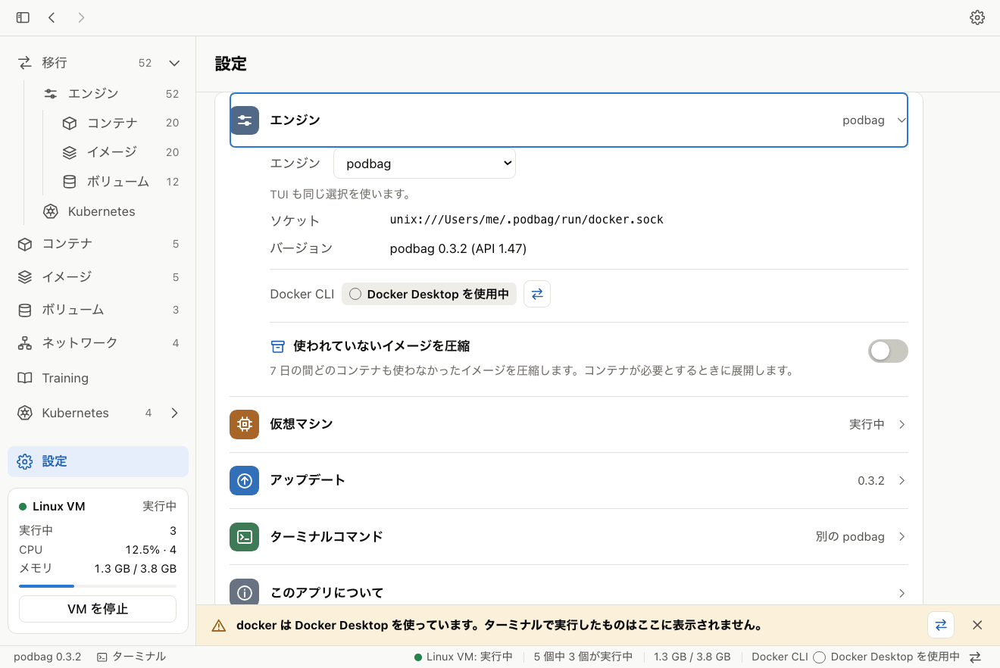
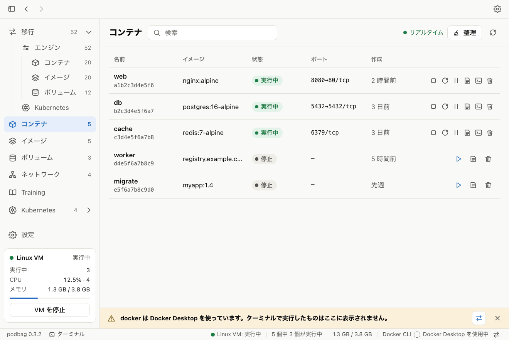
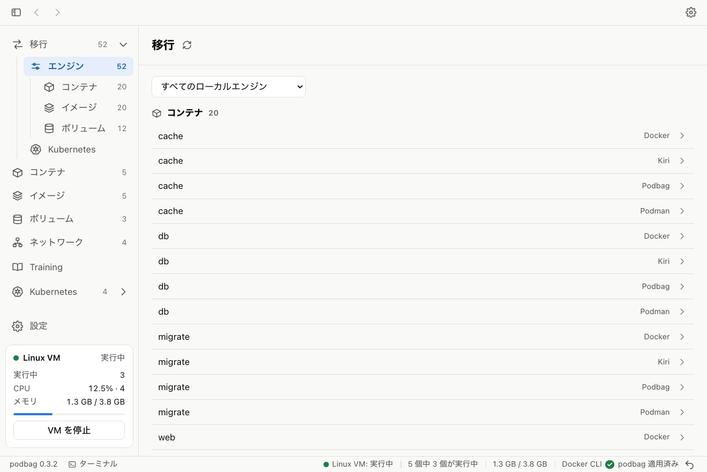
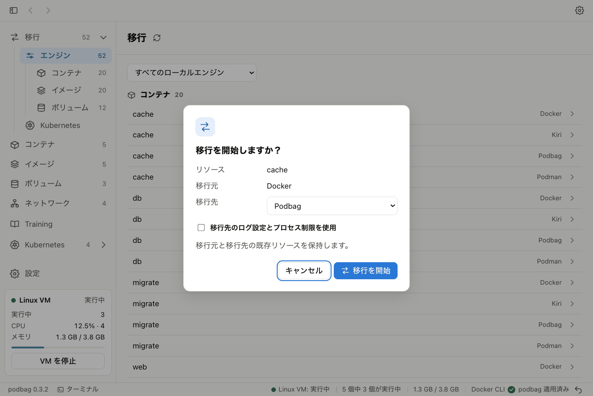

Podbag Desktop は、podbag のほか、Docker API を持つ別のエンジンでも動きます。例: Docker、Podman、Kiri。

**所要時間** 5 分。

## エンジンを選ぶ

1. **設定**を開き、**エンジン**をクリックします。
2. **podbag**、**Docker**、**Podman**、**Kiri**、または Docker コンテキストを選びます。別のエンジンを使うには、**カスタム Unix ソケット…**を選び、アドレスを入力します。例: `unix:///path/to/docker.sock`。

一覧に、そのエンジンの内容が表示されます。TUI も同じ選択を使います。**エンジン**には、エンジンのソケットとバージョンも表示されます。

## docker コマンドを podbag に向ける

**Docker CLI** は、`docker` コマンドの行き先を表示します。ステータスバーと**エンジン**に表示されます。

- **podbag 適用済み:** `docker` は podbag で実行されます。ターミナルで実行したものが、アプリに表示されます。
- **Docker Desktop を使用中:** `docker` は別のエンジンで実行されます。ウィンドウの下のバーがそれを知らせます。

**docker で podbag を使う**をクリックすると、コマンドが podbag に向きます。新しいターミナルは podbag コンテキストを使います。ほかのコンテキストはそのままです。元に戻すには、ステータスバーの右端の矢印をクリックします（以前のコンテキスト**に戻す**）。

## 使われていないイメージを圧縮する

podbag では、**エンジン**に**使われていないイメージを圧縮**があります。7 日間どのコンテナも使わなかったイメージを圧縮します。コンテナがイメージを必要とするときは、圧縮を解いて渡します。[使っていないイメージの圧縮](../idle-image-compression/)を参照してください。

## 別のエンジンから移行する

**移行**は、コンテナ、イメージ、ボリュームを、あるエンジンから別のエンジンへコピーします。例: Docker から podbag へ。

1. サイドバーで**移行**を開きます。
2. 探す場所を選びます。**すべてのローカルエンジン**、1 つのエンジン、またはコンテキストです。
3. 一覧に、コンテナ、イメージ、ボリュームが、それぞれのエンジンと一緒に表示されます。1 つをクリックします。
4. **移行先**でコピー先を選びます。コンテナでは、**移行先のログ設定とプロセス制限を使用**にチェックを入れることができます。
5. **移行を開始**をクリックします。アプリは項目をコピーし、コピーを確認します。終わると、**移行完了**と表示されます。

移行元はそのまま残ります。アプリは、移行先にすでにあるものを変更しません。サイドバーの**エンジン**の下にある**コンテナ**、**イメージ**、**ボリューム**は、1 種類だけを表示します。**移行**の下の**Kubernetes**は、同じ方法で Kubernetes のリソースを別のコンテキストや名前空間にコピーします。

## 次へ

[Kubernetes と設定](../gui-kubernetes-settings/)。
