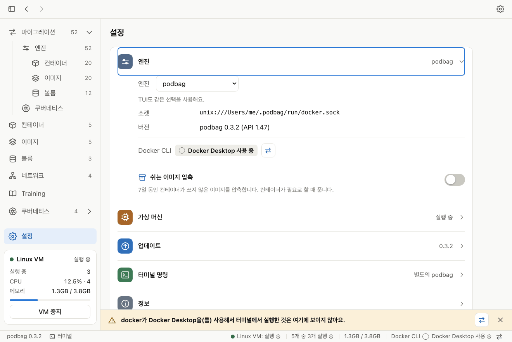
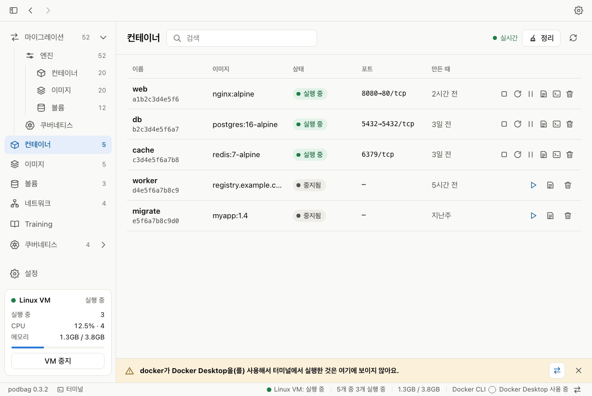
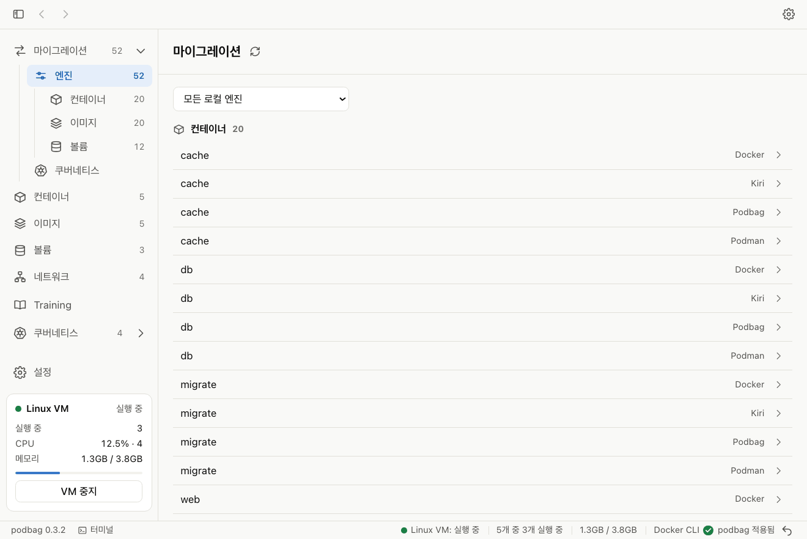
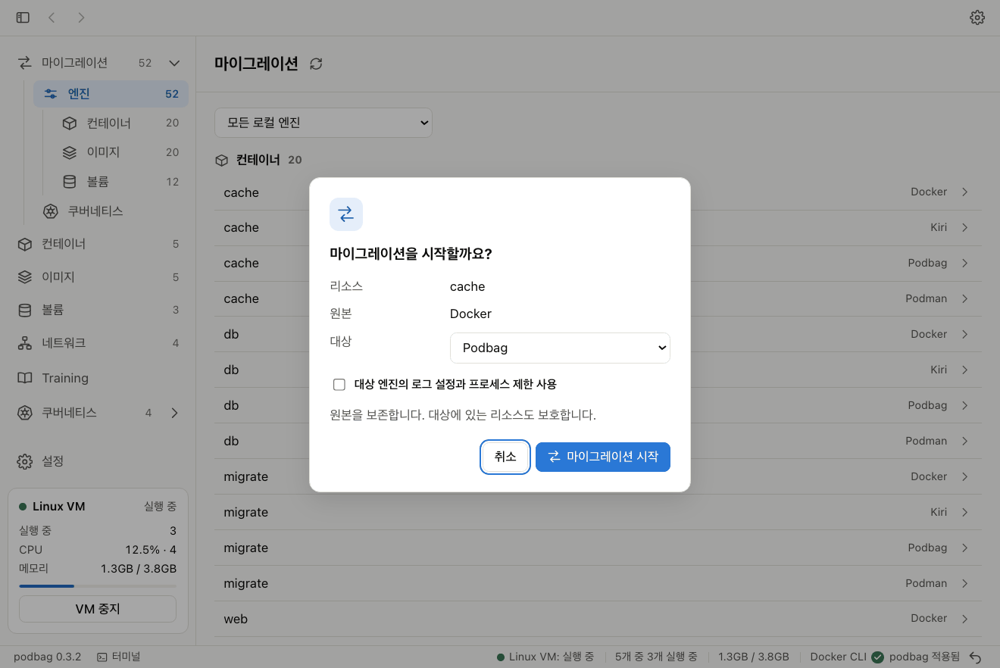

Podbag Desktop은 podbag과 함께, Docker API를 쓰는 다른 엔진에서도 동작합니다. 예: Docker, Podman, Kiri.

**예상 시간** 5분.

## 엔진 고르기

1. **설정**을 열고 **엔진**을 클릭합니다.
2. **podbag**, **Docker**, **Podman**, **Kiri** 또는 Docker 컨텍스트를 고릅니다. 다른 엔진은 **사용자 지정 Unix 소켓…**을 고르고 주소를 입력합니다. 예: `unix:///path/to/docker.sock`.

그러면 목록에 그 엔진이 보입니다. TUI도 같은 선택을 씁니다. **엔진**에는 엔진의 소켓과 버전도 보입니다.

## docker 명령을 podbag으로 보내기

**Docker CLI**는 `docker` 명령이 어디로 가는지 보여줍니다. 상태 표시줄과 **엔진**에 보입니다.

- **podbag 적용됨:** `docker`가 podbag에서 실행됩니다. 터미널에서 실행한 것이 앱에 보입니다.
- **Docker Desktop 사용 중:** `docker`가 다른 엔진에서 실행됩니다. 창 아래쪽 막대가 이것을 알려줍니다.

**podbag으로 전환**을 클릭하면 명령이 podbag으로 갑니다. 새 터미널은 podbag 컨텍스트를 씁니다. 다른 컨텍스트는 그대로입니다. 되돌리려면 상태 표시줄 오른쪽의 화살표(이전 컨텍스트로 **복원**)를 클릭합니다.

## 쉬는 이미지 압축

podbag을 쓰면 **엔진**에 **쉬는 이미지 압축**이 있습니다. 7일 동안 어떤 컨테이너도 쓰지 않은 이미지를 압축합니다. 컨테이너가 이미지를 쓰면 압축을 풀어서 줍니다. [쉬는 이미지 압축](../idle-image-compression/)을 참고합니다.

## 다른 엔진에서 마이그레이션하기

**마이그레이션**은 컨테이너, 이미지, 볼륨을 한 엔진에서 다른 엔진으로 복사합니다. 예: Docker에서 podbag으로.

1. 사이드바에서 **마이그레이션**을 엽니다.
2. 어디를 볼지 고릅니다: **모든 로컬 엔진**, 엔진 하나, 또는 컨텍스트.
3. 목록에 컨테이너, 이미지, 볼륨이 엔진 이름과 함께 보입니다. 하나를 클릭합니다.
4. **대상**에서 옮길 곳을 고릅니다. 컨테이너는 **대상 엔진의 로그 설정과 프로세스 제한 사용**을 체크할 수 있습니다.
5. **마이그레이션 시작**을 클릭합니다. 앱이 항목을 복사하고 복사본을 확인합니다. 끝나면 **마이그레이션 완료**가 보입니다.

원본은 그대로 남습니다. 대상에 이미 있는 것도 바꾸지 않습니다. 사이드바에서 **엔진** 아래의 **컨테이너**, **이미지**, **볼륨**은 한 종류만 보여줍니다. **마이그레이션** 아래의 **쿠버네티스**는 같은 방법으로 Kubernetes 리소스를 다른 컨텍스트나 네임스페이스로 복사합니다.

## 다음

[쿠버네티스와 설정](../gui-kubernetes-settings/).
