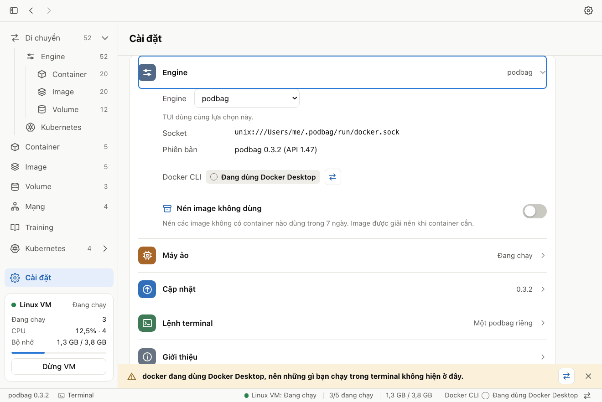
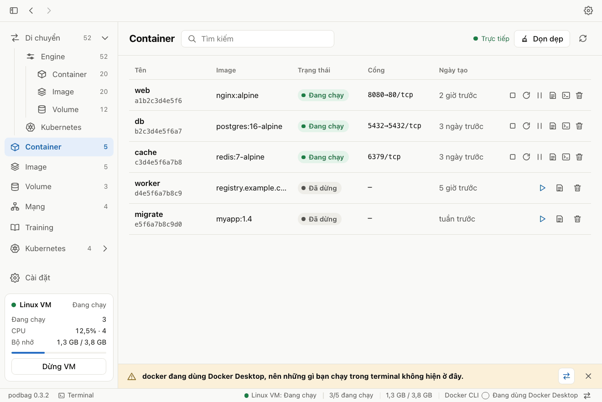
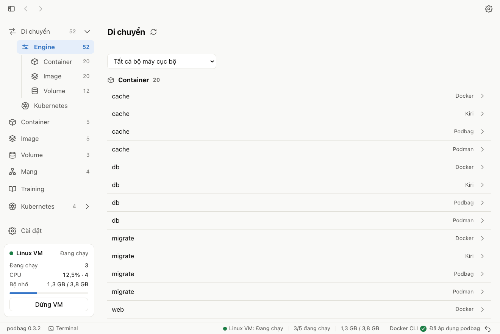
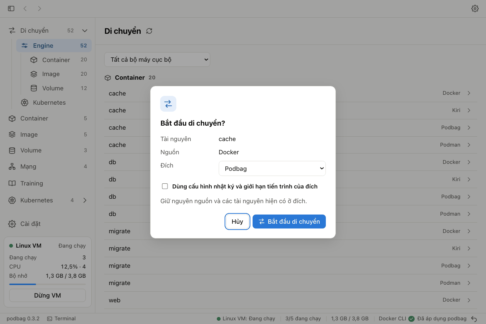

Podbag Desktop dùng được với podbag và với các engine khác có Docker API, như Docker, Podman và Kiri.

**Thời gian** 5 phút.

## Chọn engine

1. Mở **Cài đặt** và nhấp vào **Engine**.
2. Chọn **podbag**, **Docker**, **Podman**, **Kiri** hoặc một Docker context. Với engine khác, hãy chọn **Socket Unix tùy chỉnh…** và nhập địa chỉ của nó, ví dụ `unix:///path/to/docker.sock`.

Sau đó, các danh sách hiện nội dung của engine đó. TUI cũng dùng lựa chọn này. **Engine** cũng hiện socket và phiên bản của engine.

## Trỏ lệnh docker về podbag

**Docker CLI** cho biết lệnh `docker` gửi tới đâu. Bạn thấy nó trên thanh trạng thái và trong **Engine**.

- **Đã áp dụng podbag:** `docker` chạy trên podbag. Những gì bạn chạy trong terminal sẽ hiện trong ứng dụng.
- **Đang dùng Docker Desktop:** `docker` chạy trên một engine khác. Một thanh ở cuối cửa sổ báo điều này.

Nhấp vào **Dùng podbag cho docker** để trỏ lệnh về podbag. Terminal mới sẽ dùng context podbag. Các context khác giữ nguyên. Để quay lại, nhấp vào mũi tên ở bên phải thanh trạng thái: **Chuyển lại** context cũ.

## Nén image không dùng

Với podbag, **Engine** có tùy chọn **Nén image không dùng**. Tùy chọn này nén các image không có container nào dùng trong 7 ngày. Khi container cần một image, nó nhận image đã được giải nén. Xem [Nén image không dùng](../idle-image-compression/).

## Di chuyển từ engine khác

**Di chuyển** sao chép container, image và volume từ một engine sang engine khác, ví dụ từ Docker sang podbag.

1. Mở **Di chuyển** trên thanh bên.
2. Chọn nơi để tìm: **Tất cả bộ máy cục bộ**, một engine hoặc một context.
3. Danh sách hiện các container, image và volume, kèm engine của từng mục. Nhấp vào một mục.
4. Chọn nơi nhận trong **Đích**. Với container, bạn có thể đánh dấu **Dùng cấu hình nhật ký và giới hạn tiến trình của đích**.
5. Nhấp vào **Bắt đầu di chuyển**. Ứng dụng sao chép mục đó và kiểm tra bản sao. Khi xong, ứng dụng hiện **Di chuyển hoàn tất**.

Nguồn được giữ nguyên. Ứng dụng không thay đổi những gì đã có ở đích. Trên thanh bên, **Container**, **Image** và **Volume** dưới **Engine** chỉ hiện một loại. **Kubernetes** dưới **Di chuyển** sao chép tài nguyên Kubernetes từ một context hoặc namespace sang context hoặc namespace khác theo cùng cách.

## Tiếp theo

[Kubernetes và cài đặt](../gui-kubernetes-settings/).
