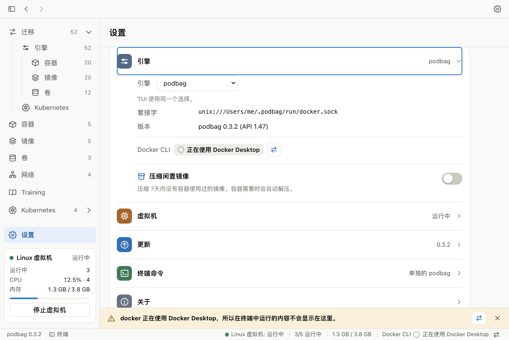
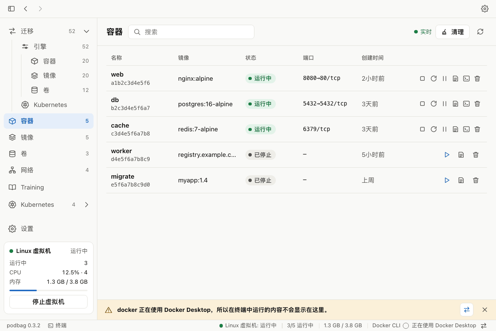
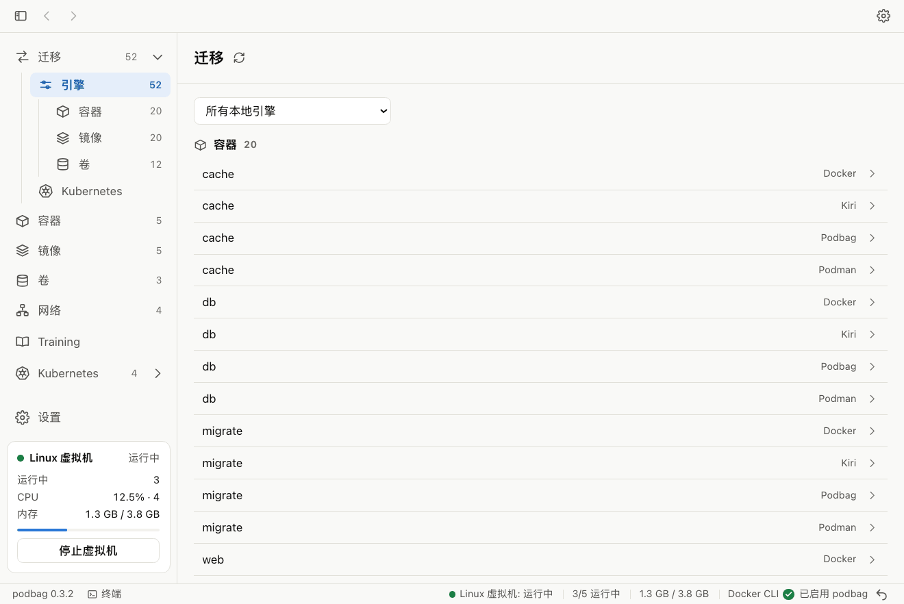
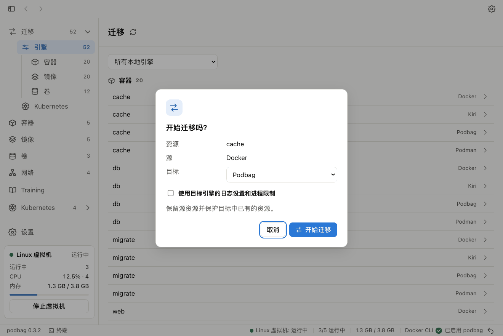

Podbag Desktop 可用于 podbag，也可用于其他提供 Docker API 的引擎，例如 Docker、Podman 和 Kiri。

**预计用时** 5 分钟。

## 选择引擎

1. 打开**设置**，然后点击**引擎**。
2. 选择 **podbag**、**Docker**、**Podman**、**Kiri** 或某个 Docker 上下文。要使用其他引擎，请选择**自定义 Unix 套接字…**，然后输入它的地址，例如 `unix:///path/to/docker.sock`。

之后，列表会显示这个引擎的内容。TUI 使用同一个选择。**引擎**还会显示引擎的套接字和版本。

## 让 docker 命令使用 podbag

**Docker CLI** 显示 `docker` 命令发往哪里。你可以在状态栏和**引擎**中看到它。

- **已启用 podbag：** `docker` 在 podbag 上运行。你在终端中运行的内容会显示在应用中。
- **正在使用 Docker Desktop：** `docker` 在其他引擎上运行。窗口底部的提示栏会告诉你这一点。

点击**让 docker 使用 podbag**，命令就会发往 podbag。新的终端会使用 podbag 上下文。其他上下文保持不变。要改回原来的设置，请点击状态栏右侧的箭头：**切换回**原来的上下文。

## 压缩闲置镜像

使用 podbag 时，**引擎**中有**压缩闲置镜像**。它会压缩 7 天内没有容器使用过的镜像。当容器需要某个镜像时，会得到解压后的镜像。参见[压缩闲置镜像](../idle-image-compression/)。

## 从其他引擎迁移

**迁移**会把容器、镜像和卷从一个引擎复制到另一个引擎，例如从 Docker 复制到 podbag。

1. 在侧边栏中打开**迁移**。
2. 选择查看范围：**所有本地引擎**、某一个引擎或某个上下文。
3. 列表会显示容器、镜像和卷，以及每一项所在的引擎。点击其中一项。
4. 在**目标**中选择目标位置。对于容器，你可以勾选**使用目标引擎的日志设置和进程限制**。
5. 点击**开始迁移**。应用会复制该项目，并检查副本。完成后，会显示**迁移完成**。

源资源会保留。应用不会改变目标中已有的内容。在侧边栏中，**引擎**下面的**容器**、**镜像**和**卷**只显示一种资源。**迁移**下面的 **Kubernetes** 用同样的方法，把 Kubernetes 资源从一个上下文或命名空间复制到另一个。

## 下一步

[Kubernetes 和设置](../gui-kubernetes-settings/)。
