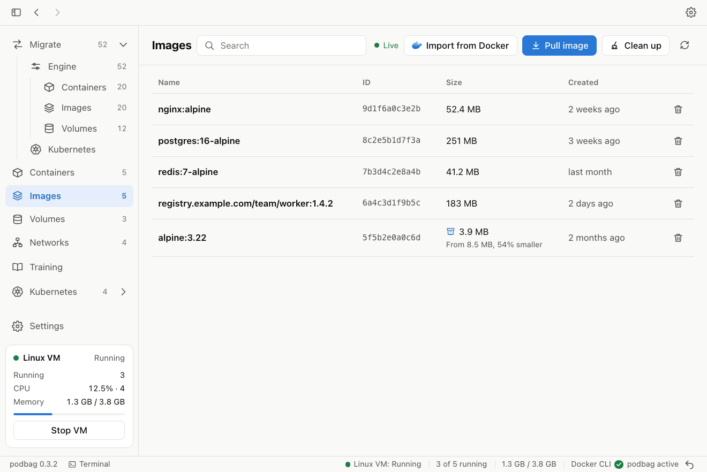
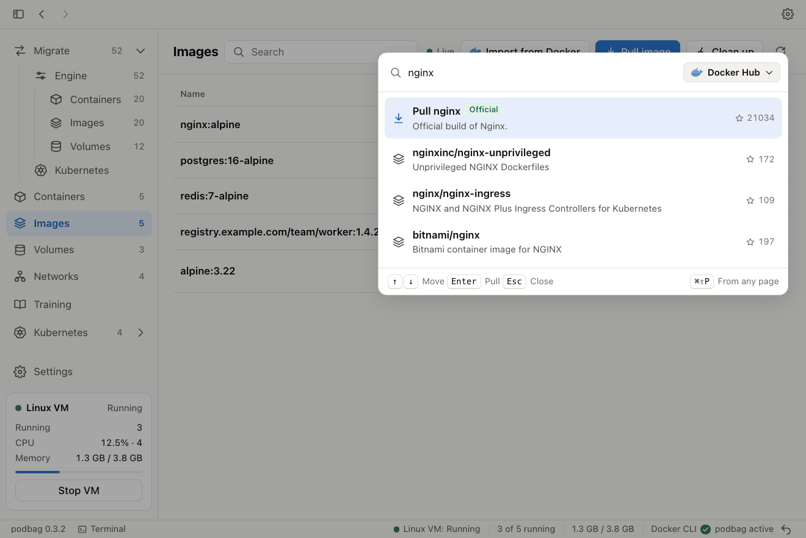
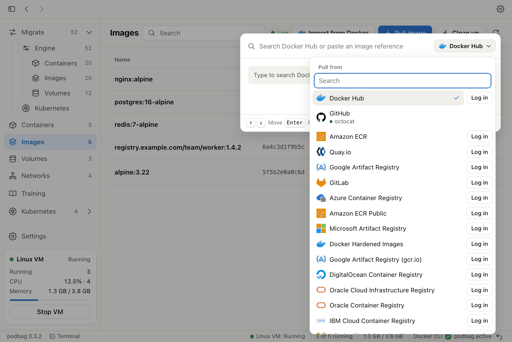
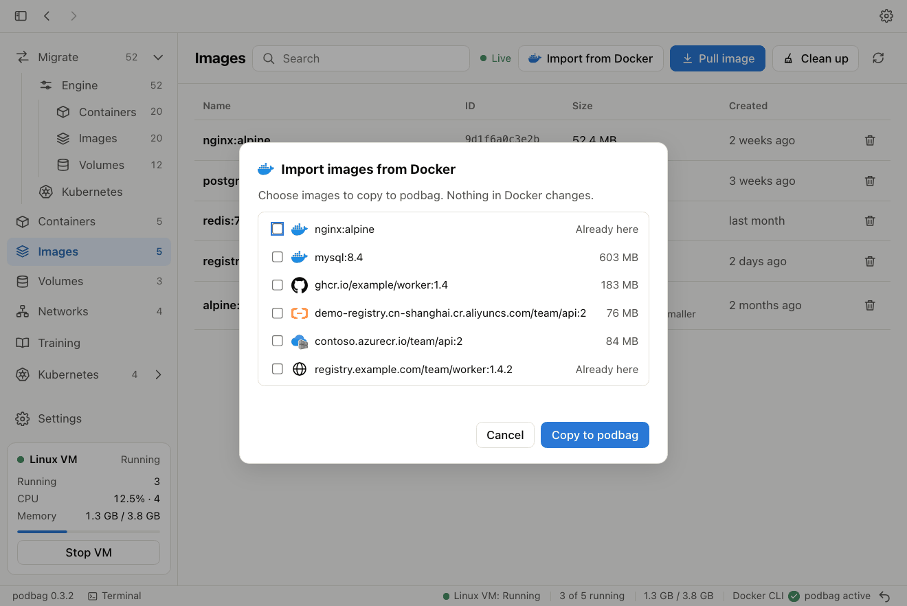

Open **Images** in the sidebar. The list shows each image's name, ID, size and creation time. A compressed image shows its size on disk and how much smaller it got. See [Compress idle images](../idle-image-compression/).

**Time** 5 minutes.

## Pull an image from Docker Hub

1. Click **Pull image**. On any page, you can also press `⌘⇧P` (`Ctrl+Shift+P` on Linux and Windows).
2. Type a name, for example `nginx`. The panel searches Docker Hub while you type.
3. Choose a result with `↑` `↓` and press `Enter`, or click it. Then choose a tag.

The first row pulls exactly what you typed. You can also paste a full reference, such as `ghcr.io/owner/app:1.0`. The panel shows the progress. When the pull is done, the image is in the list. `Esc` goes back one step, then closes the panel.

## Pull from another registry

Click the registry button at the right of the search box. It shows **Docker Hub** at first. The **Pull from** menu lists GitHub, Amazon ECR, Quay.io, Google Artifact Registry, GitLab, Azure Container Registry and many more. Type in **Search** to find one.

Some registries need an address, for example `contoso.azurecr.io`. The panel asks for it once and remembers it.

## Log in to a registry

Click **Log in** next to a registry in the **Pull from** menu. Enter your user name and your password or token, and click **Log in**. Some cloud registries log in with their own command line. Then the panel shows the command to run in a terminal, for example `az acr login --name <registry-name>`.

## Import images from Docker

When the engine is podbag and Docker is installed, **Images** has **Import from Docker**. It lists Docker's images. The images that podbag already has show **Already here**. Check the images you want and click **Copy to podbag**. Nothing in Docker changes.

## See and remove images

Click an image to see its tags, its size and the containers that use it. **Remove** removes the image. **Clean up** removes all images that no container uses. The app asks first.

## Next

[Volumes and networks](../gui-volumes-networks/).
