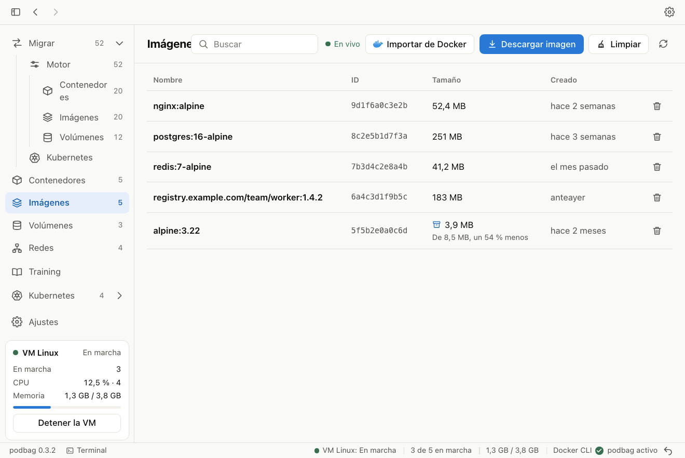
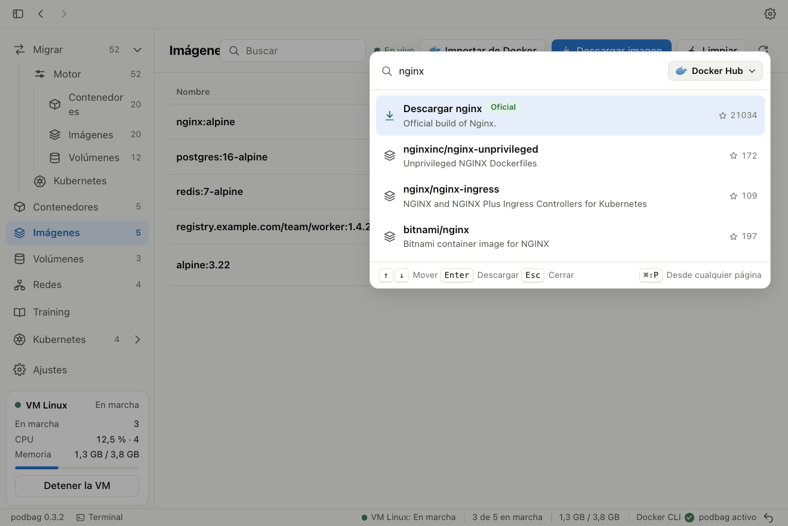
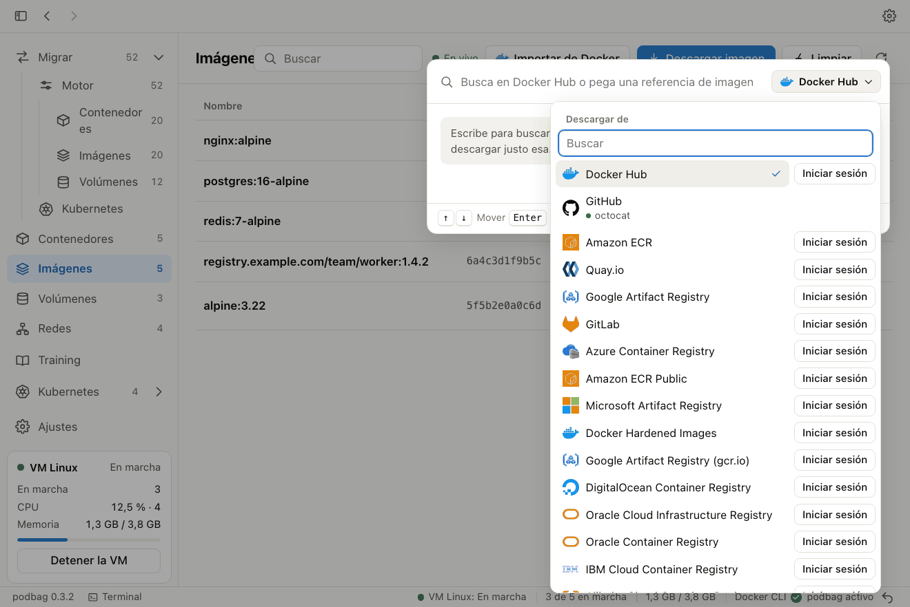
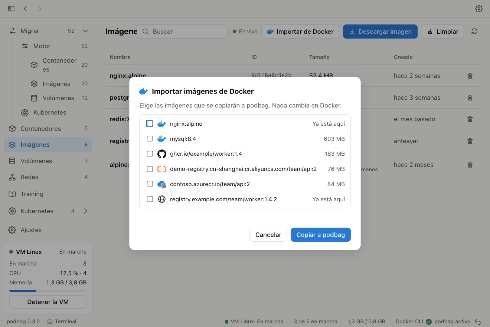

Abre **Imágenes** en la barra lateral. La lista muestra el nombre, el ID, el tamaño y la fecha de creación de cada imagen. Una imagen comprimida muestra su tamaño en disco y cuánto se redujo. Consulta [Comprimir imágenes sin uso](../idle-image-compression/).

**Tiempo** 5 minutos.

## Descarga una imagen de Docker Hub

1. Haz clic en **Descargar imagen**. En cualquier página, también puedes pulsar `⌘⇧P` (`Ctrl+Shift+P` en Linux y Windows).
2. Escribe un nombre, por ejemplo `nginx`. El panel busca en Docker Hub mientras escribes.
3. Elige un resultado con `↑` `↓` y pulsa `Enter`, o haz clic en él. Después elige una etiqueta.

La primera fila descarga exactamente lo que escribiste. También puedes pegar una referencia completa, como `ghcr.io/owner/app:1.0`. El panel muestra el progreso. Cuando termina la descarga, la imagen está en la lista. `Esc` vuelve un paso atrás y luego cierra el panel.

## Descarga de otro registro

Haz clic en el botón del registro, a la derecha del cuadro de búsqueda. Al principio muestra **Docker Hub**. El menú **Descargar de** muestra GitHub, Amazon ECR, Quay.io, Google Artifact Registry, GitLab, Azure Container Registry y muchos más. Escribe en **Buscar** para encontrar uno.

Algunos registros necesitan una dirección, por ejemplo `contoso.azurecr.io`. El panel la pide una vez y la recuerda.

## Inicia sesión en un registro

Haz clic en **Iniciar sesión** junto a un registro en el menú **Descargar de**. Escribe tu nombre de usuario y tu contraseña o token, y haz clic en **Iniciar sesión**. Algunos registros en la nube inician sesión con su propia línea de comandos. En ese caso, el panel muestra el comando que debes ejecutar en una terminal, por ejemplo `az acr login --name <registry-name>`.

## Importa imágenes de Docker

Cuando el motor es podbag y Docker está instalado, **Imágenes** tiene **Importar de Docker**. Muestra las imágenes de Docker. Las imágenes que podbag ya tiene muestran **Ya está aquí**. Marca las imágenes que quieres y haz clic en **Copiar a podbag**. Nada cambia en Docker.

## Mira y elimina imágenes

Haz clic en una imagen para ver sus etiquetas, su tamaño y los contenedores que la usan. **Eliminar** elimina la imagen. **Limpiar** elimina todas las imágenes que ningún contenedor usa. La app pregunta antes.

## Siguiente

[Volúmenes y redes](../gui-volumes-networks/).
