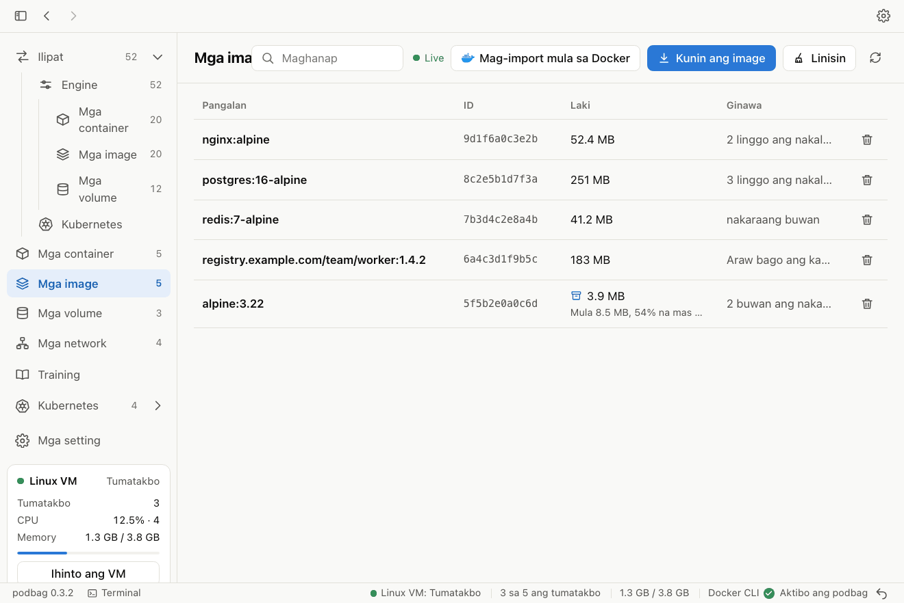
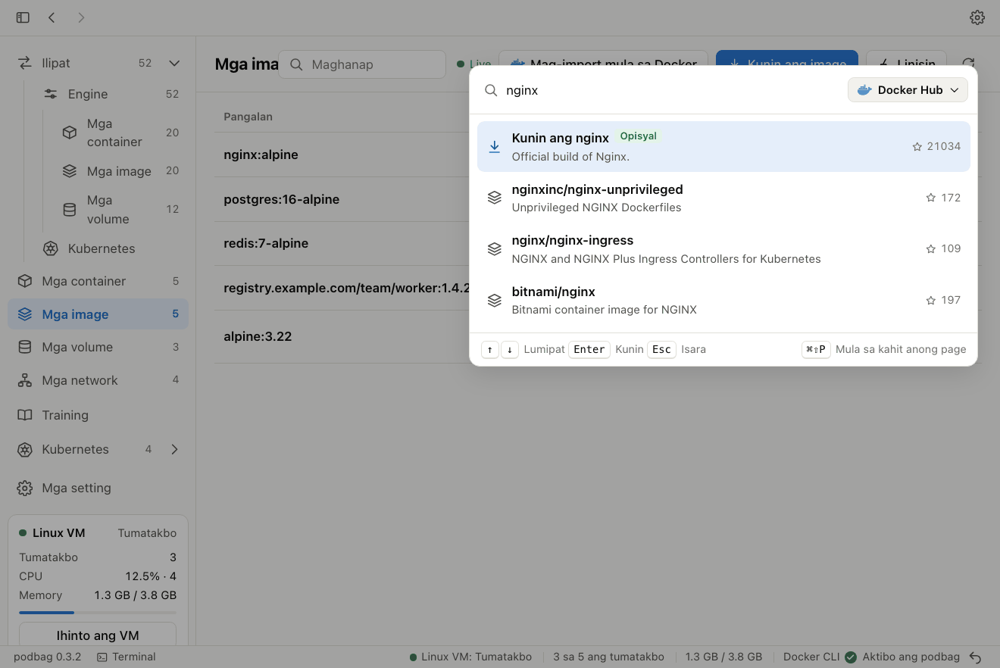
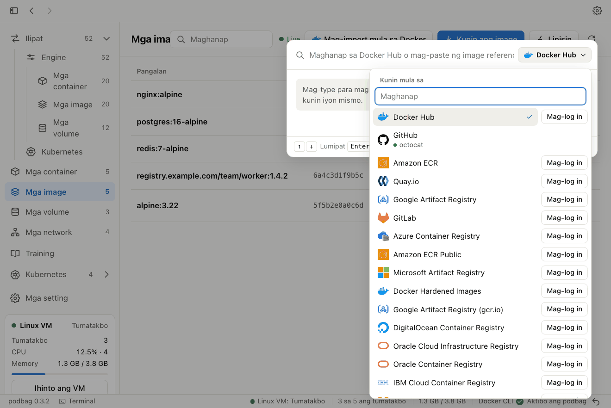
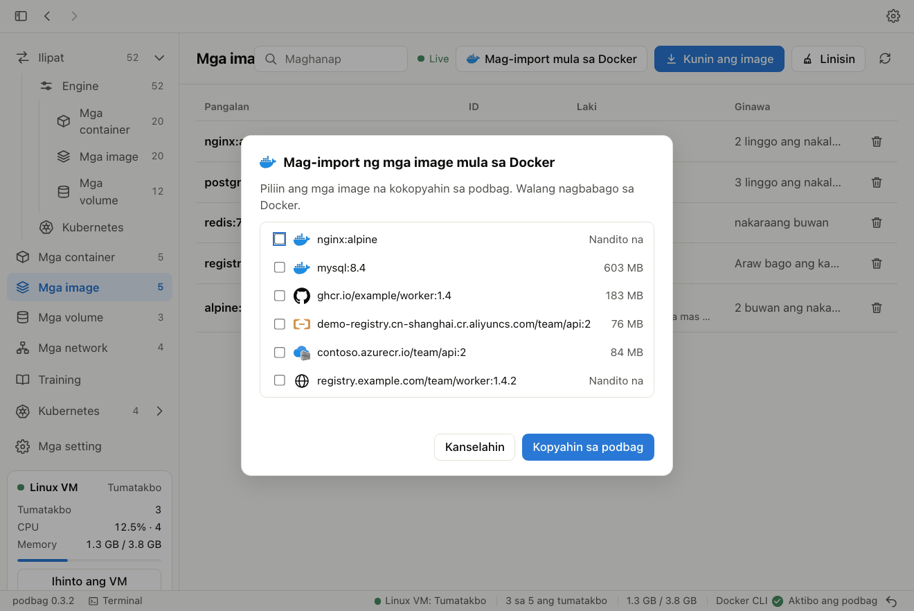

Buksan ang **Mga image** sa sidebar. Ipinapakita ng listahan ang pangalan, ID, laki at oras ng pagkagawa ng bawat image. Ipinapakita ng naka-compress na image ang laki nito sa disk at kung gaano ito lumiit. Tingnan ang [I-compress ang mga hindi ginagamit na image](../idle-image-compression/).

**Oras** 5 minuto.

## Kumuha ng image mula sa Docker Hub

1. I-click ang **Kunin ang image**. Sa kahit anong page, puwede mo ring pindutin ang `⌘⇧P` (`Ctrl+Shift+P` sa Linux at Windows).
2. Mag-type ng pangalan, halimbawa `nginx`. Naghahanap ang panel sa Docker Hub habang nagta-type ka.
3. Pumili ng resulta gamit ang `↑` `↓` at pindutin ang `Enter`, o i-click ito. Saka pumili ng tag.

Kinukuha ng unang row ang mismong tinype mo. Puwede ka ring mag-paste ng buong reference, gaya ng `ghcr.io/owner/app:1.0`. Ipinapakita ng panel ang progreso. Kapag tapos na ang pagkuha, nasa listahan na ang image. Bumabalik nang isang hakbang ang `Esc`, saka nito isinasara ang panel.

## Kumuha mula sa ibang registry

I-click ang button ng registry sa kanan ng search box. **Docker Hub** ang nakalagay rito sa simula. Nakalista sa menu na **Kunin mula sa** ang GitHub, Amazon ECR, Quay.io, Google Artifact Registry, GitLab, Azure Container Registry at marami pang iba. Mag-type sa **Maghanap** para makahanap ng isa.

May mga registry na kailangan ng address, halimbawa `contoso.azurecr.io`. Isang beses itong itatanong ng panel, at tatandaan nito.

## Mag-log in sa registry

I-click ang **Mag-log in** sa tabi ng registry sa menu na **Kunin mula sa**. Ilagay ang user name mo at ang password o token mo, at i-click ang **Mag-log in**. May mga cloud registry na nagla-log in gamit ang sarili nilang command line. Kung gayon, ipinapakita ng panel ang command na patatakbuhin sa terminal, halimbawa `az acr login --name <registry-name>`.

## Mag-import ng mga image mula sa Docker

Kapag podbag ang engine at naka-install ang Docker, may **Mag-import mula sa Docker** ang **Mga image**. Nakalista rito ang mga image ng Docker. May **Nandito na** ang mga image na nasa podbag na. I-check ang mga image na gusto mo at i-click ang **Kopyahin sa podbag**. Walang nagbabago sa Docker.

## Magpatakbo ng image

Ang **Patakbuhin** sa row ng image ay nagbubukas ng form sa pagpapatakbo na nakalagay na ang image na iyon. Tingnan ang [Magpatakbo ng container](../gui-containers/).

## Tingnan at alisin ang mga image

I-click ang image para makita ang mga tag nito, ang laki nito at ang mga container na gumagamit nito. Inaalis ng **Alisin** ang image. Inaalis ng **Linisin** ang lahat ng image na hindi ginagamit ng anumang container. Nagtatanong muna ang app.

## Susunod

[Mga volume at network](../gui-volumes-networks/).
