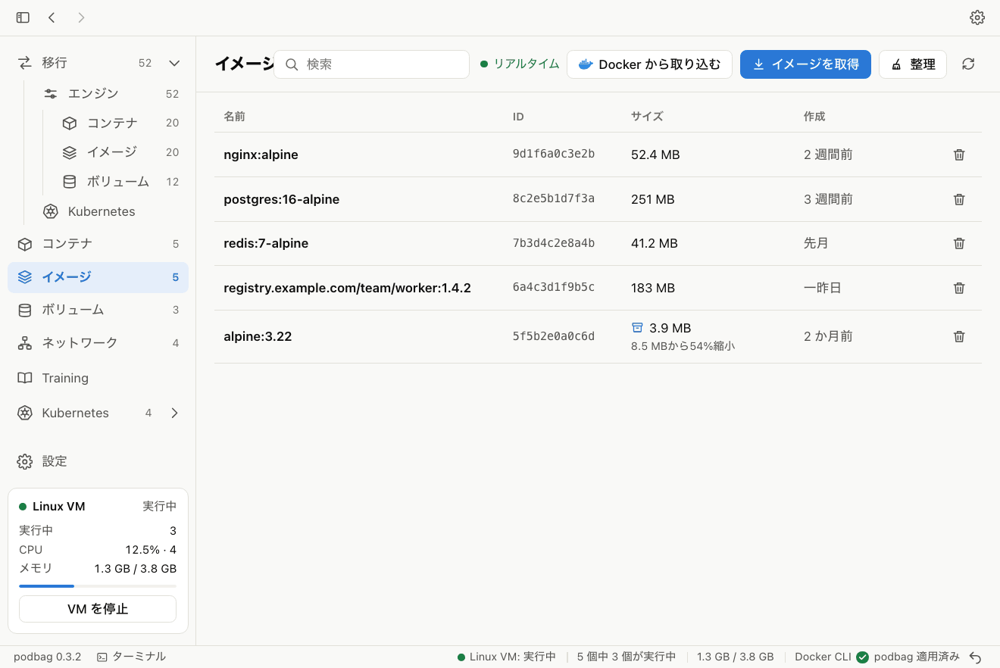
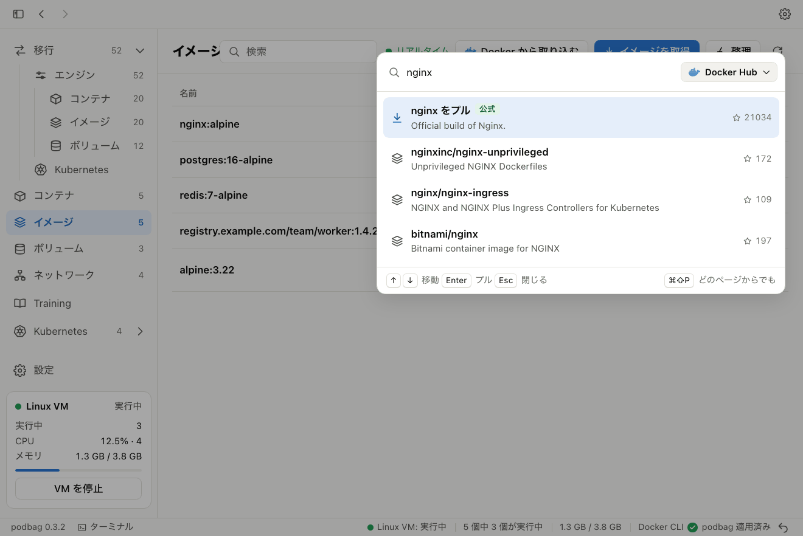
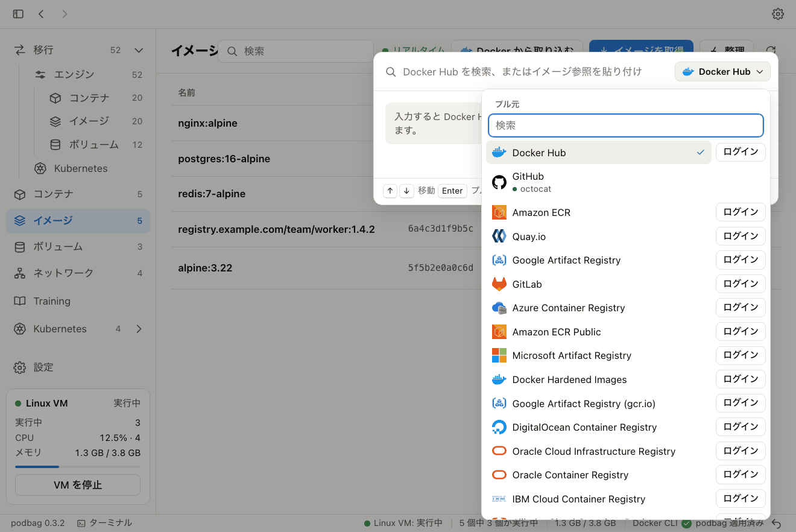
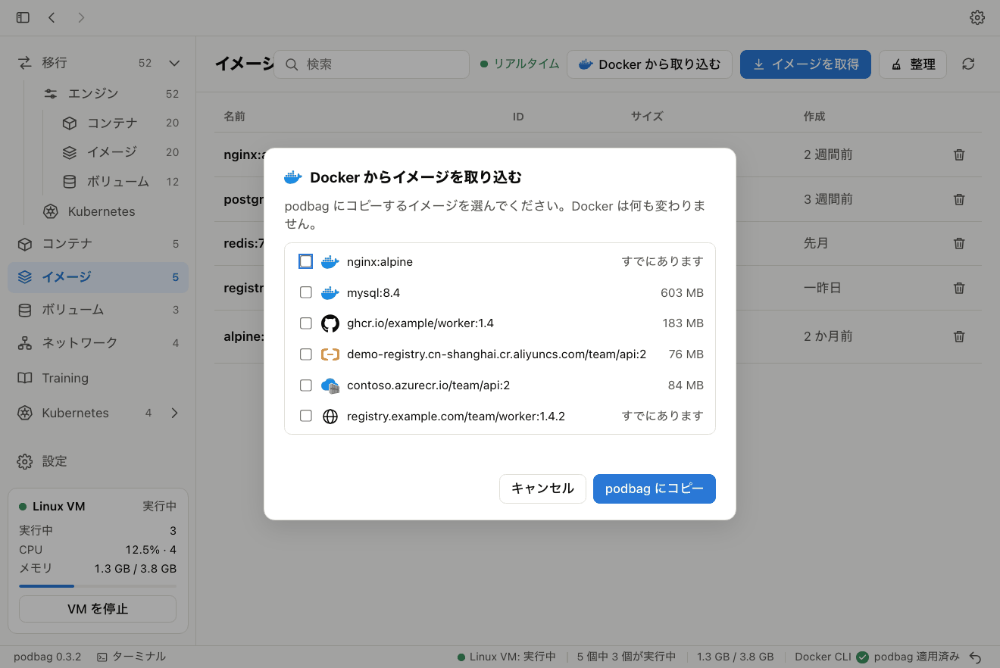

サイドバーで**イメージ**を開きます。一覧には、イメージごとに名前、ID、サイズ、作成日時が表示されます。圧縮されたイメージには、ディスク上のサイズと、どれだけ小さくなったかが表示されます。[使っていないイメージの圧縮](../idle-image-compression/)を参照してください。

**所要時間** 5 分。

## Docker Hub からイメージを取得する

1. **イメージを取得**をクリックします。どのページでも、`⌘⇧P`（Linux と Windows では `Ctrl+Shift+P`）を押して開くこともできます。
2. 名前を入力します。例: `nginx`。入力している間に、パネルが Docker Hub を検索します。
3. `↑` `↓` で結果を選んで `Enter` を押すか、結果をクリックします。次に、タグを選びます。

最初の行は、入力したとおりのものを取得します。`ghcr.io/owner/app:1.0` のような完全な参照を貼り付けることもできます。パネルに進行状況が表示されます。取得が終わると、イメージが一覧に表示されます。`Esc` は 1 つ前の段階に戻ります。その次の `Esc` でパネルを閉じます。

## 別のレジストリから取得する

検索ボックスの右にあるレジストリボタンをクリックします。最初は **Docker Hub** と表示されます。**プル元**メニューには、GitHub、Amazon ECR、Quay.io、Google Artifact Registry、GitLab、Azure Container Registry など、多くのレジストリがあります。**検索**に入力して探します。

レジストリによっては、アドレスが必要です。例: `contoso.azurecr.io`。パネルは一度だけアドレスを尋ね、それを覚えます。

## レジストリにログインする

**プル元**メニューで、レジストリの横の**ログイン**をクリックします。ユーザー名と、パスワードまたはトークンを入力して、**ログイン**をクリックします。クラウドのレジストリには、独自のコマンドラインツールでログインするものがあります。その場合、パネルはターミナルで実行するコマンドを表示します。例: `az acr login --name <registry-name>`。

## Docker からイメージを取り込む

エンジンが podbag で、Docker がインストールされているときは、**イメージ**に**Docker から取り込む**があります。Docker のイメージが一覧で表示されます。podbag にすでにあるイメージには、**すでにあります**と表示されます。取り込むイメージにチェックを入れて、**podbag にコピー**をクリックします。Docker 側は何も変わりません。

## イメージを見て削除する

イメージをクリックすると、タグ、サイズ、そのイメージを使うコンテナが表示されます。**削除**は、イメージを削除します。**整理**は、どのコンテナも使っていないイメージをすべて削除します。アプリは先に確認します。

## 次へ

[ボリュームとネットワーク](../gui-volumes-networks/)。
