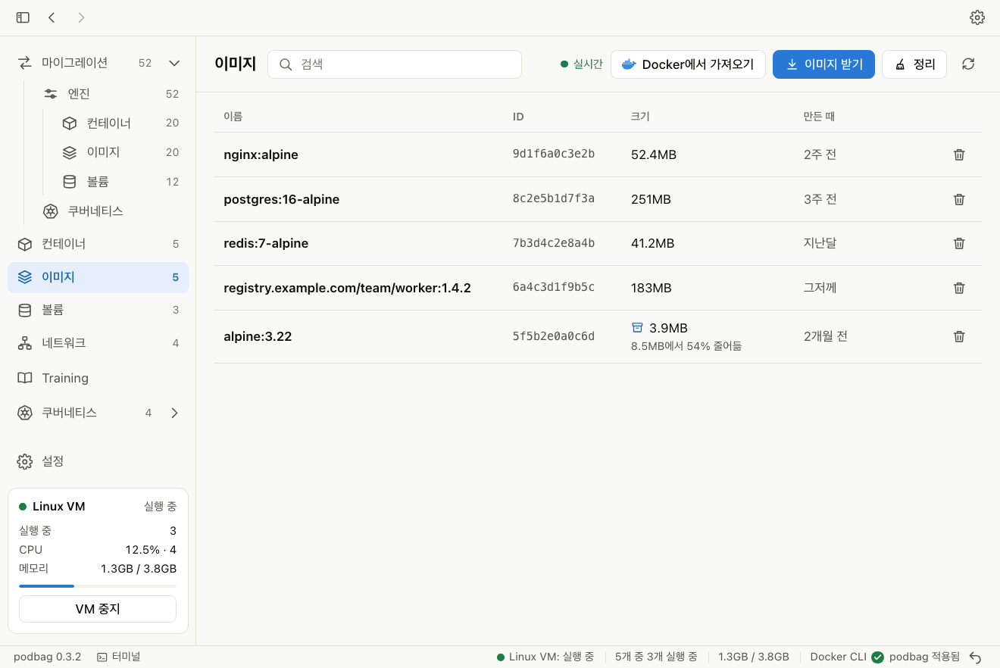
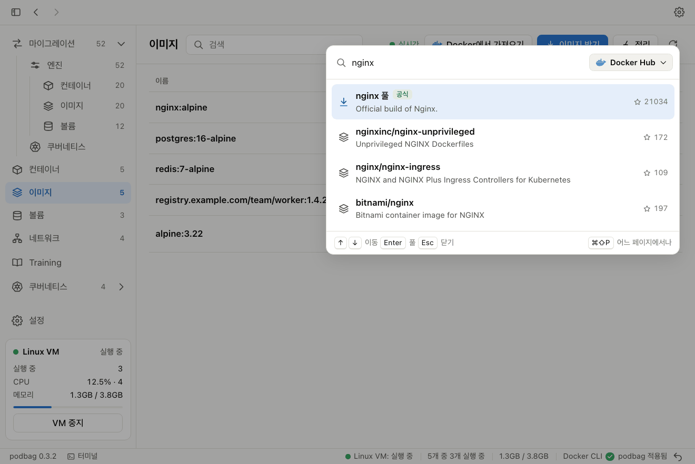
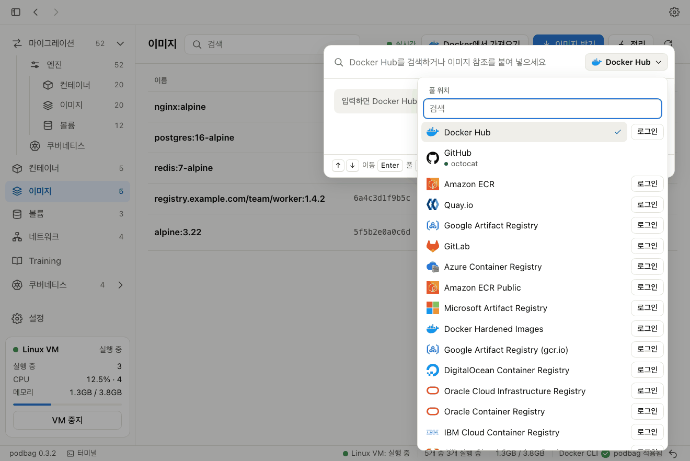
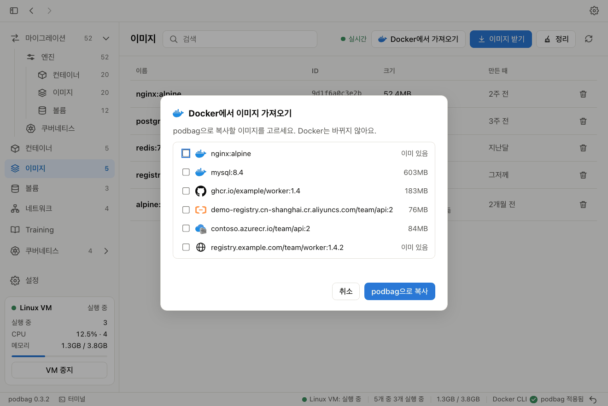

사이드바에서 **이미지**를 엽니다. 목록에는 이미지마다 이름, ID, 크기, 만든 시간이 보입니다. 압축된 이미지는 디스크에서 차지하는 크기와 얼마나 작아졌는지 보여줍니다. [쉬는 이미지 압축](../idle-image-compression/)을 참고합니다.

**예상 시간** 5분.

## Docker Hub에서 이미지 받기

1. **이미지 받기**를 클릭합니다. 어느 페이지에서나 `⌘⇧P`(Linux와 Windows에서는 `Ctrl+Shift+P`)를 눌러도 됩니다.
2. 이름을 입력합니다. 예: `nginx`. 입력하는 동안 Docker Hub를 검색합니다.
3. `↑` `↓`로 결과를 고르고 `Enter`를 누르거나, 결과를 클릭합니다. 그다음 태그를 고릅니다.

첫 줄은 입력한 이름 그대로 받습니다. `ghcr.io/owner/app:1.0` 같은 전체 참조를 붙여 넣어도 됩니다. 창에 진행 상황이 보입니다. 받기가 끝나면 이미지가 목록에 있습니다. `Esc`는 한 단계 뒤로 가고, 그다음 창을 닫습니다.

## 다른 레지스트리에서 받기

검색 상자 오른쪽의 레지스트리 버튼을 클릭합니다. 처음에는 **Docker Hub**가 보입니다. **풀 위치** 메뉴에는 GitHub, Amazon ECR, Quay.io, Google Artifact Registry, GitLab, Azure Container Registry 등 많은 레지스트리가 있습니다. **검색**에 입력해서 찾습니다.

어떤 레지스트리는 주소가 필요합니다. 예: `contoso.azurecr.io`. 창은 주소를 한 번 묻고 기억합니다.

## 레지스트리에 로그인하기

**풀 위치** 메뉴에서 레지스트리 옆의 **로그인**을 클릭합니다. 사용자 이름과 비밀번호 또는 토큰을 입력하고 **로그인**을 클릭합니다. 어떤 클라우드 레지스트리는 자기 명령줄 도구로 로그인합니다. 그러면 창은 터미널에서 실행할 명령을 보여줍니다. 예: `az acr login --name <registry-name>`.

## Docker에서 이미지 가져오기

엔진이 podbag이고 Docker가 설치되어 있으면, **이미지**에 **Docker에서 가져오기**가 있습니다. Docker의 이미지 목록이 보입니다. podbag에 이미 있는 이미지에는 **이미 있음**이 보입니다. 원하는 이미지를 체크하고 **podbag으로 복사**를 클릭합니다. Docker 쪽은 바뀌지 않습니다.

## 이미지 보기와 삭제하기

이미지를 클릭하면 태그, 크기, 이 이미지를 쓰는 컨테이너가 보입니다. **삭제**는 이미지를 삭제합니다. **정리**는 어떤 컨테이너도 쓰지 않는 이미지를 모두 삭제합니다. 앱이 먼저 묻습니다.

## 다음

[볼륨과 네트워크](../gui-volumes-networks/).
