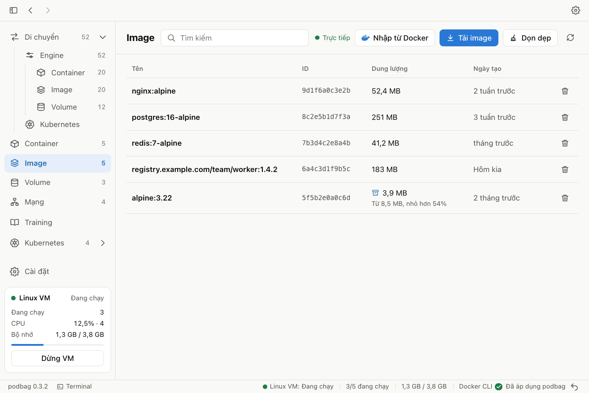
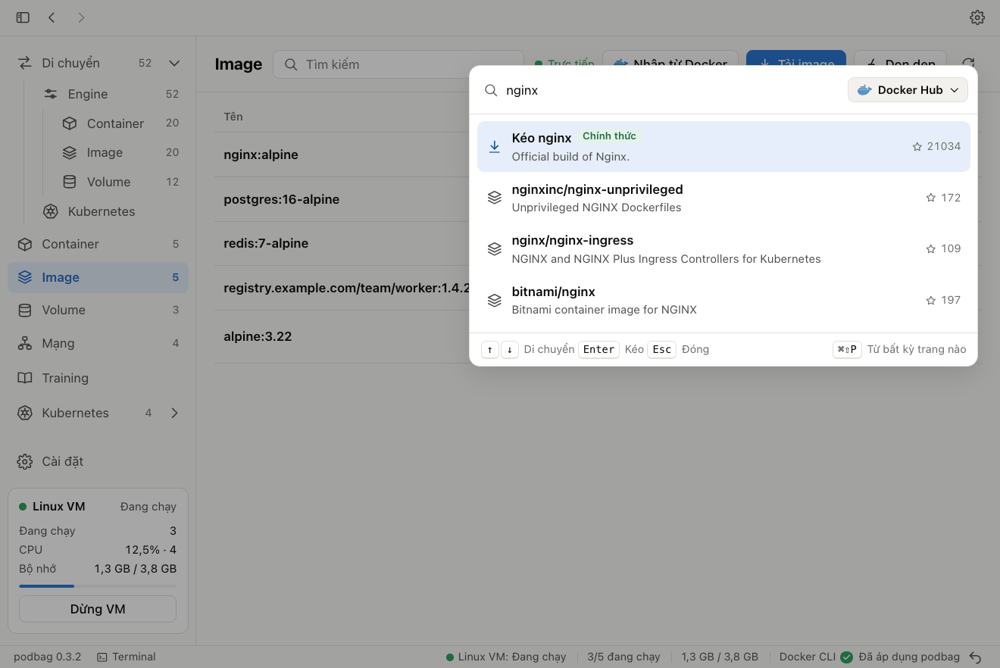
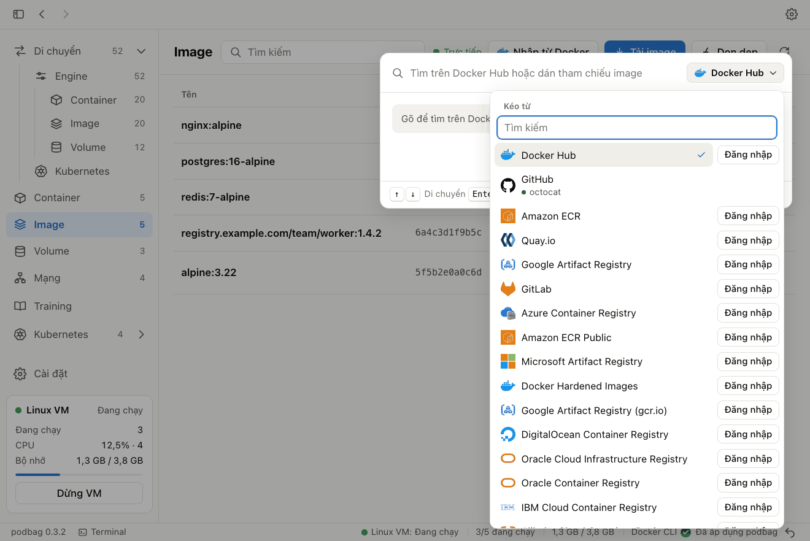
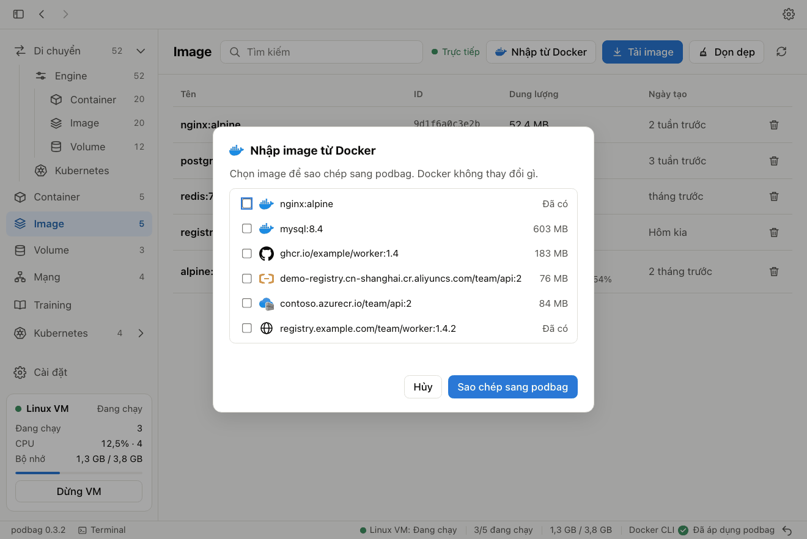

Mở **Image** trên thanh bên. Danh sách hiện tên, ID, dung lượng và ngày tạo của mỗi image. Image đã nén hiện dung lượng trên đĩa và mức nhỏ đi. Xem [Nén image không dùng](../idle-image-compression/).

**Thời gian** 5 phút.

## Tải image từ Docker Hub

1. Nhấp vào **Tải image**. Ở bất kỳ trang nào, bạn cũng có thể nhấn `⌘⇧P` (`Ctrl+Shift+P` trên Linux và Windows).
2. Gõ một tên, ví dụ `nginx`. Bảng tìm trên Docker Hub trong khi bạn gõ.
3. Chọn một kết quả bằng `↑` `↓` rồi nhấn `Enter`, hoặc nhấp vào kết quả đó. Sau đó, chọn một tag.

Dòng đầu tiên tải đúng tên bạn đã gõ. Bạn cũng có thể dán một tham chiếu đầy đủ, ví dụ `ghcr.io/owner/app:1.0`. Bảng hiện tiến độ. Khi tải xong, image có trong danh sách. `Esc` lùi lại một bước, rồi đóng bảng.

## Tải từ registry khác

Nhấp vào nút registry ở bên phải ô tìm kiếm. Lúc đầu, nút hiện **Docker Hub**. Menu **Kéo từ** liệt kê GitHub, Amazon ECR, Quay.io, Google Artifact Registry, GitLab, Azure Container Registry và nhiều registry khác. Gõ vào **Tìm kiếm** để tìm một registry.

Một số registry cần địa chỉ, ví dụ `contoso.azurecr.io`. Bảng hỏi địa chỉ một lần và nhớ nó.

## Đăng nhập vào registry

Trong menu **Kéo từ**, nhấp vào **Đăng nhập** bên cạnh một registry. Nhập tên người dùng và mật khẩu hoặc token, rồi nhấp vào **Đăng nhập**. Một số registry đám mây đăng nhập bằng dòng lệnh riêng của chúng. Khi đó, bảng hiện lệnh để bạn chạy trong terminal, ví dụ `az acr login --name <registry-name>`.

## Nhập image từ Docker

Khi engine là podbag và máy có cài Docker, trang **Image** có nút **Nhập từ Docker**. Nút này liệt kê các image của Docker. Những image podbag đã có thì hiện **Đã có**. Đánh dấu các image bạn muốn và nhấp vào **Sao chép sang podbag**. Docker không thay đổi gì.

## Xem và xóa image

Nhấp vào một image để xem tag, dung lượng và các container đang dùng nó. **Xóa** xóa image. **Dọn dẹp** xóa tất cả image không có container nào dùng. Ứng dụng hỏi trước.

## Tiếp theo

[Volume và mạng](../gui-volumes-networks/).
