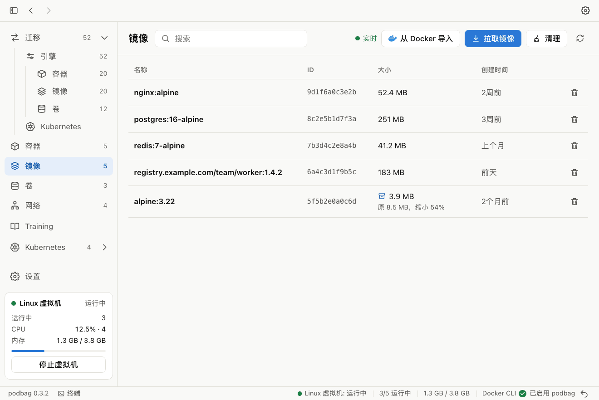
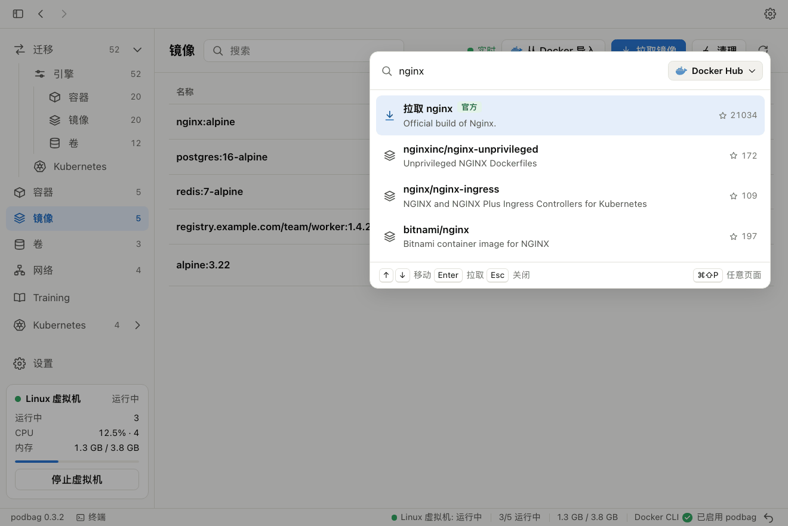
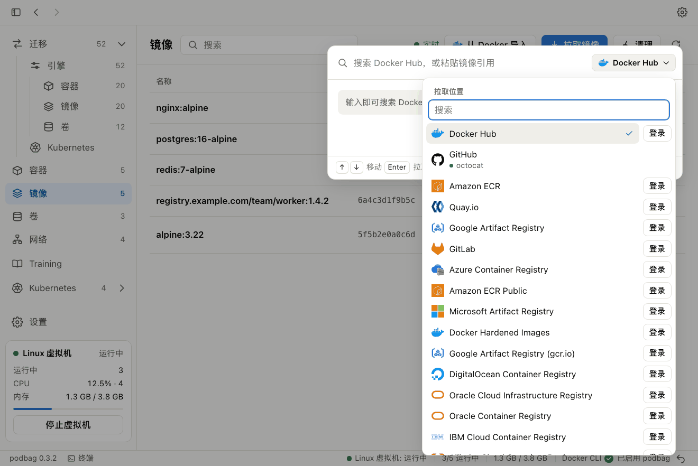
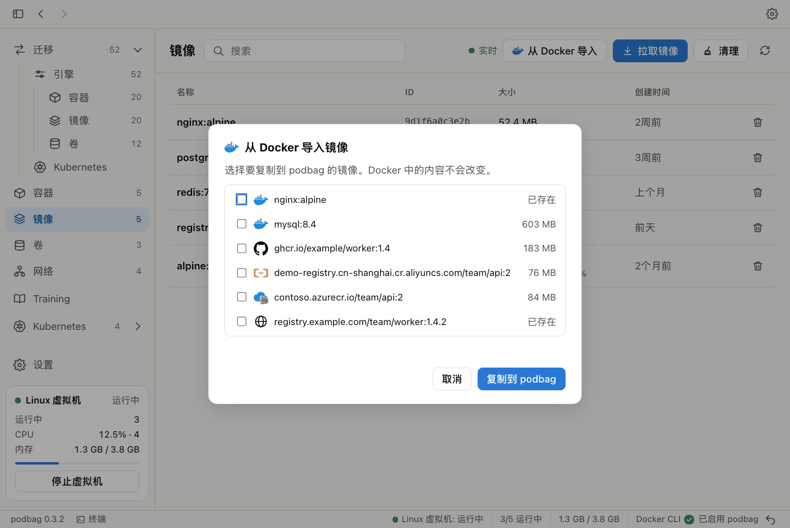

在侧边栏中打开**镜像**。列表显示每个镜像的名称、ID、大小和创建时间。压缩过的镜像会显示它在磁盘上的大小，以及缩小了多少。参见[压缩闲置镜像](../idle-image-compression/)。

**预计用时** 5 分钟。

## 从 Docker Hub 拉取镜像

1. 点击**拉取镜像**。在任意页面，也可以按 `⌘⇧P`（在 Linux 和 Windows 上按 `Ctrl+Shift+P`）。
2. 输入名称，例如 `nginx`。你输入时，面板会搜索 Docker Hub。
3. 用 `↑` `↓` 选择一个结果并按 `Enter`，或者直接点击它。然后选择标签。

第一行会完全按你输入的内容拉取。你也可以粘贴完整的引用，例如 `ghcr.io/owner/app:1.0`。面板会显示进度。拉取完成后，镜像会出现在列表中。`Esc` 先后退一步，然后关闭面板。

## 从其他镜像仓库拉取

点击搜索框右侧的仓库按钮。它一开始显示 **Docker Hub**。**拉取位置**菜单列出了 GitHub、Amazon ECR、Quay.io、Google Artifact Registry、GitLab、Azure Container Registry 等许多仓库。在**搜索**中输入文字，可以找到某个仓库。

有些仓库需要地址，例如 `contoso.azurecr.io`。面板只询问一次，然后会记住它。

## 登录镜像仓库

在**拉取位置**菜单中，点击某个仓库旁边的**登录**。输入用户名，以及密码或令牌，然后点击**登录**。有些云仓库用它们自己的命令行工具登录。这时面板会显示要在终端中运行的命令，例如 `az acr login --name <registry-name>`。

## 从 Docker 导入镜像

当引擎是 podbag 并且已安装 Docker 时，**镜像**页面有**从 Docker 导入**。它会列出 Docker 的镜像。podbag 中已有的镜像会显示**已存在**。勾选你想要的镜像，然后点击**复制到 podbag**。Docker 中的内容不会改变。

## 运行镜像

点击镜像所在行的**运行**，会打开运行表单，并已填好这个镜像。参见[运行容器](../gui-containers/)。

## 查看和删除镜像

点击一个镜像，可以看到它的标签、大小和使用它的容器。**删除**会删除这个镜像。**清理**会删除所有没有容器使用的镜像。应用会先询问你。

## 下一步

[卷和网络](../gui-volumes-networks/)。
