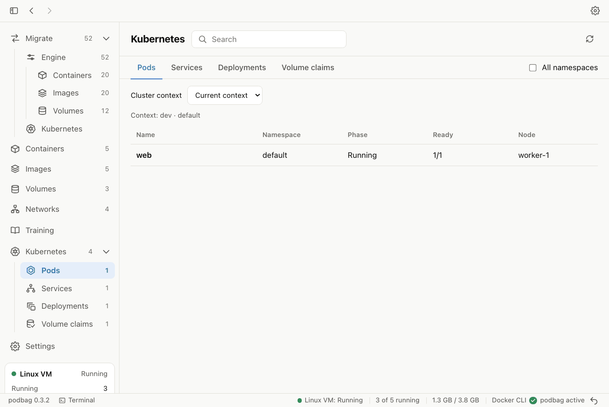
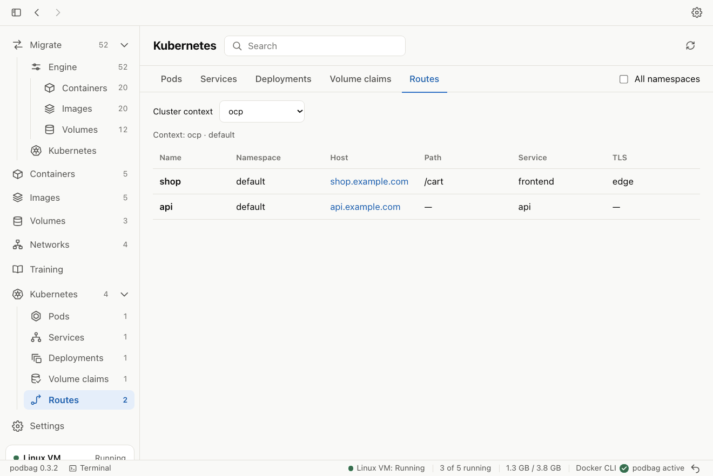
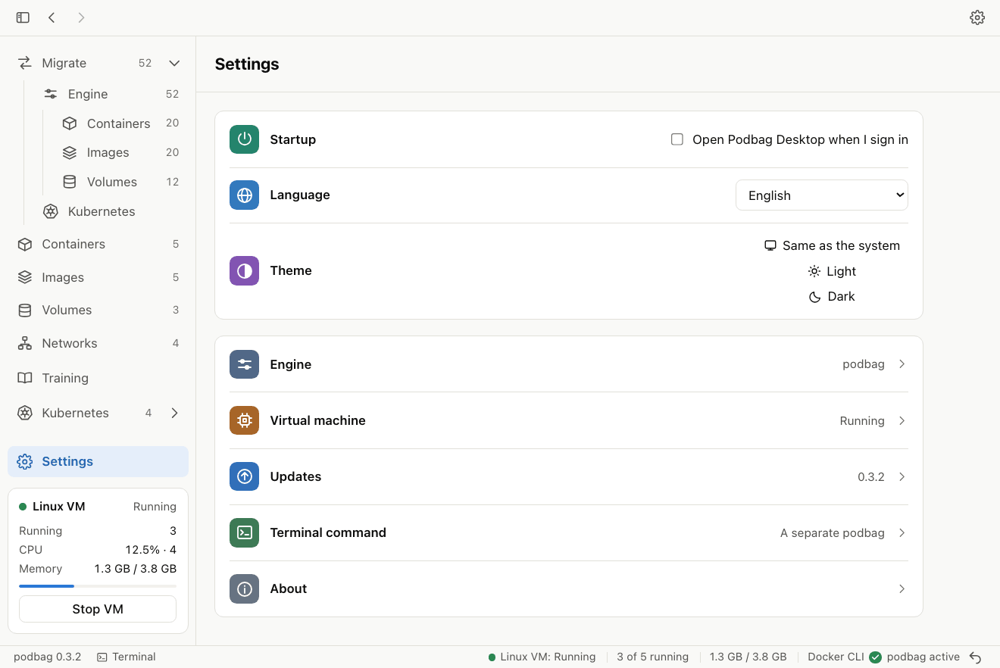
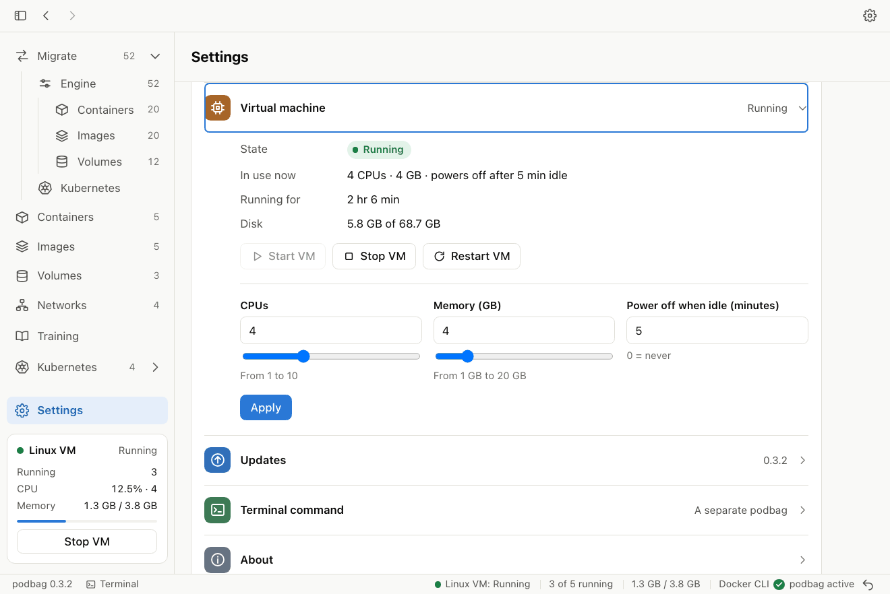
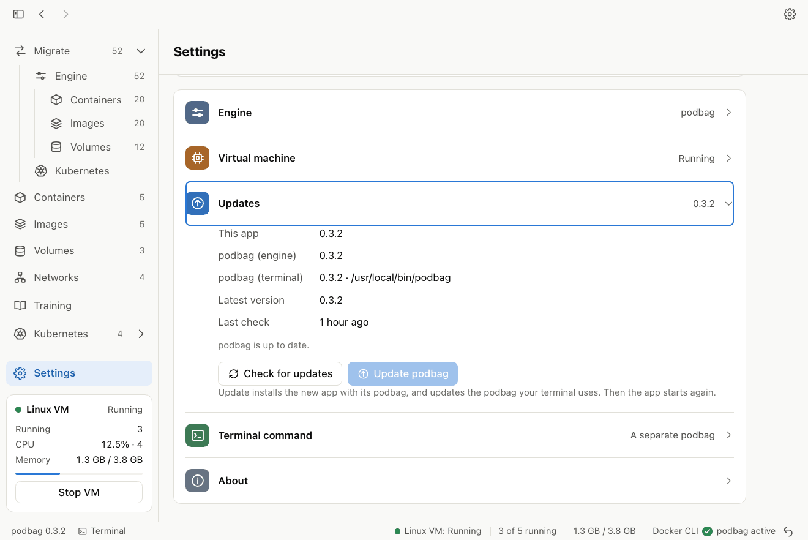

Podbag Desktop shows Kubernetes clusters next to your containers. **Settings** has the options of the app, the engine and the VM.

**Time** 5 minutes.

## Look at a Kubernetes cluster

The app uses `kubectl` and its contexts. Install `kubectl` first.

1. Click **Kubernetes** in the sidebar. It opens **Pods**, **Services**, **Deployments** and **Volume claims**, each with its count.
2. Choose a list. The page also has a tab for each list.
3. Choose the context in **Cluster context**. **Current context** is the one that `kubectl` uses now.
4. Check **All namespaces** to see all namespaces. Otherwise you see the context's namespace.

Click an item to see all of it as JSON. The Kubernetes page only reads. It changes nothing in the cluster.

## Look at OpenShift Routes

On an OpenShift cluster, the Kubernetes page also has a **Routes** tab, and the sidebar lists **Routes**. A Route is the public address of a Service. The app shows Routes only when the cluster's API serves `route.openshift.io/v1`. Other clusters have no Routes tab.

The list shows the **Host**, **Path**, **Service** and **TLS** mode of each Route. Click a host to open its address in the browser. The address starts with `https://` when the Route has TLS settings. Otherwise it starts with `http://`.

**Migrate** does not copy Routes. A Route's host belongs to its cluster.

## Change the settings

Open **Settings** in the sidebar, or press `⌘,` (`Ctrl+,` on Linux and Windows).

- **Startup:** **Open Podbag Desktop when I sign in**.
- **Language:** **Same as the system** or one of seven languages.
- **Theme:** **Same as the system**, **Light** or **Dark**.
- **Engine:** see [Engines, the docker command and migration](../gui-engines/).
- **Virtual machine:** on macOS and Windows. See below.
- **Updates:** see below.
- **Terminal command:** what terminals run for `podbag`. When they find none, **Install** adds the command. It uses the app's podbag, so it is updated with the app.
- **About:** what podbag is.

## Set the virtual machine

**Virtual machine** shows the VM's state, the resources in use, how long it has run and its disk. **Start VM**, **Stop VM** and **Restart VM** are also here.

1. Change **CPUs**, **Memory (GB)** or **Power off when idle (minutes)**. `0` means never.
2. Click **Apply**.
3. When the VM runs, the app asks when to use the new settings: **Restart now** or **At the next start**. It also says how many containers will stop.

## Update podbag

**Updates** shows the versions of the app, the engine and the terminal's podbag, the latest version and the last check.

- **Check for updates** looks for a new version. The app also looks once a day.
- **Update podbag** updates the terminal's podbag and the app. Then the app starts again.

When a new version is out, the status bar also shows it. Click it to open **Updates**.

## More

[GUI practice](/training/) has hands-on modules that you start in **Training**. The [podbag usage guide](https://github.com/SteelCrab/podbag/blob/main/docs/usage.md) has more about the app. Back to [how to use the GUI](/training/gui/).
