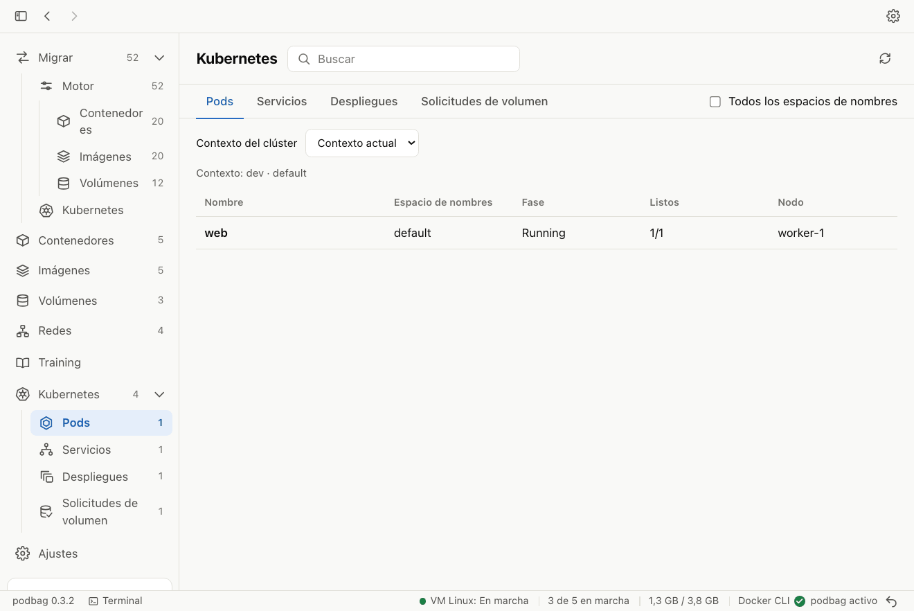
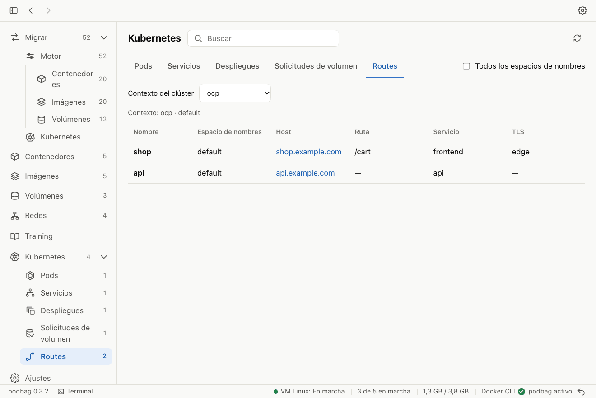
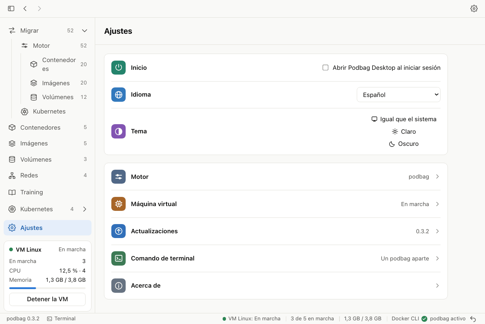
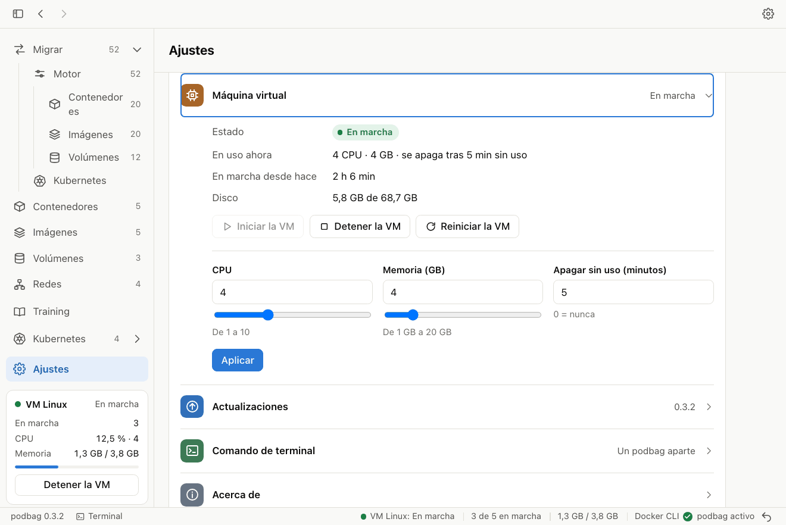
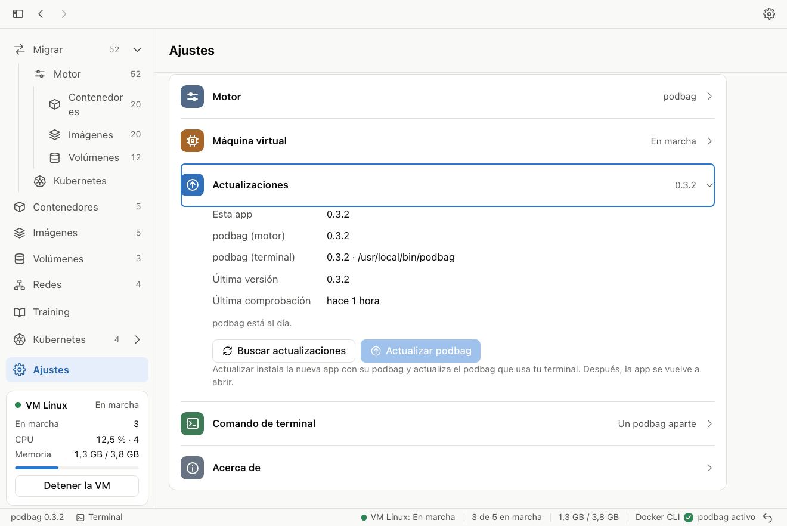

Podbag Desktop muestra los clústeres de Kubernetes junto a tus contenedores. **Ajustes** tiene las opciones de la app, del motor y de la VM.

**Tiempo** 5 minutos.

## Mira un clúster de Kubernetes

La app usa `kubectl` y sus contextos. Instala `kubectl` primero.

1. Haz clic en **Kubernetes** en la barra lateral. Se abren **Pods**, **Servicios**, **Despliegues** y **Solicitudes de volumen**, cada uno con su número de elementos.
2. Elige una lista. La página también tiene una pestaña para cada lista.
3. Elige el contexto en **Contexto del clúster**. **Contexto actual** es el que usa `kubectl` ahora.
4. Marca **Todos los espacios de nombres** para ver todos los espacios de nombres. Si no, ves el espacio de nombres del contexto.

Haz clic en un elemento para verlo completo en JSON. La página Kubernetes solo lee. No cambia nada en el clúster.

## Mira los Routes de OpenShift

En un clúster de OpenShift, la página Kubernetes tiene también una pestaña **Routes**, y la barra lateral lista **Routes**. Un Route es la dirección pública de un Servicio. La app muestra los Routes solo cuando la API del clúster ofrece `route.openshift.io/v1`. Los demás clústeres no tienen la pestaña Routes.

La lista muestra el **Host**, la **Ruta**, el **Servicio** y el modo de **TLS** de cada Route. Haz clic en un host para abrir su dirección en el navegador. La dirección empieza con `https://` cuando el Route tiene ajustes de TLS. Si no, empieza con `http://`.

**Migrar** no copia los Routes. El host de un Route pertenece a su clúster.

## Cambia los ajustes

Abre **Ajustes** en la barra lateral, o pulsa `⌘,` (`Ctrl+,` en Linux y Windows).

- **Inicio:** **Abrir Podbag Desktop al iniciar sesión**.
- **Idioma:** **Igual que el sistema** o uno de siete idiomas.
- **Tema:** **Igual que el sistema**, **Claro** u **Oscuro**.
- **Motor:** consulta [Motores, el comando docker y la migración](../gui-engines/).
- **Máquina virtual:** en macOS y Windows. Consulta más abajo.
- **Actualizaciones:** consulta más abajo.
- **Comando de terminal:** lo que ejecutan las terminales para `podbag`. Si no encuentran nada, **Instalar** añade el comando. Usa el podbag de la app, así que se actualiza con la app.
- **Acerca de:** qué es podbag.

## Configura la máquina virtual

**Máquina virtual** muestra el estado de la VM, los recursos en uso, cuánto tiempo lleva en marcha y su disco. **Iniciar la VM**, **Detener la VM** y **Reiniciar la VM** también están aquí.

1. Cambia **CPU**, **Memoria (GB)** o **Apagar sin uso (minutos)**. `0` significa nunca.
2. Haz clic en **Aplicar**.
3. Si la VM está en marcha, la app pregunta cuándo usar los nuevos ajustes: **Reiniciar ahora** o **En el próximo inicio**. También indica cuántos contenedores se detendrán.

## Actualiza podbag

**Actualizaciones** muestra las versiones de la app, del motor y del podbag de la terminal, la última versión y la última comprobación.

- **Buscar actualizaciones** busca una versión nueva. La app también busca una vez al día.
- **Actualizar podbag** actualiza el podbag de la terminal y la app. Después, la app se vuelve a abrir.

Cuando sale una versión nueva, la barra de estado también la muestra. Haz clic en ella para abrir **Actualizaciones**.

## Más

[Práctica con GUI](/es/training/) tiene módulos prácticos que inicias en **Training**. La [guía de uso de podbag](https://github.com/SteelCrab/podbag/blob/main/docs/usage.md) tiene más información sobre la app. Vuelve a [cómo usar la GUI](/es/training/gui/).
