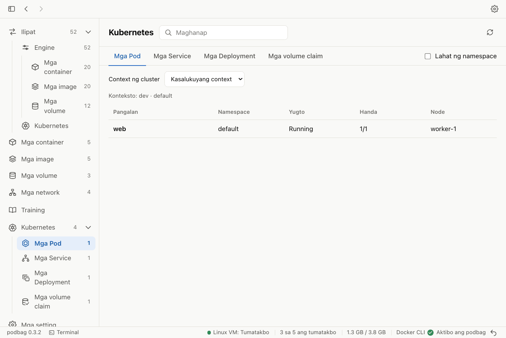
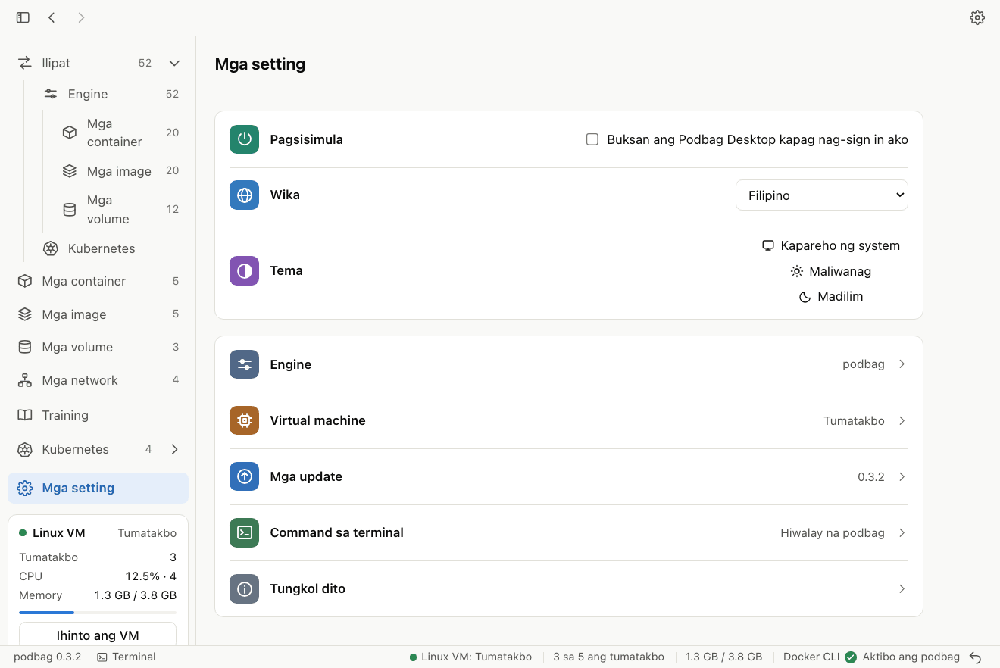
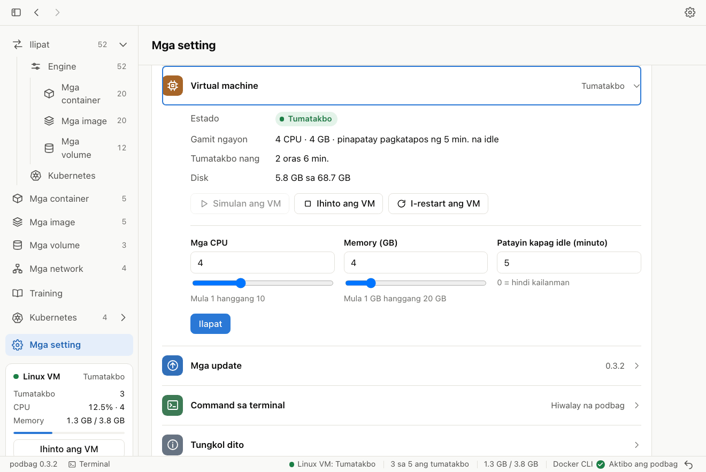
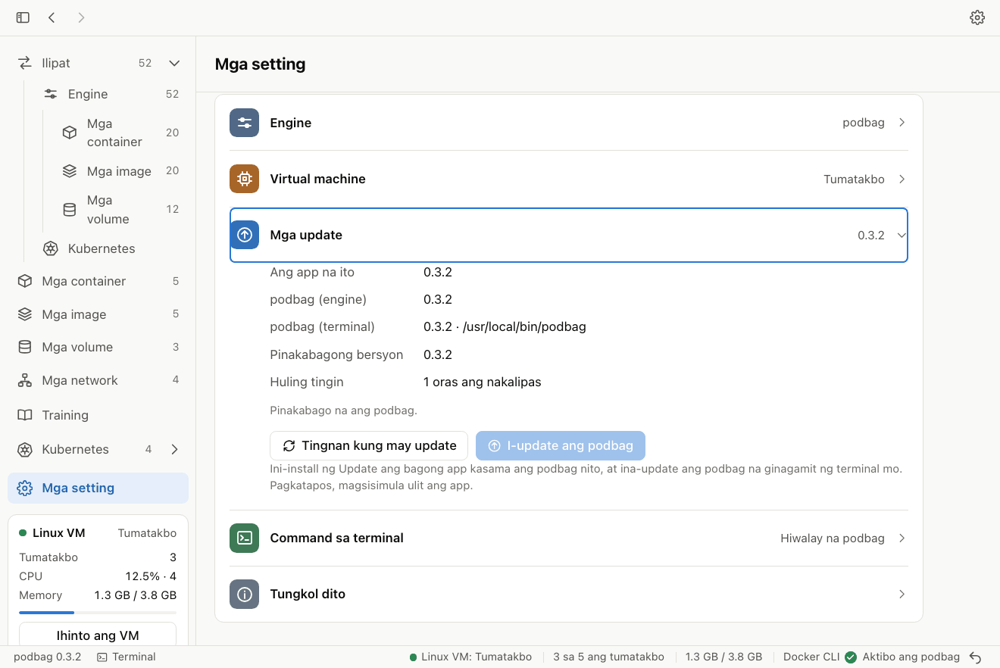

Ipinapakita ng Podbag Desktop ang mga Kubernetes cluster sa tabi ng iyong mga container. Nasa **Mga setting** ang mga opsiyon ng app, ng engine at ng VM.

**Oras** 5 minuto.

## Tingnan ang isang Kubernetes cluster

Ginagamit ng app ang `kubectl` at ang mga context nito. I-install muna ang `kubectl`.

1. I-click ang **Kubernetes** sa sidebar. Bubukas ang **Mga Pod**, **Mga Service**, **Mga Deployment** at **Mga volume claim**, bawat isa ay may bilang.
2. Pumili ng listahan. May tab din ang page para sa bawat listahan.
3. Piliin ang context sa **Context ng cluster**. Ang **Kasalukuyang context** ay ang context na ginagamit ngayon ng `kubectl`.
4. I-check ang **Lahat ng namespace** para makita ang lahat ng namespace. Kung hindi, ang namespace lang ng context ang makikita mo.

I-click ang item para makita ang buong item bilang JSON. Nagbabasa lang ang page ng Kubernetes. Wala itong binabago sa cluster.

## Baguhin ang mga setting

Buksan ang **Mga setting** sa sidebar, o pindutin ang `⌘,` (`Ctrl+,` sa Linux at Windows).

- **Pagsisimula:** **Buksan ang Podbag Desktop kapag nag-sign in ako**.
- **Wika:** **Kapareho ng system** o isa sa pitong wika.
- **Tema:** **Kapareho ng system**, **Maliwanag** o **Madilim**.
- **Engine:** tingnan ang [Mga engine, ang docker command at paglilipat](../gui-engines/).
- **Virtual machine:** sa macOS at Windows. Tingnan sa ibaba.
- **Mga update:** tingnan sa ibaba.
- **Command sa terminal:** ang pinapatakbo ng mga terminal para sa `podbag`. Kapag wala silang mahanap, idinadagdag ng **I-install** ang command. Ginagamit nito ang podbag ng app, kaya naa-update ito kasabay ng app.
- **Tungkol dito:** kung ano ang podbag.

## I-set ang virtual machine

Ipinapakita ng **Virtual machine** ang estado ng VM, ang mga resource na ginagamit, kung gaano na ito katagal tumatakbo at ang disk nito. Nandito rin ang **Simulan ang VM**, **Ihinto ang VM** at **I-restart ang VM**.

1. Baguhin ang **Mga CPU**, **Memory (GB)** o **Patayin kapag idle (minuto)**. Ang ibig sabihin ng `0` ay hindi kailanman.
2. I-click ang **Ilapat**.
3. Kapag tumatakbo ang VM, itatanong ng app kung kailan gagamitin ang bagong settings: **I-restart ngayon** o **Sa susunod na simula**. Sinasabi rin nito kung ilang container ang hihinto.

## I-update ang podbag

Ipinapakita ng **Mga update** ang mga bersyon ng app, ng engine at ng podbag ng terminal, ang pinakabagong bersyon at ang huling pagtingin.

- Naghahanap ng bagong bersyon ang **Tingnan kung may update**. Naghahanap din ang app isang beses bawat araw.
- Ina-update ng **I-update ang podbag** ang podbag ng terminal at ang app. Pagkatapos, magsisimula ulit ang app.

Kapag may bagong bersyon, ipinapakita rin ito ng status bar. I-click ito para buksan ang **Mga update**.

## Higit pa

May mga hands-on module ang [Pagsasanay sa GUI](/fil/training/) na sinisimulan mo sa **Training**. Mas marami pang tungkol sa app sa [gabay sa paggamit ng podbag](https://github.com/SteelCrab/podbag/blob/main/docs/usage.md). Bumalik sa [Paano gamitin ang GUI](/fil/training/gui/).
