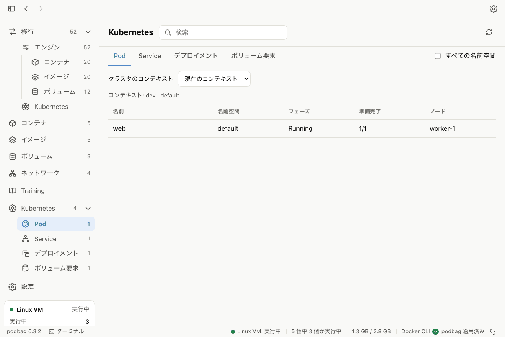
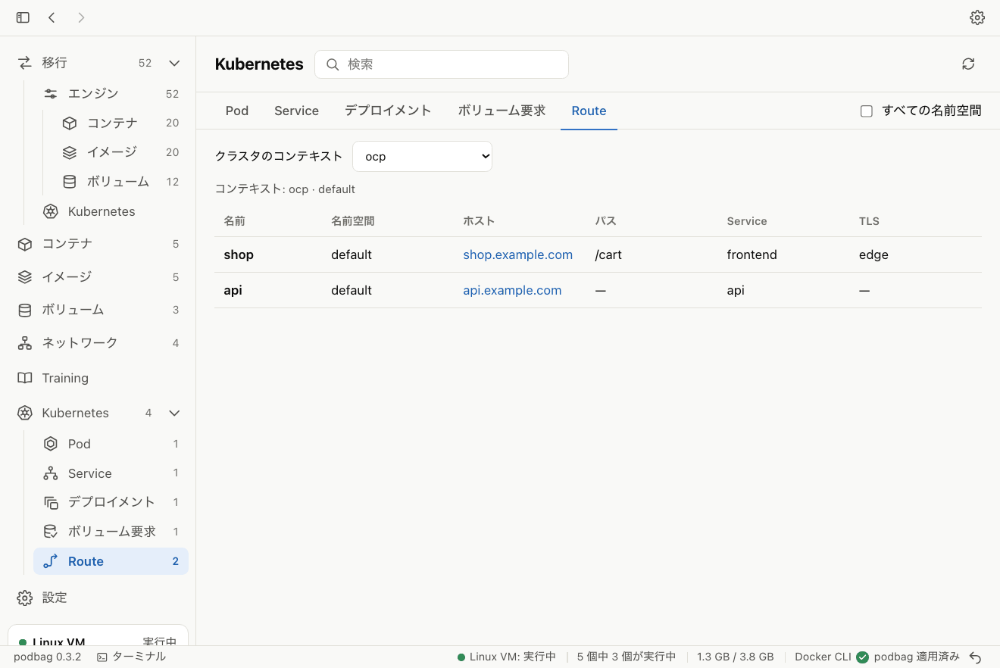
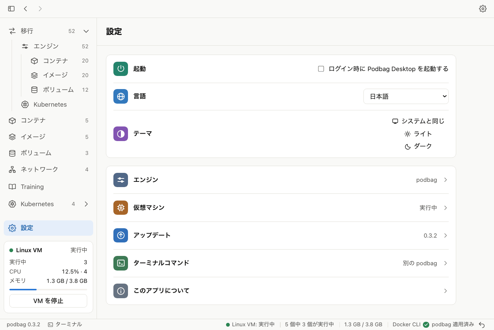
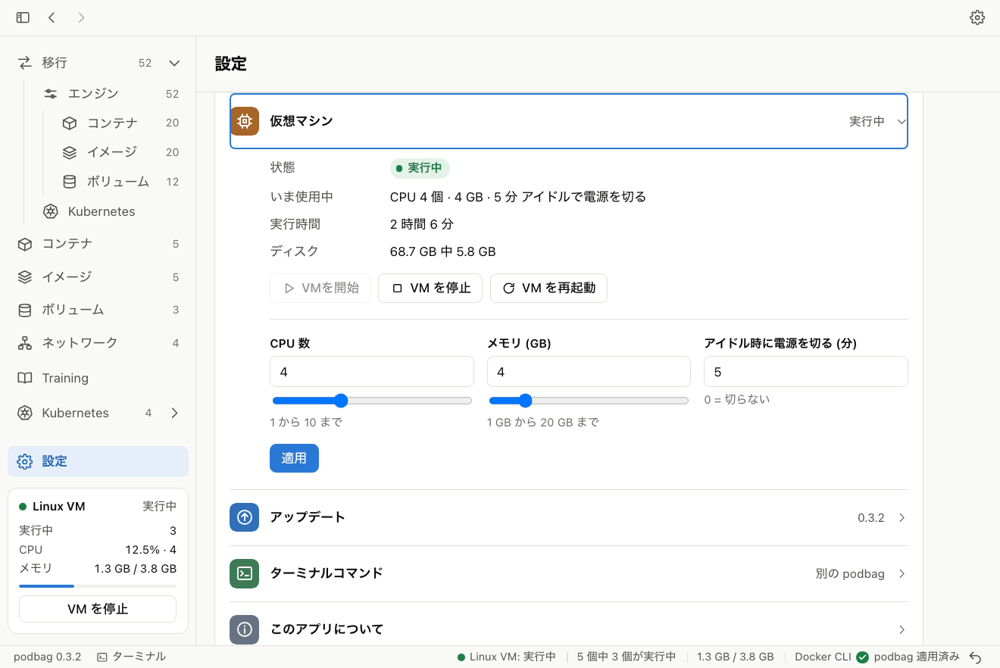
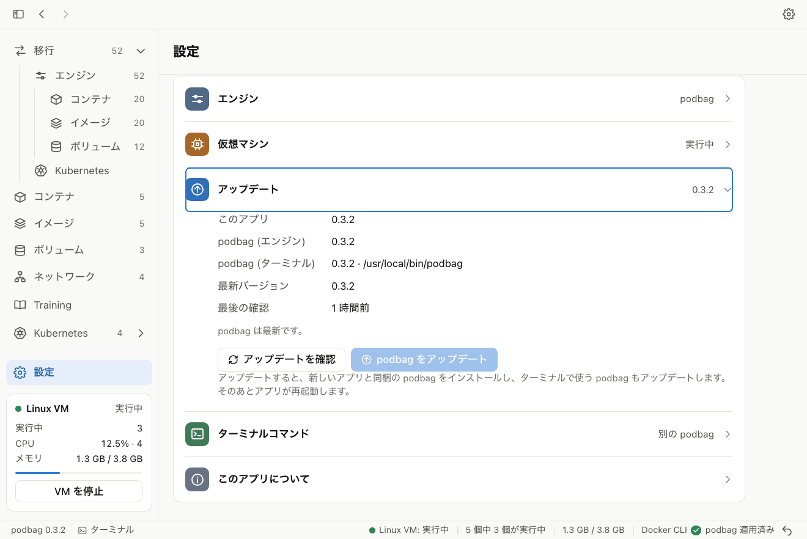

Podbag Desktop は、コンテナの横に Kubernetes クラスタを表示します。**設定**には、アプリ、エンジン、VM のオプションがあります。

**所要時間** 5 分。

## Kubernetes クラスタを見る

アプリは `kubectl` とそのコンテキストを使います。先に `kubectl` をインストールします。

1. サイドバーで**Kubernetes**をクリックします。**Pod**、**Service**、**デプロイメント**、**ボリューム要求**が、それぞれの数と一緒に開きます。
2. 一覧を選びます。ページにも、一覧ごとのタブがあります。
3. **クラスタのコンテキスト**でコンテキストを選びます。**現在のコンテキスト**は、いま `kubectl` が使っているコンテキストです。
4. **すべての名前空間**にチェックを入れると、すべての名前空間が表示されます。チェックを入れないと、コンテキストの名前空間だけが表示されます。

項目をクリックすると、すべての内容が JSON で表示されます。Kubernetes ページは読むだけです。クラスタを何も変更しません。

## OpenShift の Route を見る

OpenShift のクラスタでは、Kubernetes ページに **Route** タブも表示され、サイドバーにも **Route** が並びます。Route は、Service の公開アドレスです。クラスタの API が `route.openshift.io/v1` を提供しているときだけ、アプリは Route を表示します。ほかのクラスタには、Route タブはありません。

一覧には、Route ごとに**ホスト**、**パス**、**Service**、TLS のモードが表示されます。ホストをクリックすると、そのアドレスがブラウザで開きます。Route に TLS の設定があるときは、アドレスは `https://` で始まります。ないときは `http://` で始まります。

**移行**は Route をコピーしません。Route のホストは、そのクラスタのものだからです。

## 設定を変更する

サイドバーで**設定**を開くか、`⌘,`（Linux と Windows では `Ctrl+,`）を押します。

- **起動:** **ログイン時に Podbag Desktop を起動する**
- **言語:** **システムと同じ**、または 7 つの言語のどれか
- **テーマ:** **システムと同じ**、**ライト**、**ダーク**
- **エンジン:** [エンジン、docker コマンド、移行](../gui-engines/)を参照してください。
- **仮想マシン:** macOS と Windows にあります。下を参照してください。
- **アップデート:** 下を参照してください。
- **ターミナルコマンド:** ターミナルが `podbag` として実行するものです。見つからないときは、**インストール**でコマンドを追加します。このコマンドはアプリの podbag を使うので、アプリと一緒にアップデートされます。
- **このアプリについて:** podbag の説明です。

## 仮想マシンを設定する

**仮想マシン**には、VM の状態、使用中のリソース、実行時間、ディスクが表示されます。**VMを開始**、**VM を停止**、**VM を再起動**もここにあります。

1. **CPU 数**、**メモリ (GB)**、**アイドル時に電源を切る (分)**を変更します。`0` は電源を切らないという意味です。
2. **適用**をクリックします。
3. VM が実行中のときは、新しい設定をいつ使うかをアプリが尋ねます。**今すぐ再起動**か、**次の起動で**です。停止するコンテナの数も表示されます。

## podbag をアップデートする

**アップデート**には、アプリ、エンジン、ターミナルの podbag のバージョン、最新バージョン、最後の確認日時が表示されます。

- **アップデートを確認**は、新しいバージョンを探します。アプリも 1 日に 1 回探します。
- **podbag をアップデート**は、ターミナルの podbag とアプリをアップデートします。そのあと、アプリが再起動します。

新しいバージョンが出ると、ステータスバーにも表示されます。クリックすると、**アップデート**が開きます。

## さらに詳しく

[GUI 実習](/ja/training/)には、**Training**で始める実習モジュールがあります。[podbag 使い方ガイド](https://github.com/SteelCrab/podbag/blob/main/docs/usage.md)に、アプリの説明がさらにあります。[GUI の使い方](/ja/training/gui/)に戻ります。
