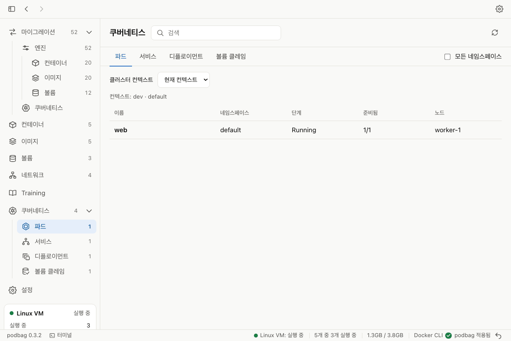
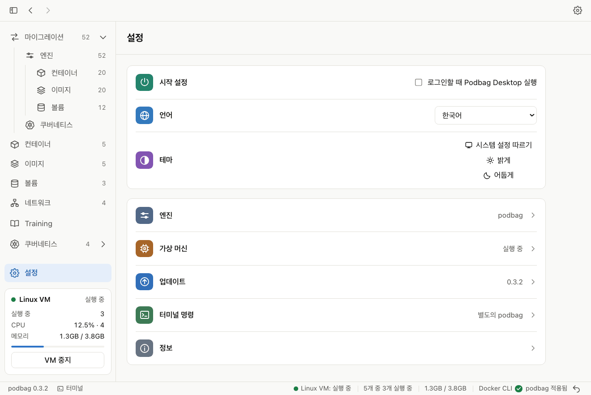
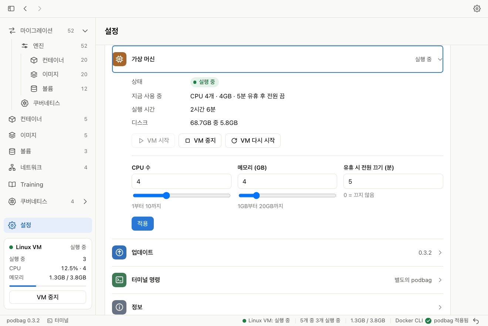
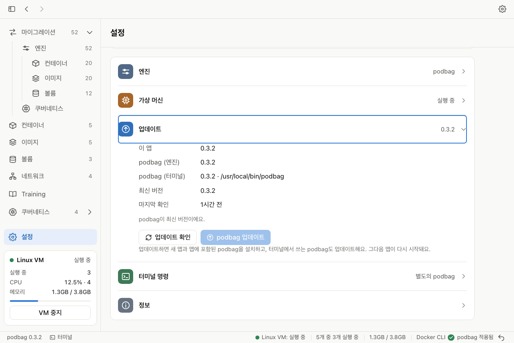

Podbag Desktop은 컨테이너 옆에 Kubernetes 클러스터를 보여줍니다. **설정**에는 앱, 엔진, VM의 옵션이 있습니다.

**예상 시간** 5분.

## Kubernetes 클러스터 보기

앱은 `kubectl`과 그 컨텍스트를 씁니다. 먼저 `kubectl`을 설치합니다.

1. 사이드바에서 **쿠버네티스**를 클릭합니다. **파드**, **서비스**, **디플로이먼트**, **볼륨 클레임**이 개수와 함께 열립니다.
2. 목록을 고릅니다. 페이지에도 목록마다 탭이 있습니다.
3. **클러스터 컨텍스트**에서 컨텍스트를 고릅니다. **현재 컨텍스트**는 지금 `kubectl`이 쓰는 컨텍스트입니다.
4. **모든 네임스페이스**를 체크하면 모든 네임스페이스가 보입니다. 체크하지 않으면 컨텍스트의 네임스페이스만 보입니다.

항목을 클릭하면 전체 내용이 JSON으로 보입니다. 쿠버네티스 페이지는 읽기만 합니다. 클러스터를 바꾸지 않습니다.

## 설정 바꾸기

사이드바에서 **설정**을 열거나 `⌘,`(Linux와 Windows에서는 `Ctrl+,`)를 누릅니다.

- **시작 설정:** **로그인할 때 Podbag Desktop 실행**
- **언어:** **시스템 설정 따르기** 또는 7개 언어 중 하나
- **테마:** **시스템 설정 따르기**, **밝게**, **어둡게**
- **엔진:** [엔진, docker 명령, 마이그레이션](../gui-engines/)을 참고합니다.
- **가상 머신:** macOS와 Windows에 있습니다. 아래를 참고합니다.
- **업데이트:** 아래를 참고합니다.
- **터미널 명령:** 터미널이 `podbag`으로 실행하는 것입니다. 찾지 못하면 **설치**로 명령을 추가합니다. 이 명령은 앱의 podbag을 쓰므로 앱과 함께 업데이트됩니다.
- **정보:** podbag 소개입니다.

## 가상 머신 설정하기

**가상 머신**에는 VM 상태, 사용 중인 자원, 실행 시간, 디스크가 보입니다. **VM 시작**, **VM 중지**, **VM 다시 시작**도 여기에 있습니다.

1. **CPU 수**, **메모리 (GB)**, **유휴 시 전원 끄기 (분)**를 바꿉니다. `0`은 끄지 않는다는 뜻입니다.
2. **적용**을 클릭합니다.
3. VM이 실행 중이면 앱이 새 설정을 언제 쓸지 묻습니다: **지금 다시 시작** 또는 **다음 시작 때**. 멈출 컨테이너 수도 알려줍니다.

## podbag 업데이트하기

**업데이트**에는 앱, 엔진, 터미널 podbag의 버전과 최신 버전, 마지막 확인 시간이 보입니다.

- **업데이트 확인**은 새 버전을 찾습니다. 앱도 하루에 한 번 찾습니다.
- **podbag 업데이트**는 터미널의 podbag과 앱을 업데이트합니다. 그다음 앱이 다시 시작됩니다.

새 버전이 나오면 상태 표시줄에도 보입니다. 클릭하면 **업데이트**가 열립니다.

## 더 보기

[GUI 실습](/ko/training/)에는 **Training**에서 시작하는 실습 모듈이 있습니다. [podbag 사용 안내](https://github.com/SteelCrab/podbag/blob/main/docs/usage.md)에 앱 설명이 더 있습니다. [GUI 사용법](/ko/training/gui/)으로 돌아갑니다.
