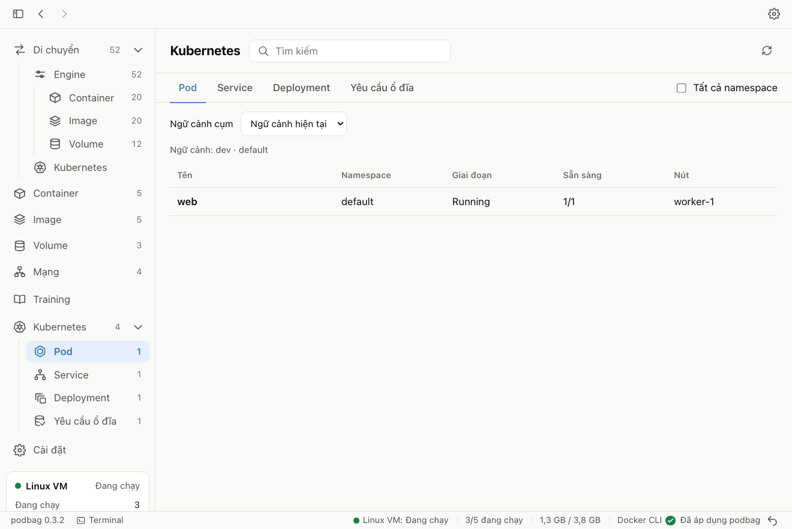
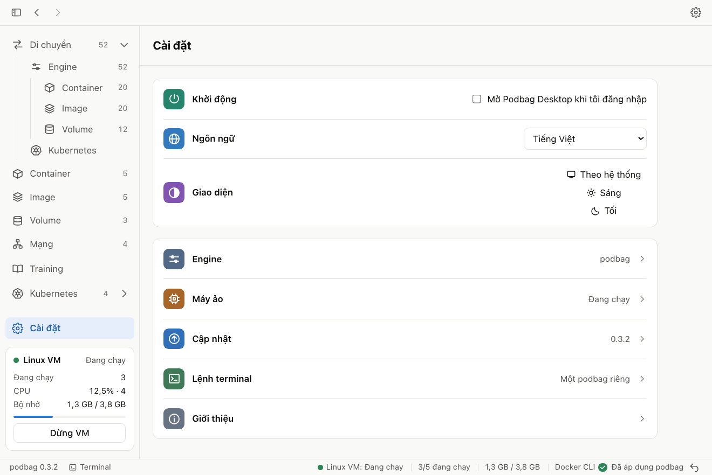
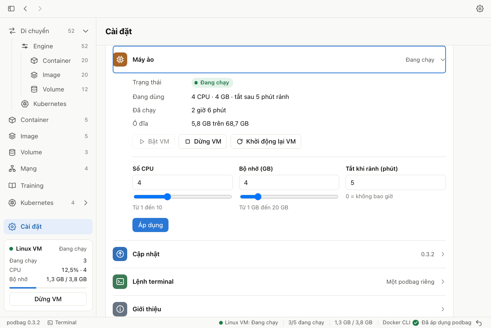
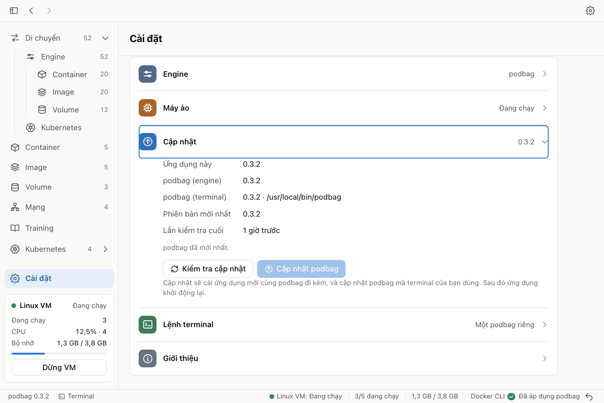

Podbag Desktop hiện các cụm Kubernetes bên cạnh container của bạn. **Cài đặt** có các tùy chọn của ứng dụng, engine và VM.

**Thời gian** 5 phút.

## Xem một cụm Kubernetes

Ứng dụng dùng `kubectl` và các ngữ cảnh (context) của nó. Hãy cài `kubectl` trước.

1. Nhấp vào **Kubernetes** trên thanh bên. Mục này mở ra **Pod**, **Service**, **Deployment** và **Yêu cầu ổ đĩa**, mỗi mục kèm số lượng.
2. Chọn một danh sách. Trang cũng có một tab cho mỗi danh sách.
3. Chọn ngữ cảnh trong **Ngữ cảnh cụm**. **Ngữ cảnh hiện tại** là ngữ cảnh mà `kubectl` đang dùng.
4. Đánh dấu **Tất cả namespace** để xem mọi namespace. Nếu không, bạn chỉ thấy namespace của ngữ cảnh.

Nhấp vào một mục để xem toàn bộ mục đó ở dạng JSON. Trang Kubernetes chỉ đọc. Trang này không thay đổi gì trong cụm.

## Thay đổi cài đặt

Mở **Cài đặt** trên thanh bên, hoặc nhấn `⌘,` (`Ctrl+,` trên Linux và Windows).

- **Khởi động:** **Mở Podbag Desktop khi tôi đăng nhập**.
- **Ngôn ngữ:** **Theo hệ thống** hoặc một trong bảy ngôn ngữ.
- **Giao diện:** **Theo hệ thống**, **Sáng** hoặc **Tối**.
- **Engine:** xem [Engine, lệnh docker và di chuyển](../gui-engines/).
- **Máy ảo:** có trên macOS và Windows. Xem phần bên dưới.
- **Cập nhật:** xem phần bên dưới.
- **Lệnh terminal:** chương trình mà terminal chạy khi bạn gõ `podbag`. Khi terminal không tìm thấy lệnh này, nút **Cài đặt** sẽ thêm lệnh. Lệnh dùng podbag của ứng dụng, nên được cập nhật cùng ứng dụng.
- **Giới thiệu:** podbag là gì.

## Đặt máy ảo

**Máy ảo** hiện trạng thái VM, tài nguyên đang dùng, thời gian VM đã chạy và ổ đĩa của nó. **Bật VM**, **Dừng VM** và **Khởi động lại VM** cũng có ở đây.

1. Thay đổi **Số CPU**, **Bộ nhớ (GB)** hoặc **Tắt khi rảnh (phút)**. `0` nghĩa là không bao giờ tắt.
2. Nhấp vào **Áp dụng**.
3. Khi VM đang chạy, ứng dụng hỏi khi nào dùng cài đặt mới: **Khởi động lại ngay** hoặc **Ở lần khởi động sau**. Ứng dụng cũng cho biết bao nhiêu container sẽ dừng.

## Cập nhật podbag

**Cập nhật** hiện phiên bản của ứng dụng, của engine và của podbag trong terminal, phiên bản mới nhất và lần kiểm tra cuối.

- **Kiểm tra cập nhật** tìm phiên bản mới. Ứng dụng cũng tự tìm mỗi ngày một lần.
- **Cập nhật podbag** cập nhật podbag trong terminal và ứng dụng. Sau đó, ứng dụng khởi động lại.

Khi có phiên bản mới, thanh trạng thái cũng hiện nó. Nhấp vào đó để mở **Cập nhật**.

## Xem thêm

[Thực hành GUI](/vi/training/) có các mô-đun thực hành mà bạn bắt đầu trong **Training**. [Tài liệu sử dụng podbag](https://github.com/SteelCrab/podbag/blob/main/docs/usage.md) có thêm thông tin về ứng dụng. Quay lại [cách dùng GUI](/vi/training/gui/).
