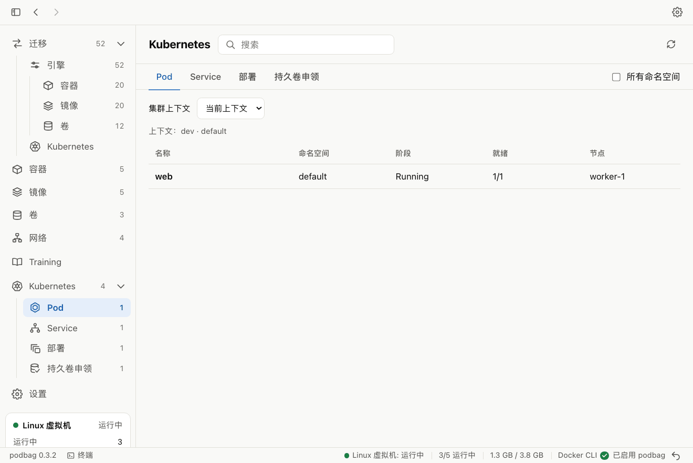
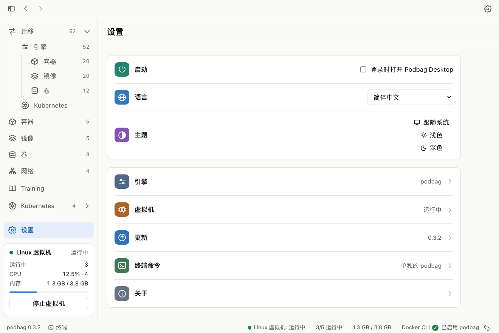
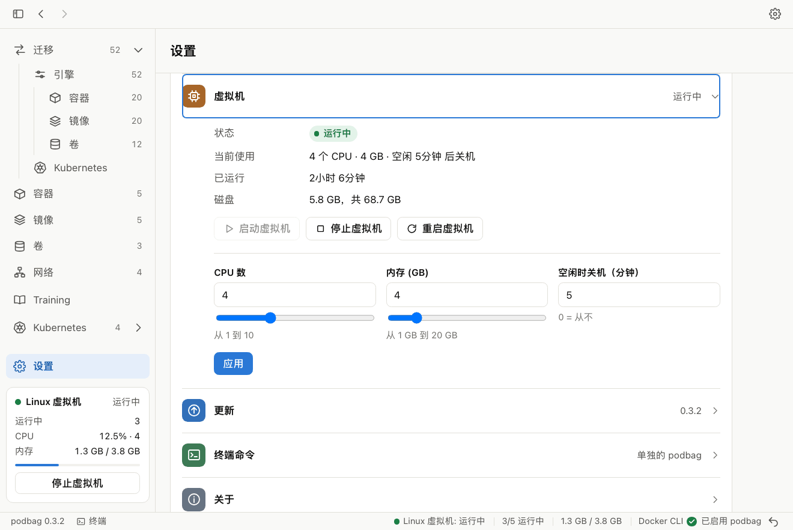
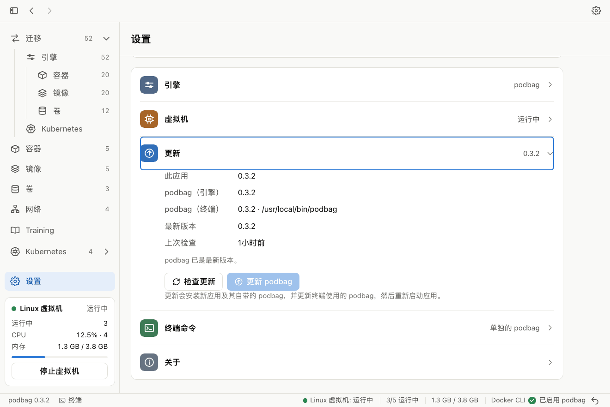

Podbag Desktop 在你的容器旁边显示 Kubernetes 集群。**设置**中有应用、引擎和 VM 的选项。

**预计用时** 5 分钟。

## 查看 Kubernetes 集群

应用使用 `kubectl` 及其上下文。请先安装 `kubectl`。

1. 在侧边栏中点击 **Kubernetes**。它会展开 **Pod**、**Service**、**部署**和**持久卷申领**，每一项都显示数量。
2. 选择一个列表。页面上也有每个列表的标签页。
3. 在**集群上下文**中选择上下文。**当前上下文**是 `kubectl` 现在使用的上下文。
4. 勾选**所有命名空间**，可以查看所有命名空间。否则只显示该上下文的命名空间。

点击一个项目，可以用 JSON 格式查看它的全部内容。Kubernetes 页面只读取集群。它不会更改集群中的任何内容。

## 更改设置

在侧边栏中打开**设置**，或按 `⌘,`（在 Linux 和 Windows 上按 `Ctrl+,`）。

- **启动：** **登录时打开 Podbag Desktop**。
- **语言：** **跟随系统**或七种语言之一。
- **主题：** **跟随系统**、**浅色**或**深色**。
- **引擎：** 参见[引擎、docker 命令和迁移](../gui-engines/)。
- **虚拟机：** 在 macOS 和 Windows 上显示。见下文。
- **更新：** 见下文。
- **终端命令：** 终端运行 `podbag` 时实际使用的程序。如果终端找不到它，**安装**会添加这个命令。它使用应用自带的 podbag，所以会随应用一起更新。
- **关于：** podbag 的简介。

## 设置虚拟机

**虚拟机**显示 VM 的状态、当前使用的资源、已运行的时间和磁盘。**启动虚拟机**、**停止虚拟机**和**重启虚拟机**也在这里。

1. 更改 **CPU 数**、**内存 (GB)** 或**空闲时关机（分钟）**。`0` 表示从不关机。
2. 点击**应用**。
3. 如果 VM 正在运行，应用会询问何时使用新设置：**现在重启**或**下次启动时**。它还会告诉你将停止多少个容器。

## 更新 podbag

**更新**显示应用、引擎和终端中 podbag 的版本，以及最新版本和上次检查的时间。

- **检查更新**会查找新版本。应用也会每天检查一次。
- **更新 podbag** 会更新终端中的 podbag 和应用。然后应用会重新启动。

有新版本时，状态栏也会显示。点击它可以打开**更新**。

## 更多内容

[GUI 实训](/zh-CN/training/)中有实操模块，你可以在 **Training** 中启动它们。[podbag 使用指南](https://github.com/SteelCrab/podbag/blob/main/docs/usage.md)中有关于应用的更多内容。返回 [GUI 使用方法](/zh-CN/training/gui/)。
