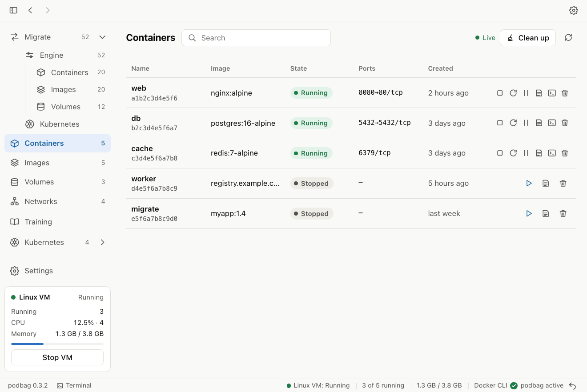
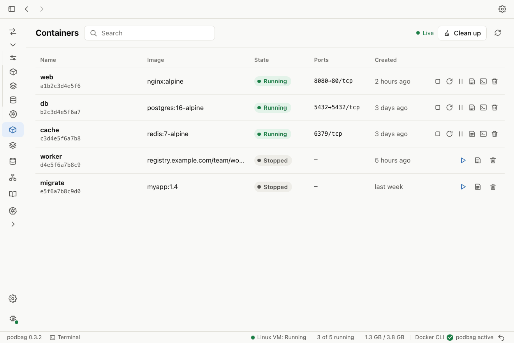

Podbag Desktop is the app for podbag. It shows your containers, images, volumes and networks in a window, and you work with them by mouse or by keyboard. It runs on Linux and macOS. Windows support is experimental and needs WSL 2.

**Time** 5 minutes.

## Install the app

Get the package for your system from the [latest release](https://github.com/SteelCrab/podbag/releases/latest).

- **macOS:** extract `podbag-desktop-aarch64-macos.zip` (Apple silicon) or `podbag-desktop-x86_64-macos.zip` (Intel). Move `podbag.app` to the Applications folder and open it.
- **Linux:** install the `.deb` on Debian or Ubuntu, or the `.rpm` on Fedora. The package includes the engine.
- **Windows:** run the `.msi` for your CPU. Turn on WSL 2 to run containers.

The app includes the CLI. When terminals cannot find a `podbag` command, the app offers to install it. You can also do this later in **Settings** › **Terminal command**.

## Read the window

- **Sidebar:** the pages **Migrate**, **Containers**, **Images**, **Volumes**, **Networks**, **Training**, **Kubernetes** and **Settings**. The number next to a page is how many items it has.
- **Linux VM:** on macOS and Windows, a card at the bottom of the sidebar shows the VM's state, the running containers, the CPU and the memory. **Stop VM** and **Start VM** stop and start the VM.
- **List:** the items of the open page. The buttons at the end of a row act on that item. Hold the pointer over a button to see its name. Click a row to open its details.
- **Top of the list:** the page's name, **Search** and the page's buttons, such as **Clean up**. **Live** means that the app gets the engine's events. Without events, the app reads the lists every few seconds.
- **Status bar:** podbag's version, **Terminal**, the VM's state, the running containers, the memory and **Docker CLI**, which shows where the `docker` command goes. Click the version to open **Updates**. Click **Terminal** to open a terminal.

## Move around

| macOS | Linux and Windows | What it does |
|---|---|---|
| `⌘F` or `⌘K` | `Ctrl+F` or `Ctrl+K` | Search the list |
| `⌘[` `⌘]` | `Alt+←` `Alt+→` | Go back or forward through the pages you opened |
| `Esc` | `Esc` | Close the details |
| `⌘⇧P` | `Ctrl+Shift+P` | Pull an image, from any page |
| `⌘,` | `Ctrl+,` | Open **Settings** |
| `⌃⌘S` | `Ctrl+B` | Hide or show the sidebar |

The back and forward arrows are also at the top left. The back and forward buttons of a mouse work too. The search looks at the names, the images, the states, the ports and the IDs.

## Make the sidebar smaller

Click the sidebar button at the top left. The sidebar then shows only icons. Hold the pointer over an icon to see its name. Click the button again to show the names.

Drag the line between the sidebar and the list to make the sidebar narrower or wider. The app remembers your choice.

## Next

[Manage containers](../gui-containers/) from the Containers list.
