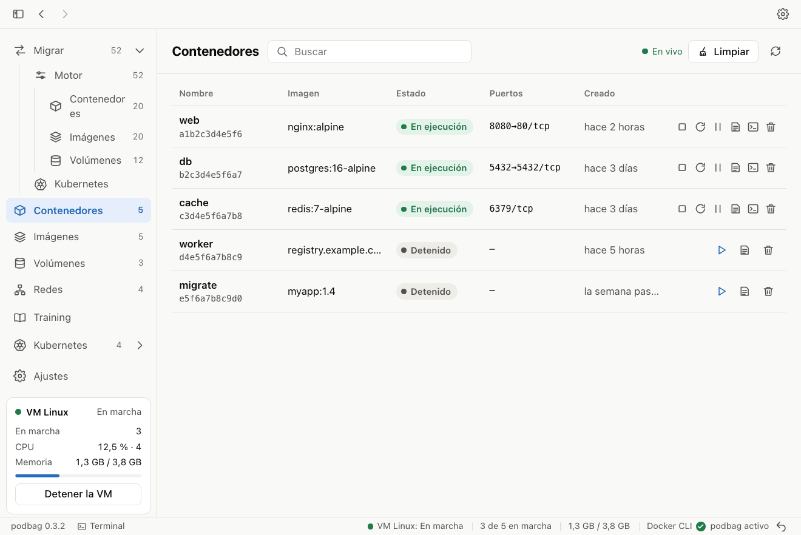
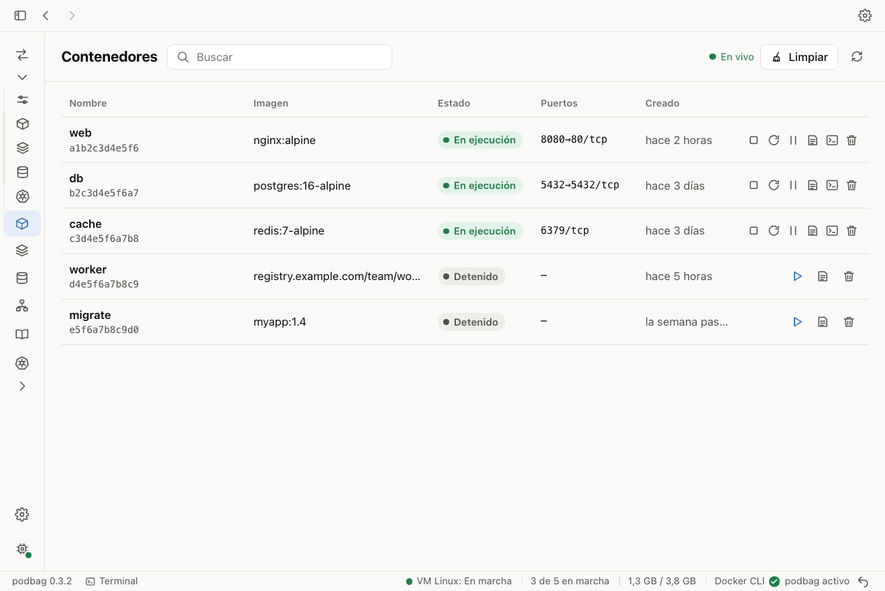

Podbag Desktop es la app de podbag. Muestra tus contenedores, imágenes, volúmenes y redes en una ventana. Trabajas con ellos con el ratón o con el teclado. Funciona en Linux y macOS. En Windows, el soporte es experimental y necesita WSL 2.

**Tiempo** 5 minutos.

## Instala la app

Descarga el paquete para tu sistema desde la [última versión](https://github.com/SteelCrab/podbag/releases/latest).

- **macOS:** extrae `podbag-desktop-aarch64-macos.zip` (Apple silicon) o `podbag-desktop-x86_64-macos.zip` (Intel). Mueve `podbag.app` a la carpeta Aplicaciones y ábrela.
- **Linux:** instala el `.deb` en Debian o Ubuntu, o el `.rpm` en Fedora. El paquete incluye el motor.
- **Windows:** ejecuta el `.msi` para tu CPU. Activa WSL 2 para ejecutar contenedores.

La app incluye la CLI. Si las terminales no encuentran el comando `podbag`, la app ofrece instalarlo. También puedes hacerlo más tarde en **Ajustes** › **Comando de terminal**.

## Lee la ventana

- **Barra lateral:** las páginas **Migrar**, **Contenedores**, **Imágenes**, **Volúmenes**, **Redes**, **Training**, **Kubernetes** y **Ajustes**. El número junto a una página indica cuántos elementos tiene.
- **VM Linux:** en macOS y Windows, una tarjeta abajo en la barra lateral muestra el estado de la VM, los contenedores en marcha, la CPU y la memoria. **Detener la VM** e **Iniciar la VM** detienen e inician la VM.
- **Lista:** los elementos de la página abierta. Los botones al final de una fila actúan sobre ese elemento. Deja el puntero sobre un botón para ver su nombre. Haz clic en una fila para abrir sus detalles.
- **Parte superior de la lista:** el nombre de la página, **Buscar** y los botones de la página, como **Limpiar**. **En vivo** significa que la app recibe los eventos del motor. Sin eventos, la app lee las listas cada pocos segundos.
- **Barra de estado:** la versión de podbag, **Terminal**, el estado de la VM, los contenedores en marcha, la memoria y **Docker CLI**. **Docker CLI** muestra adónde va el comando `docker`. Haz clic en la versión para abrir **Actualizaciones**. Haz clic en **Terminal** para abrir una terminal.

## Muévete por la app

| macOS | Linux y Windows | Qué hace |
|---|---|---|
| `⌘F` o `⌘K` | `Ctrl+F` o `Ctrl+K` | Busca en la lista |
| `⌘[` `⌘]` | `Alt+←` `Alt+→` | Vuelve atrás o adelante por las páginas que abriste |
| `Esc` | `Esc` | Cierra los detalles |
| `⌘⇧P` | `Ctrl+Shift+P` | Descarga una imagen desde cualquier página |
| `⌘,` | `Ctrl+,` | Abre **Ajustes** |
| `⌃⌘S` | `Ctrl+B` | Oculta o muestra la barra lateral |

Las flechas de atrás y adelante también están arriba a la izquierda. Los botones de atrás y adelante del ratón también funcionan. La búsqueda mira los nombres, las imágenes, los estados, los puertos y los ID.

## Reduce la barra lateral

Haz clic en el botón de la barra lateral, arriba a la izquierda. La barra lateral muestra entonces solo iconos. Deja el puntero sobre un icono para ver su nombre. Haz clic otra vez en el botón para mostrar los nombres.

Arrastra la línea entre la barra lateral y la lista para hacer la barra lateral más estrecha o más ancha. La app recuerda tu elección.

## Siguiente

[Gestiona los contenedores](../gui-containers/) desde la lista Contenedores.
