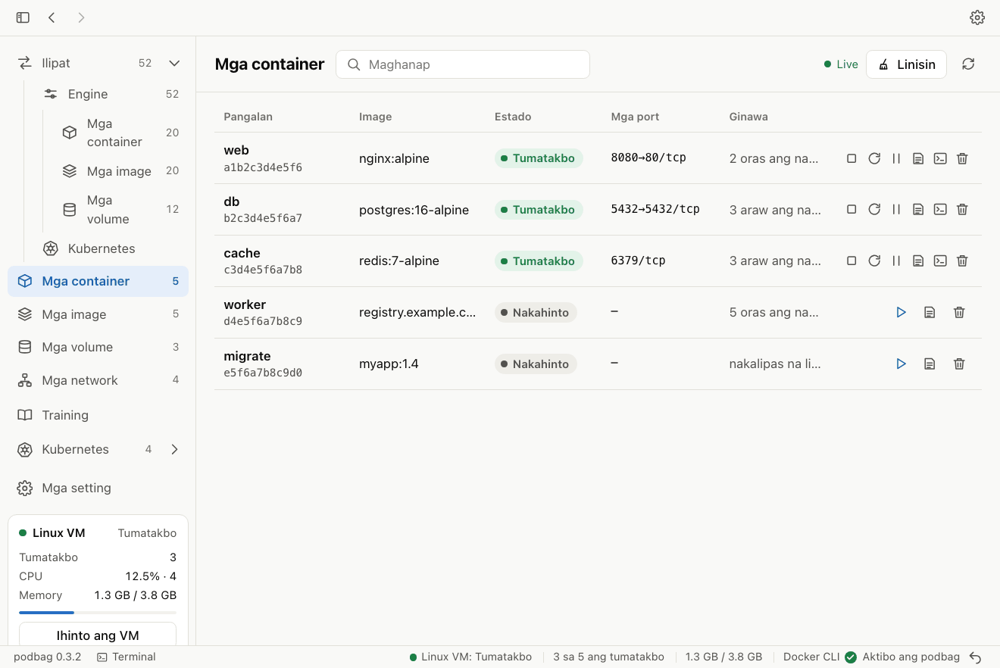
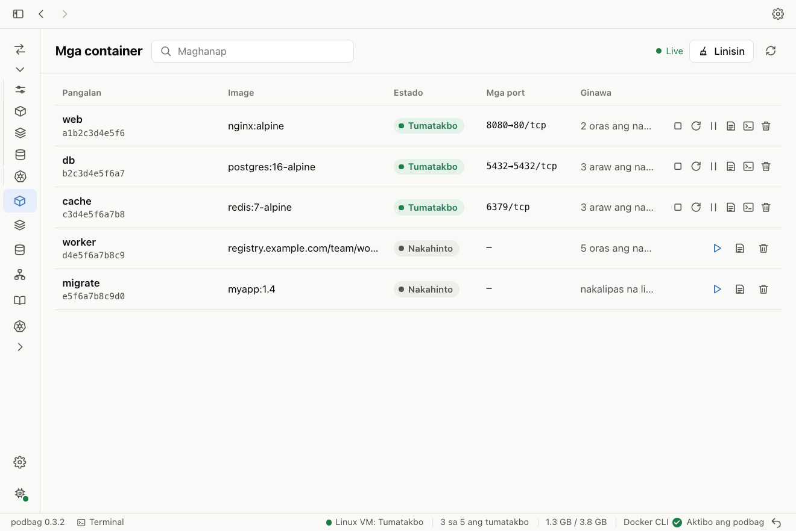

Ang Podbag Desktop ay ang app para sa podbag. Ipinapakita nito sa isang window ang iyong mga container, image, volume at network. Ginagamit mo ang mouse o ang keyboard para gumawa sa mga ito. Tumatakbo ito sa Linux at macOS. Pang-eksperimento pa lang ang suporta sa Windows, at kailangan nito ng WSL 2.

**Oras** 5 minuto.

## I-install ang app

Kunin ang package para sa iyong system mula sa [pinakabagong release](https://github.com/SteelCrab/podbag/releases/latest).

- **macOS:** i-extract ang `podbag-desktop-aarch64-macos.zip` (Apple silicon) o ang `podbag-desktop-x86_64-macos.zip` (Intel). Ilipat ang `podbag.app` sa Applications folder at buksan ito.
- **Linux:** i-install ang `.deb` sa Debian o Ubuntu, o ang `.rpm` sa Fedora. Kasama sa package ang engine.
- **Windows:** patakbuhin ang `.msi` para sa iyong CPU. I-on ang WSL 2 para magpatakbo ng mga container.

Kasama sa app ang CLI. Kapag hindi mahanap ng mga terminal ang `podbag` command, iaalok ng app na i-install ito. Puwede mo rin itong gawin mamaya sa **Mga setting** › **Command sa terminal**.

## Basahin ang window

- **Sidebar:** ang mga page na **Ilipat**, **Mga container**, **Mga image**, **Mga volume**, **Mga network**, **Training**, **Kubernetes** at **Mga setting**. Ang numero sa tabi ng page ay ang bilang ng mga item nito.
- **Linux VM:** sa macOS at Windows, may card sa ibaba ng sidebar. Ipinapakita nito ang estado ng VM, ang mga tumatakbong container, ang CPU at ang memory. Inihihinto at sinisimulan ng **Ihinto ang VM** at **Simulan ang VM** ang VM.
- **Listahan:** ang mga item ng bukas na page. Gumagawa sa item na iyon ang mga button sa dulo ng row. Itapat ang pointer sa button para makita ang pangalan nito. I-click ang row para buksan ang mga detalye nito.
- **Itaas ng listahan:** ang pangalan ng page, ang **Maghanap** at ang mga button ng page, gaya ng **Linisin**. Ang ibig sabihin ng **Live** ay natatanggap ng app ang mga event ng engine. Kapag walang event, binabasa ng app ang mga listahan bawat ilang segundo.
- **Status bar:** ang bersyon ng podbag, ang **Terminal**, ang estado ng VM, ang mga tumatakbong container, ang memory at ang **Docker CLI**. Ipinapakita ng **Docker CLI** kung saan pumupunta ang `docker` command. I-click ang bersyon para buksan ang **Mga update**. I-click ang **Terminal** para magbukas ng terminal.

## Gumalaw sa app

| macOS | Linux at Windows | Ano ang ginagawa nito |
|---|---|---|
| `⌘F` o `⌘K` | `Ctrl+F` o `Ctrl+K` | Maghanap sa listahan |
| `⌘[` `⌘]` | `Alt+←` `Alt+→` | Bumalik o umabante sa mga page na binuksan mo |
| `Esc` | `Esc` | Isara ang mga detalye |
| `⌘⇧P` | `Ctrl+Shift+P` | Kumuha ng image, mula sa kahit anong page |
| `⌘,` | `Ctrl+,` | Buksan ang **Mga setting** |
| `⌃⌘S` | `Ctrl+B` | Itago o ipakita ang sidebar |

Nasa kaliwang itaas din ang mga arrow na pabalik at pasulong. Gumagana rin ang mga button na pabalik at pasulong ng mouse. Tumitingin ang paghahanap sa mga pangalan, image, estado, port at ID.

## Paliitin ang sidebar

I-click ang button ng sidebar sa kaliwang itaas. Mga icon na lang ang ipinapakita ng sidebar. Itapat ang pointer sa icon para makita ang pangalan nito. I-click ulit ang button para ipakita ang mga pangalan.

I-drag ang linya sa pagitan ng sidebar at ng listahan para paliitin o palakihin ang sidebar. Tinatandaan ng app ang pinili mo.

## Susunod

[Pamahalaan ang mga container](../gui-containers/) mula sa listahan ng Mga container.
