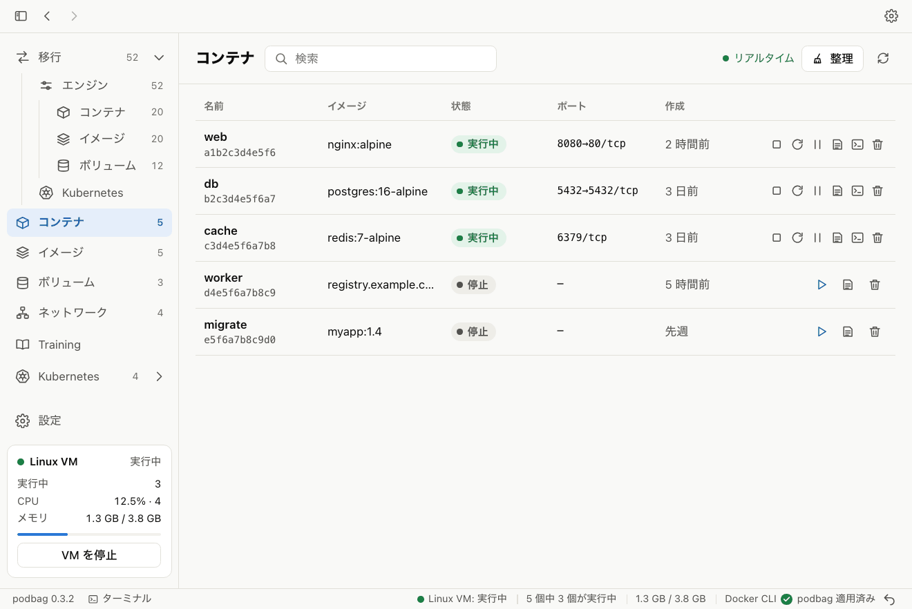
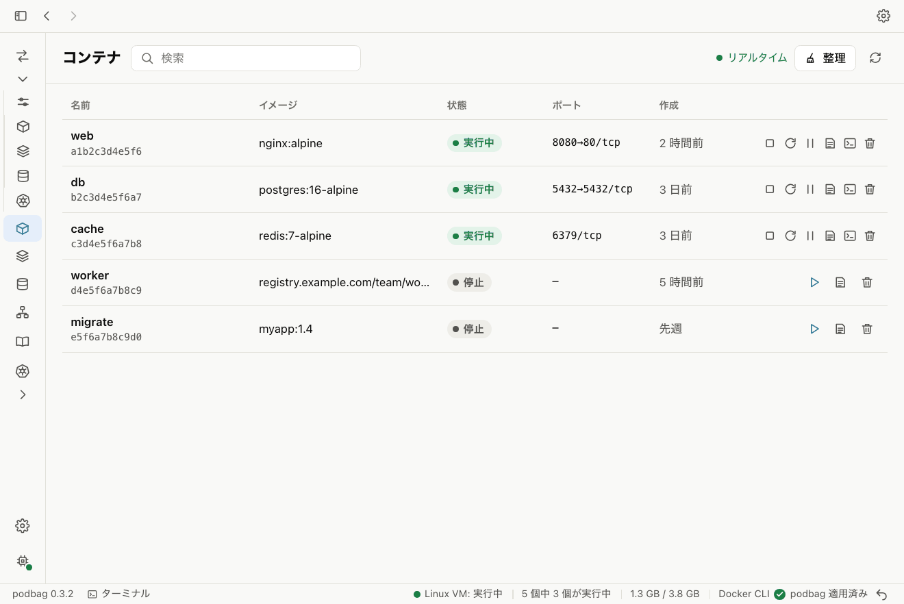

Podbag Desktop は podbag のアプリです。コンテナ、イメージ、ボリューム、ネットワークをウィンドウに表示し、マウスやキーボードで操作します。Linux と macOS で動きます。Windows のサポートは試験段階で、WSL 2 が必要です。

**所要時間** 5 分。

## アプリをインストールする

[最新リリース](https://github.com/SteelCrab/podbag/releases/latest)から、お使いのシステムに合うパッケージを入手します。

- **macOS:** `podbag-desktop-aarch64-macos.zip`（Apple silicon）または `podbag-desktop-x86_64-macos.zip`（Intel）を展開します。`podbag.app` をアプリケーションフォルダーに移動して開きます。
- **Linux:** Debian や Ubuntu では `.deb` を、Fedora では `.rpm` をインストールします。パッケージにはエンジンが含まれます。
- **Windows:** お使いの CPU に合う `.msi` を実行します。コンテナを実行するには、WSL 2 をオンにします。

アプリには CLI が含まれます。ターミナルで `podbag` コマンドが見つからないときは、アプリがインストールを提案します。あとで**設定** › **ターミナルコマンド**からインストールすることもできます。

## 画面を読む

- **サイドバー:** **移行**、**コンテナ**、**イメージ**、**ボリューム**、**ネットワーク**、**Training**、**Kubernetes**、**設定**のページがあります。ページの横の数字は、項目の数です。
- **Linux VM:** macOS と Windows では、サイドバーの下のカードに、VM の状態、実行中のコンテナ、CPU、メモリが表示されます。**VM を停止**と**VMを開始**で、VM を停止、開始します。
- **一覧:** 開いているページの項目です。行の右端のボタンは、その項目を操作します。ボタンにポインターを置くと、名前が表示されます。行をクリックすると、詳細が開きます。
- **一覧の上:** ページの名前、**検索**、**整理**などのページのボタンがあります。**リアルタイム**は、アプリがエンジンのイベントを受け取っているという意味です。イベントがないときは、アプリが数秒ごとに一覧を読み直します。
- **ステータスバー:** podbag のバージョン、**ターミナル**、VM の状態、実行中のコンテナ、メモリ、**Docker CLI** があります。**Docker CLI** は、`docker` コマンドの行き先を表示します。バージョンをクリックすると、**アップデート**が開きます。**ターミナル**をクリックすると、ターミナルが開きます。

## 移動する

| macOS | Linux と Windows | 動作 |
|---|---|---|
| `⌘F` または `⌘K` | `Ctrl+F` または `Ctrl+K` | 一覧を検索します |
| `⌘[` `⌘]` | `Alt+←` `Alt+→` | 開いたページの間を戻る、または進みます |
| `Esc` | `Esc` | 詳細を閉じます |
| `⌘⇧P` | `Ctrl+Shift+P` | どのページからでもイメージを取得します |
| `⌘,` | `Ctrl+,` | **設定**を開きます |
| `⌃⌘S` | `Ctrl+B` | サイドバーを隠す、または表示します |

戻る矢印と進む矢印は、左上にもあります。マウスの戻るボタンと進むボタンも使えます。検索は、名前、イメージ、状態、ポート、ID を対象にします。

## サイドバーを小さくする

左上のサイドバーボタンをクリックします。サイドバーにアイコンだけが表示されます。アイコンにポインターを置くと、名前が表示されます。もう一度ボタンをクリックすると、名前が表示されます。

サイドバーと一覧の間の線をドラッグすると、サイドバーを狭くしたり広くしたりできます。アプリはこの選択を覚えます。

## 次へ

コンテナの一覧で[コンテナを管理する](../gui-containers/)。
