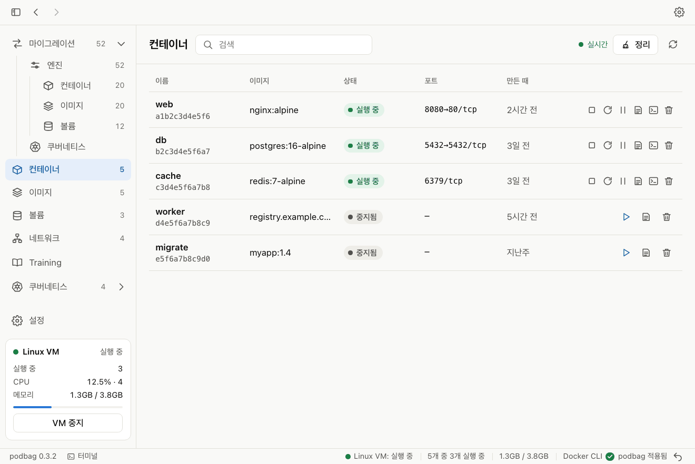
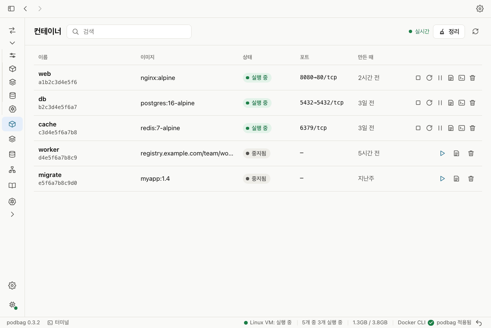

Podbag Desktop은 podbag의 앱입니다. 컨테이너, 이미지, 볼륨, 네트워크를 창에 보여주고, 마우스나 키보드로 다룹니다. Linux와 macOS에서 실행됩니다. Windows 지원은 시험 단계이고 WSL 2가 필요합니다.

**예상 시간** 5분.

## 앱 설치하기

[최신 릴리스](https://github.com/SteelCrab/podbag/releases/latest)에서 내 시스템에 맞는 패키지를 받습니다.

- **macOS:** `podbag-desktop-aarch64-macos.zip`(Apple silicon) 또는 `podbag-desktop-x86_64-macos.zip`(Intel)의 압축을 풉니다. `podbag.app`을 응용 프로그램 폴더로 옮기고 엽니다.
- **Linux:** Debian이나 Ubuntu에서는 `.deb`를, Fedora에서는 `.rpm`을 설치합니다. 패키지에 엔진이 들어 있습니다.
- **Windows:** CPU에 맞는 `.msi`를 실행합니다. 컨테이너를 실행하려면 WSL 2를 켭니다.

앱에는 CLI가 들어 있습니다. 터미널에서 `podbag` 명령을 찾지 못하면, 앱이 명령 설치를 제안합니다. 나중에 **설정** › **터미널 명령**에서 설치할 수도 있습니다.

## 창 읽기

- **사이드바:** **마이그레이션**, **컨테이너**, **이미지**, **볼륨**, **네트워크**, **Training**, **쿠버네티스**, **설정** 페이지가 있습니다. 페이지 옆의 숫자는 항목 수입니다.
- **Linux VM:** macOS와 Windows에서는 사이드바 아래쪽 카드에 VM 상태, 실행 중인 컨테이너, CPU, 메모리가 보입니다. **VM 중지**와 **VM 시작**으로 VM을 멈추고 시작합니다.
- **목록:** 열린 페이지의 항목입니다. 줄 끝의 버튼은 그 항목에 작업합니다. 버튼 위에 포인터를 올리면 이름이 보입니다. 줄을 클릭하면 상세 정보가 열립니다.
- **목록 위쪽:** 페이지 이름, **검색**, **정리** 같은 페이지 버튼이 있습니다. **실시간**은 앱이 엔진의 이벤트를 받는다는 뜻입니다. 이벤트가 없으면 앱은 몇 초마다 목록을 읽습니다.
- **상태 표시줄:** podbag 버전, **터미널**, VM 상태, 실행 중인 컨테이너, 메모리, **Docker CLI**가 있습니다. **Docker CLI**는 `docker` 명령이 어디로 가는지 보여줍니다. 버전을 클릭하면 **업데이트**가 열립니다. **터미널**을 클릭하면 터미널이 열립니다.

## 이동하기

| macOS | Linux와 Windows | 하는 일 |
|---|---|---|
| `⌘F` 또는 `⌘K` | `Ctrl+F` 또는 `Ctrl+K` | 목록 검색 |
| `⌘[` `⌘]` | `Alt+←` `Alt+→` | 연 페이지를 따라 뒤로 또는 앞으로 이동 |
| `Esc` | `Esc` | 상세 정보 닫기 |
| `⌘⇧P` | `Ctrl+Shift+P` | 어느 페이지에서나 이미지 받기 |
| `⌘,` | `Ctrl+,` | **설정** 열기 |
| `⌃⌘S` | `Ctrl+B` | 사이드바 숨기기 또는 보이기 |

뒤로와 앞으로 화살표는 왼쪽 위에도 있습니다. 마우스의 뒤로, 앞으로 버튼도 됩니다. 검색은 이름, 이미지, 상태, 포트, ID에서 찾습니다.

## 사이드바 줄이기

왼쪽 위의 사이드바 버튼을 클릭합니다. 그러면 사이드바에 아이콘만 보입니다. 아이콘 위에 포인터를 올리면 이름이 보입니다. 버튼을 다시 클릭하면 이름이 보입니다.

사이드바와 목록 사이의 선을 끌면 사이드바가 좁아지거나 넓어집니다. 앱은 이 선택을 기억합니다.

## 다음

컨테이너 목록에서 [컨테이너 다루기](../gui-containers/).
