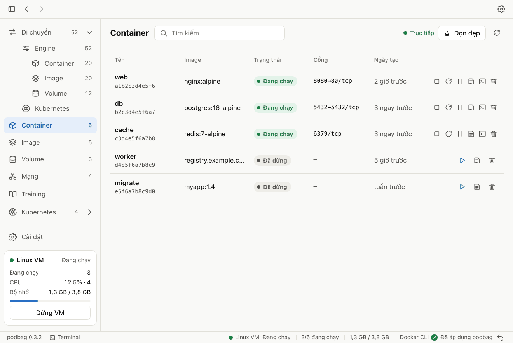
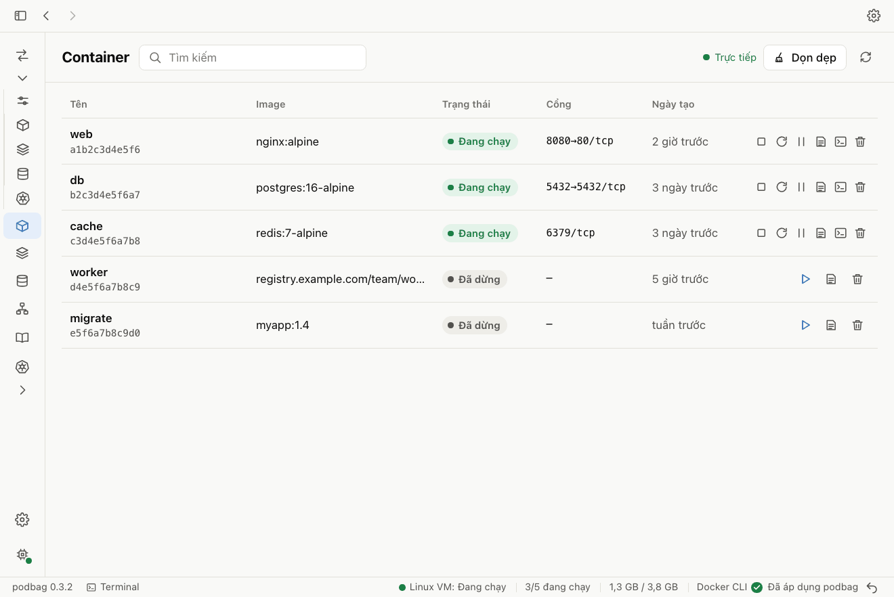

Podbag Desktop là ứng dụng của podbag. Ứng dụng hiện container, image, volume và mạng của bạn trong một cửa sổ. Bạn thao tác với chúng bằng chuột hoặc bàn phím. Ứng dụng chạy trên Linux và macOS. Hỗ trợ Windows đang ở giai đoạn thử nghiệm và cần WSL 2.

**Thời gian** 5 phút.

## Cài ứng dụng

Tải gói cho hệ thống của bạn từ [bản phát hành mới nhất](https://github.com/SteelCrab/podbag/releases/latest).

- **macOS:** giải nén `podbag-desktop-aarch64-macos.zip` (Apple silicon) hoặc `podbag-desktop-x86_64-macos.zip` (Intel). Chuyển `podbag.app` vào thư mục Applications rồi mở nó.
- **Linux:** cài gói `.deb` trên Debian hoặc Ubuntu, hoặc gói `.rpm` trên Fedora. Gói có sẵn engine.
- **Windows:** chạy tệp `.msi` cho CPU của bạn. Bật WSL 2 để chạy container.

Ứng dụng có sẵn CLI. Khi terminal không tìm thấy lệnh `podbag`, ứng dụng đề nghị cài lệnh này. Bạn cũng có thể cài sau trong **Cài đặt** › **Lệnh terminal**.

## Đọc cửa sổ

- **Thanh bên:** các trang **Di chuyển**, **Container**, **Image**, **Volume**, **Mạng**, **Training**, **Kubernetes** và **Cài đặt**. Con số cạnh một trang là số mục của trang đó.
- **Linux VM:** trên macOS và Windows, một thẻ ở cuối thanh bên hiện trạng thái VM, các container đang chạy, CPU và bộ nhớ. **Dừng VM** dừng VM. **Bật VM** bật VM.
- **Danh sách:** các mục của trang đang mở. Các nút ở cuối một dòng thao tác với mục đó. Đặt con trỏ lên một nút để xem tên nút. Nhấp vào một dòng để mở chi tiết.
- **Phía trên danh sách:** tên trang, **Tìm kiếm** và các nút của trang, ví dụ **Dọn dẹp**. **Trực tiếp** nghĩa là ứng dụng nhận sự kiện từ engine. Khi không có sự kiện, ứng dụng đọc lại các danh sách sau mỗi vài giây.
- **Thanh trạng thái:** phiên bản podbag, **Terminal**, trạng thái VM, các container đang chạy, bộ nhớ và **Docker CLI**. **Docker CLI** cho biết lệnh `docker` gửi tới đâu. Nhấp vào phiên bản để mở **Cập nhật**. Nhấp vào **Terminal** để mở terminal.

## Di chuyển

| macOS | Linux và Windows | Tác dụng |
|---|---|---|
| `⌘F` hoặc `⌘K` | `Ctrl+F` hoặc `Ctrl+K` | Tìm trong danh sách |
| `⌘[` `⌘]` | `Alt+←` `Alt+→` | Lùi lại hoặc tiến tới giữa các trang bạn đã mở |
| `Esc` | `Esc` | Đóng chi tiết |
| `⌘⇧P` | `Ctrl+Shift+P` | Tải image, từ bất kỳ trang nào |
| `⌘,` | `Ctrl+,` | Mở **Cài đặt** |
| `⌃⌘S` | `Ctrl+B` | Ẩn hoặc hiện thanh bên |

Mũi tên lùi và tiến cũng có ở góc trên bên trái. Nút lùi và tiến của chuột cũng dùng được. Tìm kiếm xét tên, image, trạng thái, cổng và ID.

## Thu nhỏ thanh bên

Nhấp vào nút thanh bên ở góc trên bên trái. Khi đó, thanh bên chỉ hiện biểu tượng. Đặt con trỏ lên một biểu tượng để xem tên của nó. Nhấp vào nút một lần nữa để hiện lại các tên.

Kéo đường kẻ giữa thanh bên và danh sách để làm thanh bên hẹp hơn hoặc rộng hơn. Ứng dụng nhớ lựa chọn của bạn.

## Tiếp theo

[Quản lý container](../gui-containers/) trong danh sách Container.
