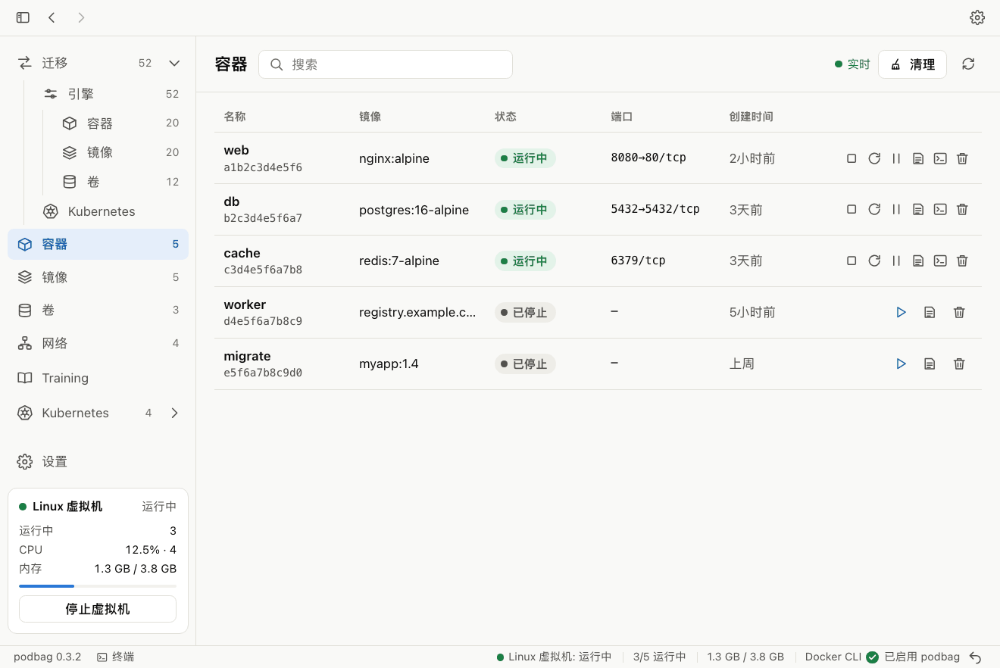
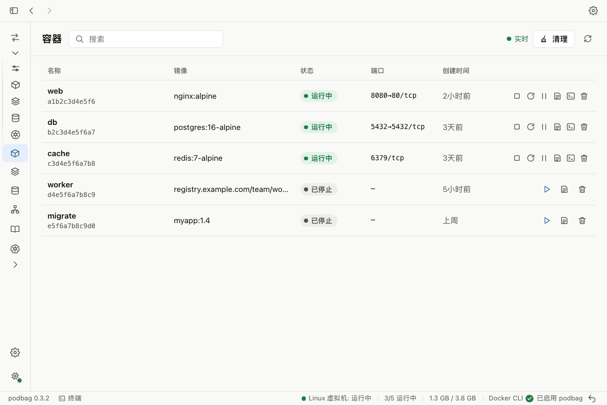

Podbag Desktop 是 podbag 的应用。它在窗口中显示你的容器、镜像、卷和网络，你可以用鼠标或键盘操作它们。它可以在 Linux 和 macOS 上运行。Windows 支持还处于试验阶段，需要 WSL 2。

**预计用时** 5 分钟。

## 安装应用

从[最新版本](https://github.com/SteelCrab/podbag/releases/latest)下载适合你系统的安装包。

- **macOS：** 解压 `podbag-desktop-aarch64-macos.zip`（Apple 芯片）或 `podbag-desktop-x86_64-macos.zip`（Intel）。把 `podbag.app` 移到“应用程序”文件夹，然后打开它。
- **Linux：** 在 Debian 或 Ubuntu 上安装 `.deb`，在 Fedora 上安装 `.rpm`。安装包中包含引擎。
- **Windows：** 运行适合你 CPU 的 `.msi`。要运行容器，请开启 WSL 2。

应用中包含 CLI。如果终端找不到 `podbag` 命令，应用会提出为你安装。你也可以以后在**设置** › **终端命令**中安装。

## 读懂窗口

- **侧边栏：** 包含**迁移**、**容器**、**镜像**、**卷**、**网络**、**Training**、**Kubernetes** 和**设置**页面。页面旁边的数字是它的项目数量。
- **Linux 虚拟机：** 在 macOS 和 Windows 上，侧边栏底部的卡片显示 VM 的状态、运行中的容器、CPU 和内存。**停止虚拟机**和**启动虚拟机**用来停止和启动 VM。
- **列表：** 当前页面的项目。行末的按钮对该项目进行操作。把指针放在按钮上，可以看到按钮的名称。点击一行，可以打开它的详情。
- **列表顶部：** 页面名称、**搜索**和页面的按钮，例如**清理**。**实时**表示应用正在接收引擎的事件。没有事件时，应用每隔几秒读取一次列表。
- **状态栏：** podbag 的版本、**终端**、VM 的状态、运行中的容器、内存和 **Docker CLI**。**Docker CLI** 显示 `docker` 命令发往哪里。点击版本号可以打开**更新**。点击**终端**可以打开终端。

## 移动

| macOS | Linux 和 Windows | 作用 |
|---|---|---|
| `⌘F` 或 `⌘K` | `Ctrl+F` 或 `Ctrl+K` | 搜索列表 |
| `⌘[` `⌘]` | `Alt+←` `Alt+→` | 在打开过的页面之间后退或前进 |
| `Esc` | `Esc` | 关闭详情 |
| `⌘⇧P` | `Ctrl+Shift+P` | 在任意页面拉取镜像 |
| `⌘,` | `Ctrl+,` | 打开**设置** |
| `⌃⌘S` | `Ctrl+B` | 隐藏或显示侧边栏 |

左上角也有后退和前进箭头。鼠标的后退键和前进键同样可用。搜索会查找名称、镜像、状态、端口和 ID。

## 缩小侧边栏

点击左上角的侧边栏按钮。侧边栏就只显示图标。把指针放在图标上，可以看到它的名称。再次点击这个按钮，名称会重新显示。

拖动侧边栏和列表之间的分隔线，可以让侧边栏变窄或变宽。应用会记住你的选择。

## 下一步

在容器列表中[管理容器](../gui-containers/)。
