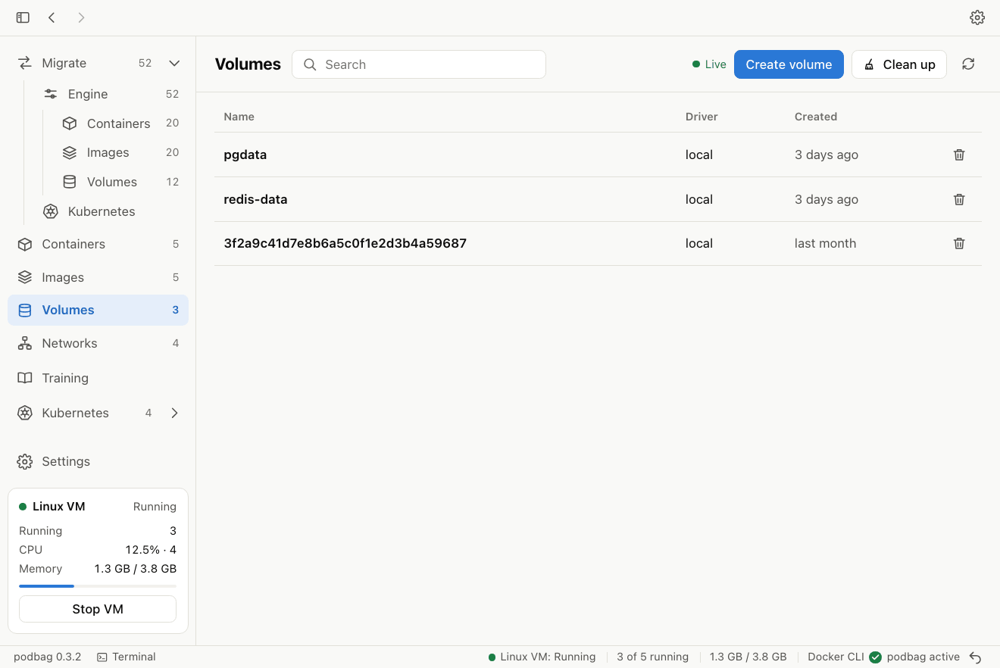
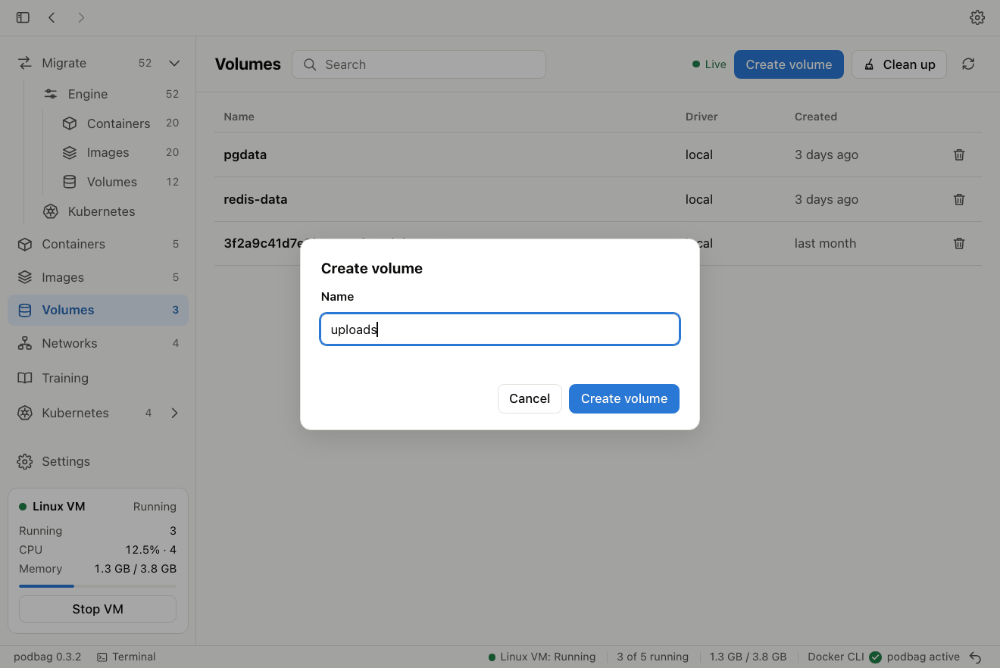
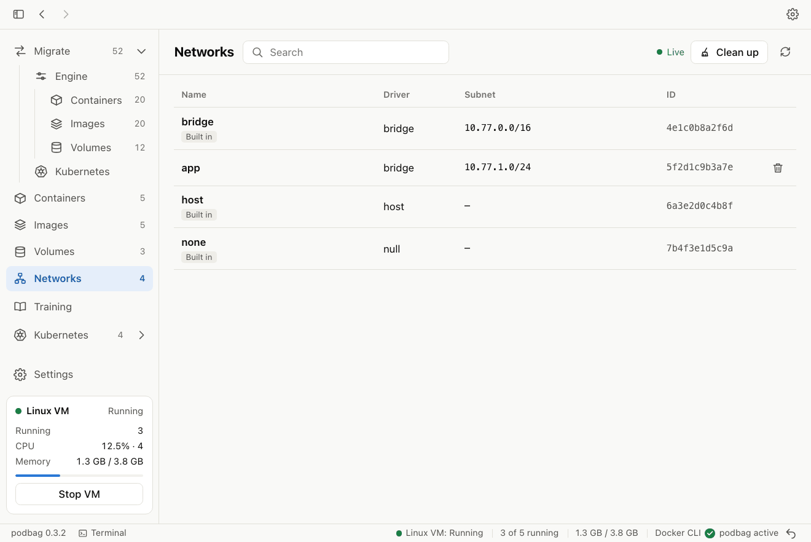

Volumes keep data after a container is removed. Networks connect containers. Podbag Desktop shows both in the sidebar.

**Time** 5 minutes.

## See the volumes

Open **Volumes**. The list shows each volume's name, driver and creation time.



Click a volume to see its path in the engine.

## Create a volume

1. Click **Create volume**.
2. Type a name, for example `uploads`.
3. Click **Create volume**.



The new volume shows in the list.

## Remove volumes

- **Remove** removes a volume and its data. The app asks first.
- **Clean up** removes all volumes that no container uses. Their data is lost. The app asks first.

## See the networks

Open **Networks**. The list shows each network's name, driver, subnet and ID. `bridge`, `host` and `none` are built in. They have no **Remove** button.



Click a network to see its subnet, gateway and scope.

## Remove networks

- **Remove** removes a network that you made. The app asks first.
- **Clean up** removes all networks that no container uses.

To make a network, use the CLI:

```sh
podbag network create app-net
```

## Next

[Engines, the docker command and migration](../gui-engines/).
