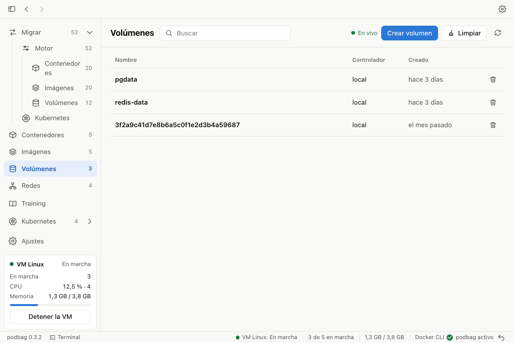
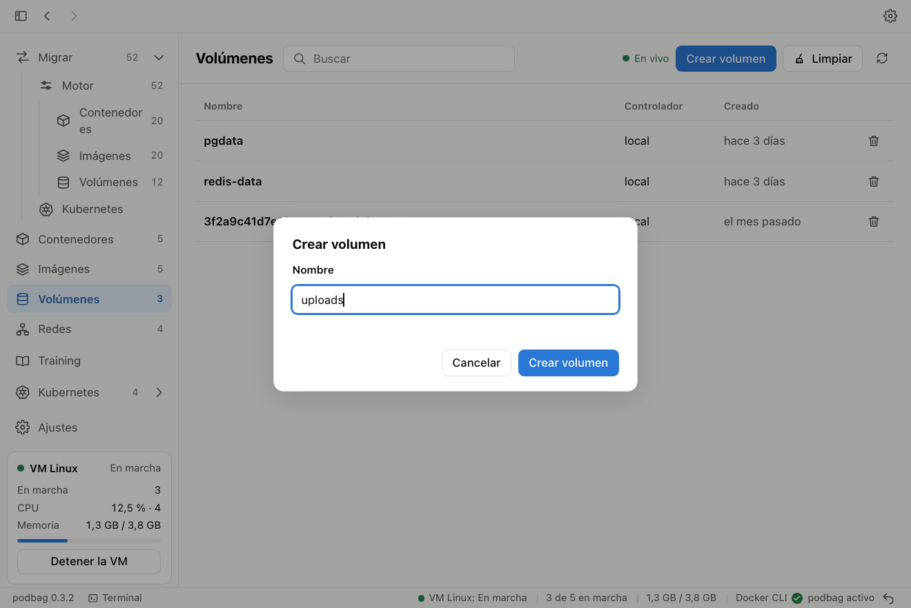
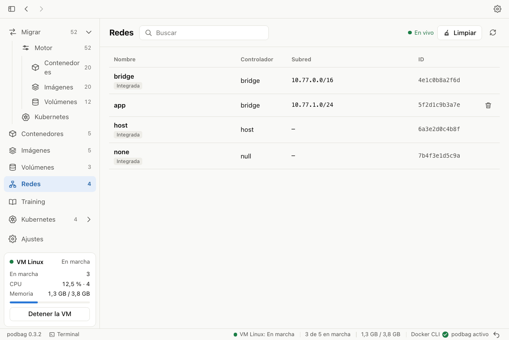

Los volúmenes guardan datos después de eliminar un contenedor. Las redes conectan contenedores. Podbag Desktop muestra los dos en la barra lateral.

**Tiempo** 5 minutos.

## Mira los volúmenes

Abre **Volúmenes**. La lista muestra el nombre, el controlador y la fecha de creación de cada volumen.



Haz clic en un volumen para ver su ruta en el motor.

## Crea un volumen

1. Haz clic en **Crear volumen**.
2. Escribe un nombre, por ejemplo `uploads`.
3. Haz clic en **Crear volumen**.



El volumen nuevo aparece en la lista.

## Elimina volúmenes

- **Eliminar** elimina un volumen y sus datos. La app pregunta antes.
- **Limpiar** elimina todos los volúmenes que ningún contenedor usa. Sus datos se pierden. La app pregunta antes.

## Mira las redes

Abre **Redes**. La lista muestra el nombre, el controlador, la subred y el ID de cada red. `bridge`, `host` y `none` están integradas. No tienen botón **Eliminar**.



Haz clic en una red para ver su subred, su puerta de enlace y su ámbito.

## Elimina redes

- **Eliminar** elimina una red que creaste. La app pregunta antes.
- **Limpiar** elimina todas las redes que ningún contenedor usa.

Para crear una red, usa la CLI:

```sh
podbag network create app-net
```

## Siguiente

[Motores, el comando docker y la migración](../gui-engines/).
