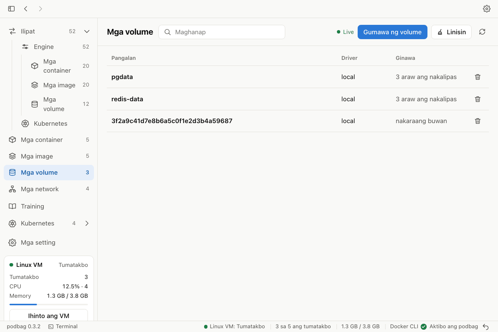
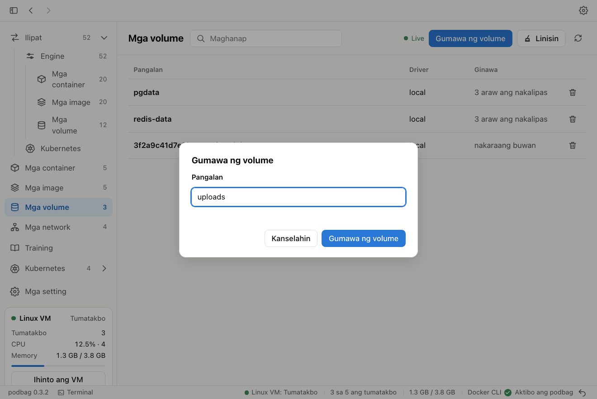
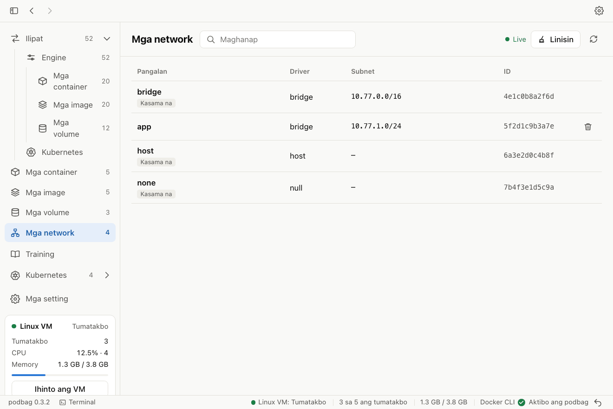

Pinapanatili ng mga volume ang data kahit naalis na ang container. Pinagkakabit ng mga network ang mga container. Ipinapakita ng Podbag Desktop ang dalawa sa sidebar.

**Oras** 5 minuto.

## Tingnan ang mga volume

Buksan ang **Mga volume**. Ipinapakita ng listahan ang pangalan, driver at oras ng pagkagawa ng bawat volume.



I-click ang volume para makita ang path nito sa engine.

## Gumawa ng volume

1. I-click ang **Gumawa ng volume**.
2. Mag-type ng pangalan, halimbawa `uploads`.
3. I-click ang **Gumawa ng volume**.



Lumalabas ang bagong volume sa listahan.

## Alisin ang mga volume

- Inaalis ng **Alisin** ang volume at ang data nito. Nagtatanong muna ang app.
- Inaalis ng **Linisin** ang lahat ng volume na hindi ginagamit ng anumang container. Mawawala ang data nila. Nagtatanong muna ang app.

## Tingnan ang mga network

Buksan ang **Mga network**. Ipinapakita ng listahan ang pangalan, driver, subnet at ID ng bawat network. Kasama na sa engine ang `bridge`, `host` at `none`. Wala silang button na **Alisin**.



I-click ang network para makita ang subnet, gateway at saklaw nito.

## Alisin ang mga network

- Inaalis ng **Alisin** ang network na ginawa mo. Nagtatanong muna ang app.
- Inaalis ng **Linisin** ang lahat ng network na hindi ginagamit ng anumang container.

Para gumawa ng network, gamitin ang CLI:

```sh
podbag network create app-net
```

## Susunod

[Mga engine, ang docker command at paglilipat](../gui-engines/).
