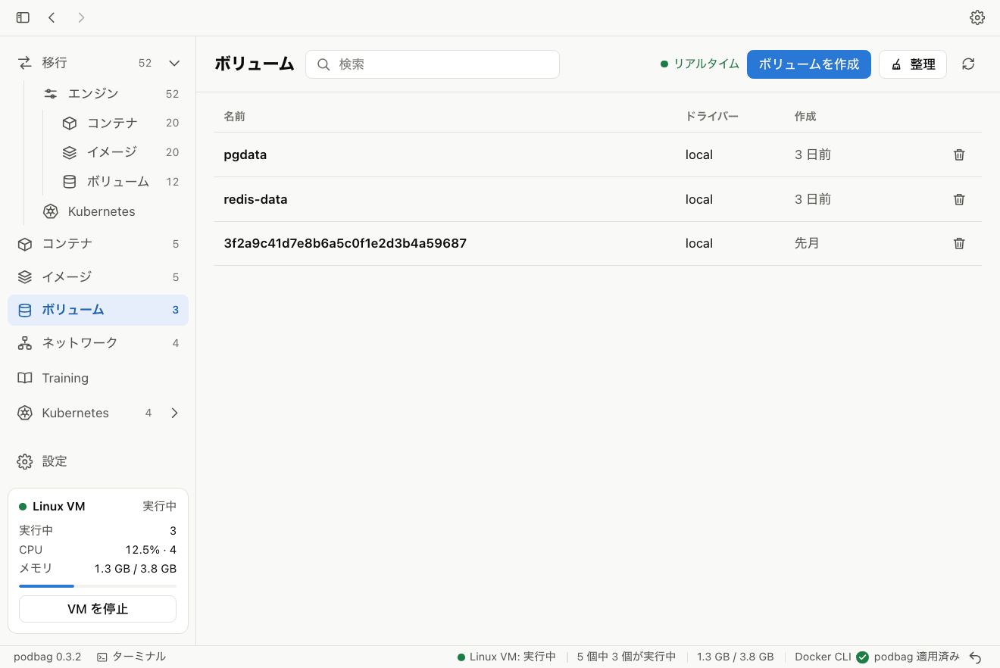
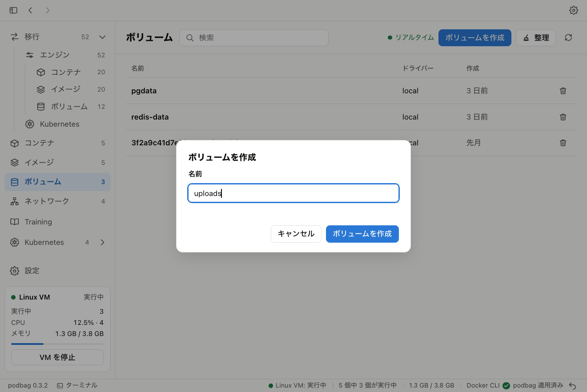
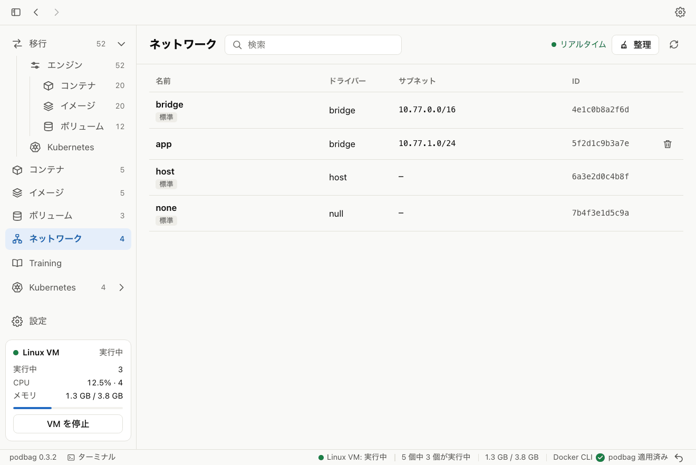

ボリュームは、コンテナを削除したあともデータを残します。ネットワークは、コンテナどうしをつなぎます。Podbag Desktop は、どちらもサイドバーに表示します。

**所要時間** 5 分。

## ボリュームを見る

**ボリューム**を開きます。一覧には、ボリュームごとに名前、ドライバー、作成日時が表示されます。



ボリュームをクリックすると、エンジン内のパスが表示されます。

## ボリュームを作成する

1. **ボリュームを作成**をクリックします。
2. 名前を入力します。例: `uploads`。
3. **ボリュームを作成**をクリックします。



新しいボリュームが一覧に表示されます。

## ボリュームを削除する

- **削除**は、ボリュームとそのデータを削除します。アプリは先に確認します。
- **整理**は、どのコンテナも使っていないボリュームをすべて削除します。そのデータは消えます。アプリは先に確認します。

## ネットワークを見る

**ネットワーク**を開きます。一覧には、ネットワークごとに名前、ドライバー、サブネット、ID が表示されます。`bridge`、`host`、`none` は標準のネットワークです。これらには**削除**ボタンがありません。



ネットワークをクリックすると、サブネット、ゲートウェイ、スコープが表示されます。

## ネットワークを削除する

- **削除**は、自分で作成したネットワークを削除します。アプリは先に確認します。
- **整理**は、どのコンテナも使っていないネットワークをすべて削除します。

ネットワークを作成するには、CLI を使います。

```sh
podbag network create app-net
```

## 次へ

[エンジン、docker コマンド、移行](../gui-engines/)。
