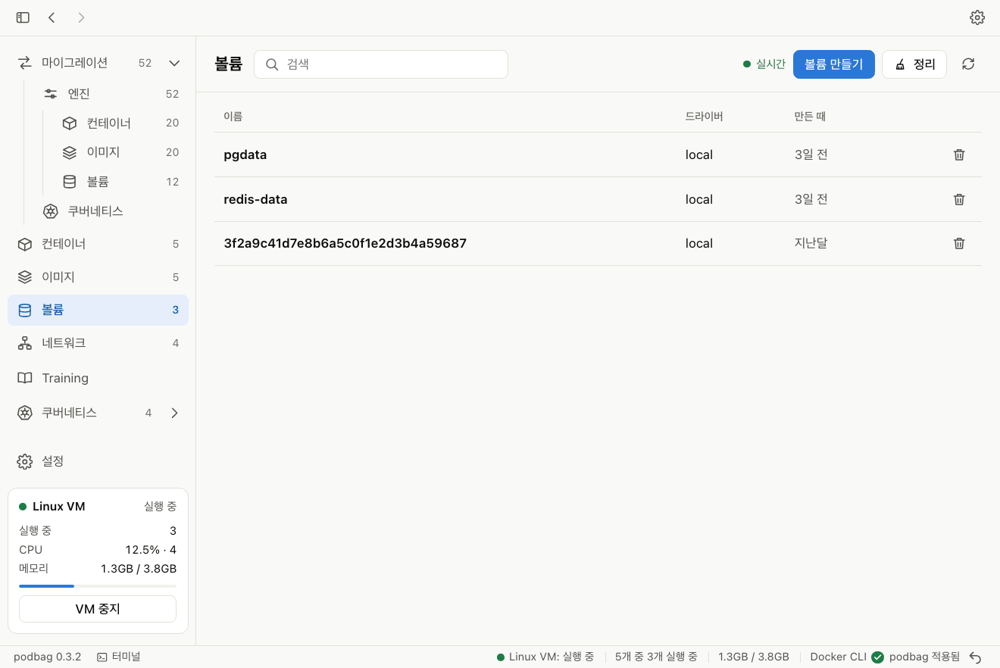
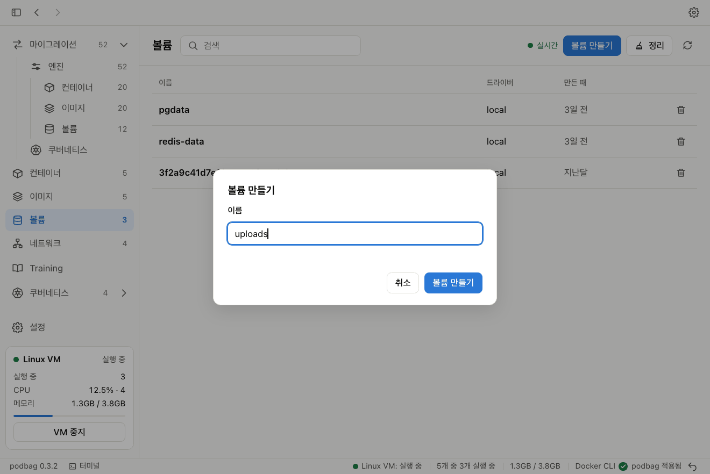
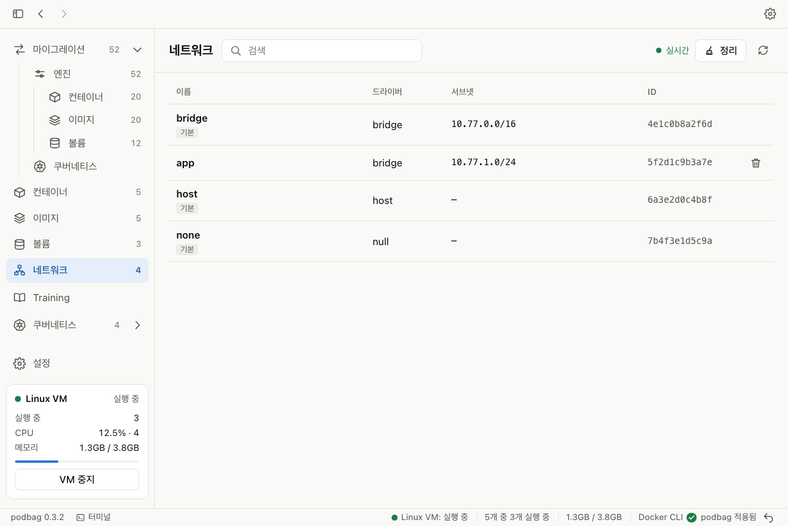

볼륨은 컨테이너를 삭제한 뒤에도 데이터를 남깁니다. 네트워크는 컨테이너를 서로 연결합니다. Podbag Desktop은 둘 다 사이드바에 보여줍니다.

**예상 시간** 5분.

## 볼륨 보기

**볼륨**을 엽니다. 목록에는 볼륨마다 이름, 드라이버, 만든 시간이 보입니다.



볼륨을 클릭하면 엔진 안의 경로가 보입니다.

## 볼륨 만들기

1. **볼륨 만들기**를 클릭합니다.
2. 이름을 입력합니다. 예: `uploads`.
3. **볼륨 만들기**를 클릭합니다.



새 볼륨이 목록에 보입니다.

## 볼륨 삭제하기

- **삭제**는 볼륨과 그 데이터를 삭제합니다. 앱이 먼저 묻습니다.
- **정리**는 어떤 컨테이너도 쓰지 않는 볼륨을 모두 삭제합니다. 그 데이터는 사라집니다. 앱이 먼저 묻습니다.

## 네트워크 보기

**네트워크**를 엽니다. 목록에는 네트워크마다 이름, 드라이버, 서브넷, ID가 보입니다. `bridge`, `host`, `none`은 기본 네트워크입니다. **삭제** 버튼이 없습니다.



네트워크를 클릭하면 서브넷, 게이트웨이, 범위가 보입니다.

## 네트워크 삭제하기

- **삭제**는 직접 만든 네트워크를 삭제합니다. 앱이 먼저 묻습니다.
- **정리**는 어떤 컨테이너도 쓰지 않는 네트워크를 모두 삭제합니다.

네트워크를 만들 때는 CLI를 씁니다.

```sh
podbag network create app-net
```

## 다음

[엔진, docker 명령, 마이그레이션](../gui-engines/).
