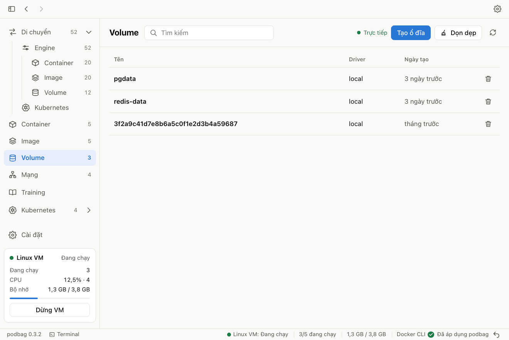
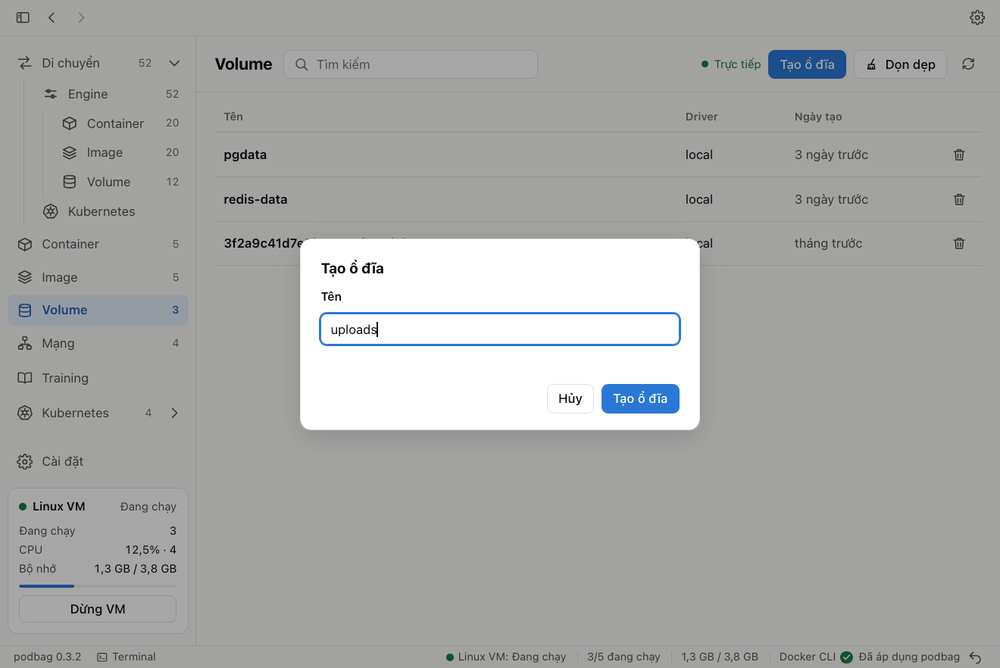
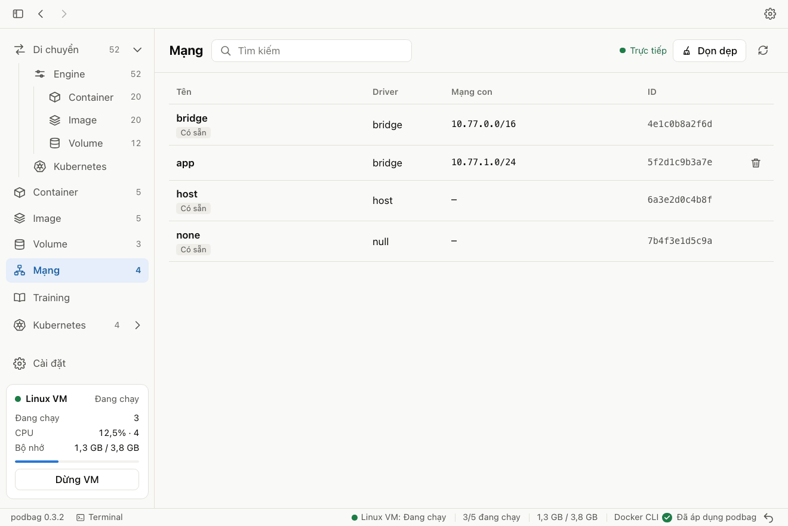

Volume giữ dữ liệu sau khi container bị xóa. Mạng kết nối các container với nhau. Podbag Desktop hiện cả hai trên thanh bên.

**Thời gian** 5 phút.

## Xem các volume

Mở **Volume**. Danh sách hiện tên, driver và ngày tạo của mỗi volume.



Nhấp vào một volume để xem đường dẫn của nó trong engine.

## Tạo volume

1. Nhấp vào **Tạo ổ đĩa**.
2. Gõ một tên, ví dụ `uploads`.
3. Nhấp vào **Tạo ổ đĩa**.



Volume mới hiện trong danh sách.

## Xóa volume

- **Xóa** xóa một volume và dữ liệu của nó. Ứng dụng hỏi trước.
- **Dọn dẹp** xóa tất cả volume không có container nào dùng. Dữ liệu của chúng sẽ mất. Ứng dụng hỏi trước.

## Xem các mạng

Mở **Mạng**. Danh sách hiện tên, driver, mạng con và ID của mỗi mạng. `bridge`, `host` và `none` là mạng có sẵn. Chúng không có nút **Xóa**.



Nhấp vào một mạng để xem mạng con, cổng mạng và phạm vi của nó.

## Xóa mạng

- **Xóa** xóa một mạng do bạn tạo. Ứng dụng hỏi trước.
- **Dọn dẹp** xóa tất cả mạng không có container nào dùng.

Để tạo mạng, hãy dùng CLI:

```sh
podbag network create app-net
```

## Tiếp theo

[Engine, lệnh docker và di chuyển](../gui-engines/).
