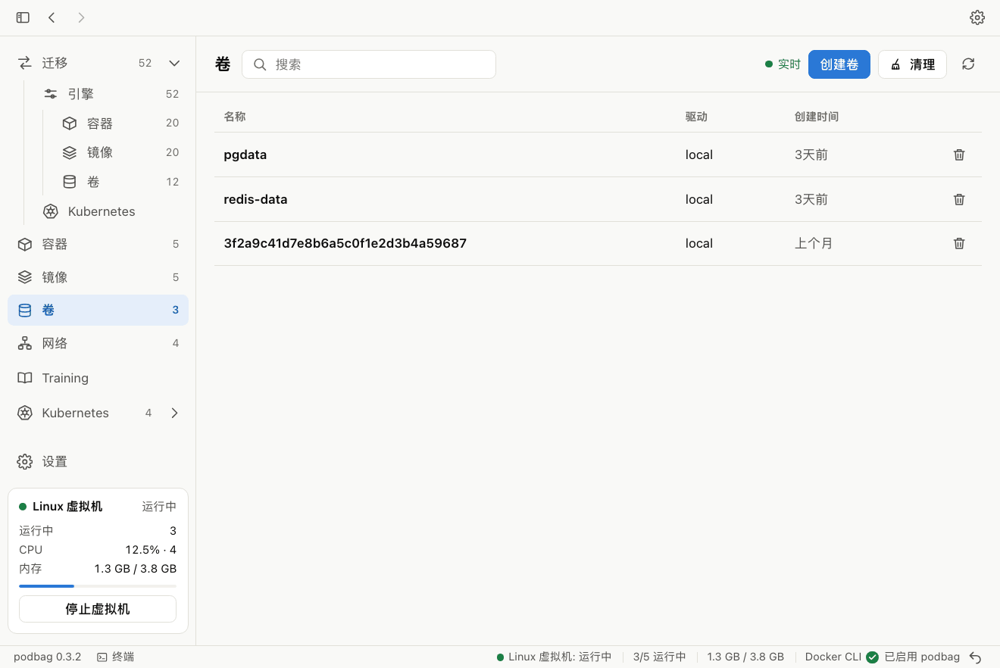
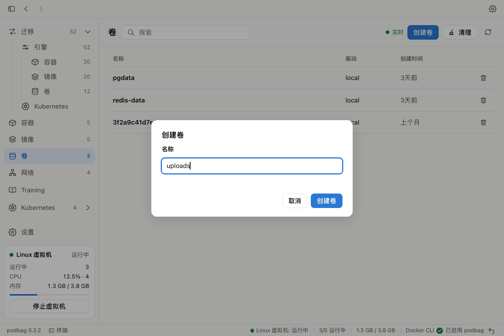
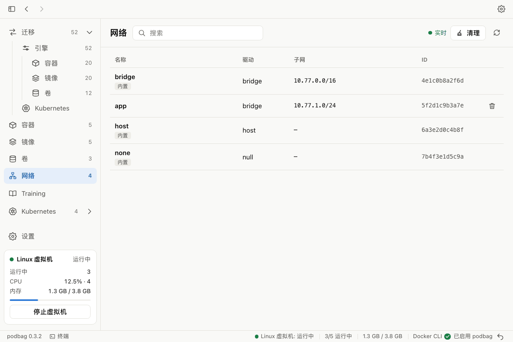

删除容器后，卷仍会保留数据。网络把容器连接起来。Podbag Desktop 在侧边栏中显示这两者。

**预计用时** 5 分钟。

## 查看卷

打开**卷**。列表显示每个卷的名称、驱动和创建时间。



点击一个卷，可以看到它在引擎中的路径。

## 创建卷

1. 点击**创建卷**。
2. 输入名称，例如 `uploads`。
3. 点击**创建卷**。



新的卷会出现在列表中。

## 删除卷

- **删除**会删除卷及其数据。应用会先询问你。
- **清理**会删除所有没有容器使用的卷。这些卷的数据会丢失。应用会先询问你。

## 查看网络

打开**网络**。列表显示每个网络的名称、驱动、子网和 ID。`bridge`、`host` 和 `none` 是内置网络。它们没有**删除**按钮。



点击一个网络，可以看到它的子网、网关和范围。

## 删除网络

- **删除**会删除你创建的网络。应用会先询问你。
- **清理**会删除所有没有容器使用的网络。

要创建网络，请使用 CLI：

```sh
podbag network create app-net
```

## 下一步

[引擎、docker 命令和迁移](../gui-engines/)。
