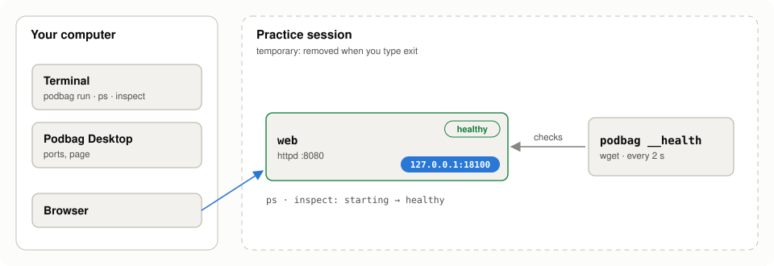

A running container is not always a working one. A health check is a command that Podbag runs inside the container again and again. If it succeeds, the container is healthy. In this module, you give a small web server a health check and watch its health.

**Time** 10 minutes.



## Start the module

Open **Training** in Podbag Desktop and select **Check that a web server is healthy**. New modules appear after **Refresh**. Or run this command in a terminal:

```sh
podbag lab start health-checks
```

You need a Podbag build with the Training catalog (after v0.3.2). Continue at the `training $` prompt.

To do the steps in the TUI instead of Podbag Desktop, add `--tui`.

```sh
podbag lab start health-checks --tui
```

In the TUI, press `:` to open the training shell for a command step, type `exit` to return to the TUI, and press `q` to end the session.

## Run a web server with a health check

Run a web server named `web`. It serves the text `Hello from web` on port `8080`. Use the port shown in Training if the default `18100` is already in use.

```sh
podbag run -d --name web -p 127.0.0.1:18100:8080 --health-cmd 'wget -q -O /dev/null http://127.0.0.1:8080/' --health-interval 2s --health-timeout 1s --health-retries 3 docker.io/library/busybox:1.37.0 sh -c 'mkdir -p /www && printf "%s\n" "Hello from web" > /www/index.html && exec httpd -f -p 8080 -h /www'
```

The health options:

- `--health-cmd` is the check. Here `wget` asks the server for its page. It succeeds when the server answers.
- `--health-interval 2s` runs the check every 2 seconds.
- `--health-timeout 1s` stops a check that runs longer than 1 second.
- `--health-retries 3` makes the container unhealthy after 3 failed checks in a row.

No process waits between the checks. When a check is due, Podbag starts `podbag __health`. It runs the check, keeps the last five results, and stops. Podbag waits until `web` is healthy.

## See the health in ps

```sh
podbag ps
```

The status of `web` ends with `(healthy)`. Right after the start, it shows `(health: starting)`. Podbag checks for `(healthy)`.

## Read the check results with inspect

```sh
podbag inspect web
```

The `health` part shows `"status": "healthy"`, the number of failed checks in a row (`failing_streak`) and the last results in `log`. Each result has its start and end time, the exit code and the output. Podbag checks for `"status": "healthy"`.

## Open the page in Podbag Desktop

Go to **Practice containers → web → View ports**. Select **Open in browser**. The page displays **Hello from web**. Podbag checks for an HTTP 200 response and this text.

- **In Podbag Desktop:** Select **Practice containers → web → View ports**.
- **In the TUI:** Select `web` in **Containers** and press `Enter`.
- **In Podbag Desktop:** Select **Open in browser**.
- **In the TUI:** Open `http://127.0.0.1:18100/` in a browser. When the page shows, press `o`.

## Clean up and finish

Remove the container. `web` still runs, so `-f` stops it first. Then end the session.

- **In Podbag Desktop:** Select **Practice containers → web → Remove** and confirm.
- **In the TUI:** Select `web` in **Containers**, press `d`, then `y`.

```sh
podbag rm -f web
exit
```

The temporary practice resources are removed. Training shows the module as complete.
