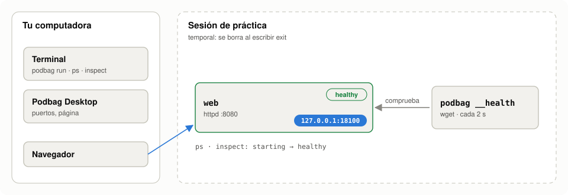

Un contenedor en ejecución no siempre funciona bien. Una comprobación de estado (health check) es un comando que Podbag ejecuta una y otra vez dentro del contenedor. Si tiene éxito, el contenedor está en buen estado (healthy). En este módulo, añades una comprobación de estado a un pequeño servidor web y observas su estado.

**Tiempo** 10 minutos.



## Inicia el módulo

Abre **Training** en Podbag Desktop y selecciona **Comprueba que un servidor web está en buen estado**. Los módulos nuevos aparecen después de **Actualizar**. O ejecuta este comando en una terminal:

```sh
podbag lab start health-checks
```

Necesitas una versión de Podbag con el catálogo de Training (posterior a v0.3.2). Continúa en el prompt `training $`.

Para hacer los pasos en la TUI en lugar de Podbag Desktop, añade `--tui`.

```sh
podbag lab start health-checks --tui
```

En la TUI, pulsa `:` para abrir la shell de Training cuando un paso pida un comando, escribe `exit` para volver a la TUI y pulsa `q` para terminar la sesión.

## Ejecuta un servidor web con una comprobación de estado

Ejecuta un servidor web llamado `web`. Sirve el texto `Hello from web` en el puerto `8080`. Si el puerto predeterminado `18100` ya está en uso, usa el puerto que indica Training.

```sh
podbag run -d --name web -p 127.0.0.1:18100:8080 --health-cmd 'wget -q -O /dev/null http://127.0.0.1:8080/' --health-interval 2s --health-timeout 1s --health-retries 3 docker.io/library/busybox:1.37.0 sh -c 'mkdir -p /www && printf "%s\n" "Hello from web" > /www/index.html && exec httpd -f -p 8080 -h /www'
```

Las opciones de la comprobación:

- `--health-cmd` es la comprobación. Aquí `wget` pide la página al servidor. Tiene éxito cuando el servidor responde.
- `--health-interval 2s` ejecuta la comprobación cada 2 segundos.
- `--health-timeout 1s` detiene una comprobación que dura más de 1 segundo.
- `--health-retries 3` marca el contenedor como unhealthy después de 3 comprobaciones fallidas seguidas.

Ningún proceso espera entre las comprobaciones. Cuando toca una comprobación, Podbag inicia `podbag __health`. Este proceso ejecuta la comprobación, guarda los últimos cinco resultados y termina. Podbag espera hasta que `web` está en buen estado.

## Mira el estado en ps

```sh
podbag ps
```

El estado de `web` termina en `(healthy)`. Justo después del inicio, muestra `(health: starting)`. Podbag busca `(healthy)`.

## Lee los resultados con inspect

```sh
podbag inspect web
```

La parte `health` muestra `"status": "healthy"`, el número de comprobaciones fallidas seguidas (`failing_streak`) y los últimos resultados en `log`. Cada resultado tiene su hora de inicio y de fin, el código de salida y la salida. Podbag busca `"status": "healthy"`.

## Abre la página en Podbag Desktop

Ve a **Contenedores de práctica → web → Ver puertos**. Selecciona **Abrir en el navegador**. La página muestra **Hello from web**. Podbag comprueba que hay una respuesta HTTP 200 y este texto.

- **En Podbag Desktop:** Selecciona **Contenedores de práctica → web → Ver puertos**.
- **En la TUI:** Selecciona `web` en **Contenedores** y pulsa `Enter`.
- **En Podbag Desktop:** Selecciona **Abrir en el navegador**.
- **En la TUI:** Abre `http://127.0.0.1:18100/` en un navegador. Cuando se vea la página, pulsa `o`.

## Limpia y termina

Elimina el contenedor. `web` sigue en ejecución, así que `-f` lo detiene primero. Luego termina la sesión.

- **En Podbag Desktop:** Selecciona **Contenedores de práctica → web → Eliminar** y confirma.
- **En la TUI:** Selecciona `web` en **Contenedores**, pulsa `d` y luego `y`.

```sh
podbag rm -f web
exit
```

Se eliminan los recursos temporales de la práctica. Training muestra el módulo como completado.
