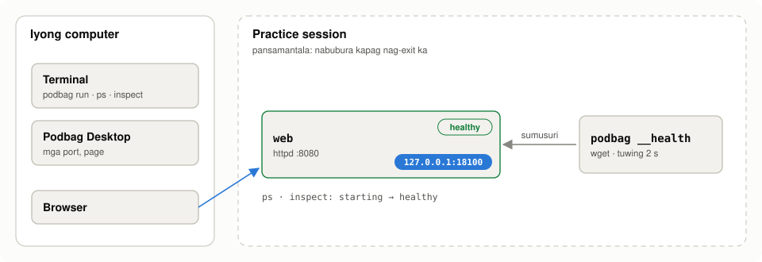

Hindi laging gumagana ang tumatakbong container. Ang health check ay command na paulit-ulit na pinapatakbo ng Podbag sa loob ng container. Kapag nagtagumpay ito, healthy ang container. Sa module na ito, bibigyan mo ng health check ang isang maliit na web server at babantayan ang health nito.

**Oras** 10 minuto.



## Simulan ang module

Buksan ang **Training** sa Podbag Desktop at piliin ang **Suriin kung healthy ang web server**. Lalabas ang mga bagong module pagkatapos ng **I-refresh**. O patakbuhin ang command na ito sa terminal:

```sh
podbag lab start health-checks
```

Kailangan mo ng build ng Podbag na may Training catalog (pagkatapos ng v0.3.2). Magpatuloy sa prompt na `training $`.

Para gawin ang mga hakbang sa TUI sa halip na sa Podbag Desktop, idagdag ang `--tui`.

```sh
podbag lab start health-checks --tui
```

Sa TUI, pindutin ang `:` para buksan ang training shell sa isang hakbang na command. I-type ang `exit` para bumalik sa TUI. Pindutin ang `q` para tapusin ang practice session.

## Magpatakbo ng web server na may health check

Magpatakbo ng web server na `web`. Inihahain nito ang text na `Hello from web` sa port na `8080`. Gamitin ang port na nasa Training kung gamit na ang default na `18100`.

```sh
podbag run -d --name web -p 127.0.0.1:18100:8080 --health-cmd 'wget -q -O /dev/null http://127.0.0.1:8080/' --health-interval 2s --health-timeout 1s --health-retries 3 docker.io/library/busybox:1.37.0 sh -c 'mkdir -p /www && printf "%s\n" "Hello from web" > /www/index.html && exec httpd -f -p 8080 -h /www'
```

Ang mga option ng health:

- Ang `--health-cmd` ang check. Dito, hinihingi ng `wget` sa server ang page nito. Nagtatagumpay ito kapag sumagot ang server.
- Pinapatakbo ng `--health-interval 2s` ang check tuwing 2 segundo.
- Inihihinto ng `--health-timeout 1s` ang check na tumatagal nang higit sa 1 segundo.
- Ginagawang unhealthy ng `--health-retries 3` ang container pagkatapos ng 3 sunod-sunod na nabigong check.

Walang prosesong naghihintay sa pagitan ng mga check. Kapag oras na ng check, sinisimulan ng Podbag ang `podbag __health`. Pinapatakbo nito ang check, itinatago ang huling limang resulta, at humihinto. Naghihintay ang Podbag hanggang maging healthy ang `web`.

## Tingnan ang health sa ps

```sh
podbag ps
```

Nagtatapos sa `(healthy)` ang status ng `web`. Pagkatapos mismo ng pagsisimula, ipinapakita nito ang `(health: starting)`. Hinahanap ng Podbag ang `(healthy)`.

## Basahin ang mga resulta ng check gamit ang inspect

```sh
podbag inspect web
```

Ipinapakita ng bahaging `health` ang `"status": "healthy"`, ang bilang ng sunod-sunod na nabigong check (`failing_streak`) at ang mga huling resulta sa `log`. May oras ng simula at pagtatapos ang bawat resulta, pati ang exit code at ang output. Hinahanap ng Podbag ang `"status": "healthy"`.

## Buksan ang page sa Podbag Desktop

Pumunta sa **Mga practice container → web → Tingnan ang mga port**. Piliin ang **Buksan sa browser**. Ipinapakita ng page ang **Hello from web**. Sinusuri ng Podbag kung may tugon na HTTP 200 at ang text na ito.

- **Sa Podbag Desktop:** Piliin ang **Mga practice container → web → Tingnan ang mga port**.
- **Sa TUI:** Piliin ang `web` sa **Mga container** at pindutin ang `Enter`.
- **Sa Podbag Desktop:** Piliin ang **Buksan sa browser**.
- **Sa TUI:** Buksan ang `http://127.0.0.1:18100/` sa browser. Kapag lumabas ang page, pindutin ang `o`.

## Maglinis at tapusin

Alisin ang container. Tumatakbo pa ang `web`, kaya inihihinto muna ito ng `-f`. Pagkatapos, tapusin ang session.

- **Sa Podbag Desktop:** Piliin ang **Mga practice container → web → Alisin** at kumpirmahin.
- **Sa TUI:** Piliin ang `web` sa **Mga container**, pindutin ang `d`, saka ang `y`.

```sh
podbag rm -f web
exit
```

Naaalis ang mga pansamantalang resource ng practice. Ipinapakita ng Training na tapos na ang module.
