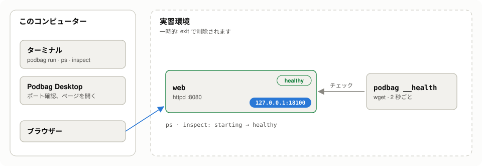

実行中のコンテナが、正しく動いているとは限りません。ヘルスチェックは、Podbag がコンテナの中で繰り返し実行するコマンドです。コマンドが成功すれば、コンテナは healthy（正常）です。このモジュールでは、小さな Web サーバーにヘルスチェックを付け、その状態を確認します。

**所要時間** 10 分。



## モジュールを開始する

Podbag Desktop で **Training** を開き、**Web サーバーが正常か確認する**を選びます。新しいモジュールは**更新**の後に表示されます。ターミナルで次のコマンドを実行しても開始できます。

```sh
podbag lab start health-checks
```

Training カタログがある Podbag のビルド（v0.3.2 より後）が必要です。`training $` プロンプトが表示されたら続けます。

Podbag Desktop の代わりに TUI で手順を進めるには、`--tui` を付けます。

```sh
podbag lab start health-checks --tui
```

TUI では、コマンドの手順で `:` を押すと Training シェルが開きます。`exit` と入力すると TUI に戻ります。`q` を押すと実習を終了します。

## ヘルスチェック付きで Web サーバーを実行する

`web` という名前の Web サーバーを実行します。このサーバーは、ポート `8080` でテキスト `Hello from web` を配信します。既定の `18100` がすでに使われている場合は、Training に表示されるポートを使います。

```sh
podbag run -d --name web -p 127.0.0.1:18100:8080 --health-cmd 'wget -q -O /dev/null http://127.0.0.1:8080/' --health-interval 2s --health-timeout 1s --health-retries 3 docker.io/library/busybox:1.37.0 sh -c 'mkdir -p /www && printf "%s\n" "Hello from web" > /www/index.html && exec httpd -f -p 8080 -h /www'
```

ヘルスチェックのオプションは次のとおりです。

- `--health-cmd` はチェックの内容です。ここでは `wget` がサーバーにページを要求します。サーバーが応答すれば成功です。
- `--health-interval 2s` は、2 秒ごとにチェックを実行します。
- `--health-timeout 1s` は、1 秒より長くかかるチェックを止めます。
- `--health-retries 3` は、チェックが 3 回続けて失敗すると、コンテナを unhealthy にします。

チェックとチェックの間に待機するプロセスはありません。チェックの時刻になると、Podbag が `podbag __health` を起動します。このプロセスはチェックを実行し、直近 5 回の結果を保存して終了します。Podbag は、`web` が healthy になるまで待ちます。

## ps で状態を見る

```sh
podbag ps
```

`web` の状態の末尾に `(healthy)` が付きます。起動した直後は `(health: starting)` と表示されます。Podbag は `(healthy)` を確認します。

## inspect でチェックの結果を読む

```sh
podbag inspect web
```

`health` の部分に、`"status": "healthy"`、続けて失敗した回数（`failing_streak`）、`log` の直近の結果が表示されます。各結果には、開始時刻と終了時刻、終了コード、出力があります。Podbag は `"status": "healthy"` を確認します。

## Podbag Desktop でページを開く

**実習コンテナ → web → ポートを表示**に移動します。**ブラウザーで開く**を選びます。ページに **Hello from web** と表示されます。Podbag は、HTTP 200 の応答とこのテキストを確認します。

- **Podbag Desktop で:** **実習コンテナ → web → ポートを表示**を選びます。
- **TUI で:** **コンテナ**で `web` を選び、`Enter` を押します。
- **Podbag Desktop で:** **ブラウザーで開く**を選びます。
- **TUI で:** ブラウザーで `http://127.0.0.1:18100/` を開きます。ページが表示されたら `o` を押します。

## 片付けて終了する

コンテナを削除します。`web` はまだ実行中なので、`-f` で先に停止します。その後、実習を終了します。

- **Podbag Desktop で:** **実習コンテナ → web → 削除**を選び、確認します。
- **TUI で:** **コンテナ**で `web` を選び、`d` を押してから `y` を押します。

```sh
podbag rm -f web
exit
```

一時的な実習用のリソースが削除されます。Training にモジュールの完了が表示されます。
