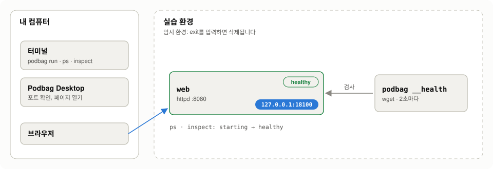

실행 중인 컨테이너가 항상 제대로 동작하는 것은 아닙니다. 상태 검사는 Podbag이 컨테이너 안에서 반복해서 실행하는 명령입니다. 명령이 성공하면 컨테이너는 healthy 상태입니다. 이번 트레이닝에서는 작은 웹 서버에 상태 검사를 넣고 상태를 지켜봅니다.

**예상 시간** 10분.



## 실습 시작

Podbag Desktop에서 **Training**을 열고 **웹 서버 상태 검사하기**를 선택합니다. 새 모듈은 **새로 고침** 후에 나타납니다. 터미널에서 다음 명령을 실행해도 됩니다.

```sh
podbag lab start health-checks
```

Training 카탈로그를 지원하는 Podbag 빌드가 필요합니다(v0.3.2 이후). `training $` 프롬프트가 나오면 다음 단계로 진행합니다.

## 상태 검사를 넣어 웹 서버 실행

`web`이라는 웹 서버를 실행합니다. 이 서버는 `8080` 포트에서 `Hello from web`이라는 글자를 보여 줍니다. 기본 포트 `18100`이 이미 사용 중이면 Training에 표시된 포트를 사용합니다.

```sh
podbag run -d --name web -p 127.0.0.1:18100:8080 --health-cmd 'wget -q -O /dev/null http://127.0.0.1:8080/' --health-interval 2s --health-timeout 1s --health-retries 3 docker.io/library/busybox:1.37.0 sh -c 'mkdir -p /www && printf "%s\n" "Hello from web" > /www/index.html && exec httpd -f -p 8080 -h /www'
```

상태 검사 옵션은 다음과 같습니다.

- `--health-cmd`는 검사 명령입니다. 여기서는 `wget`이 서버에 페이지를 요청합니다. 서버가 응답하면 성공합니다.
- `--health-interval 2s`는 2초마다 검사합니다.
- `--health-timeout 1s`는 1초보다 오래 걸리는 검사를 멈춥니다.
- `--health-retries 3`은 검사가 연속 3번 실패하면 컨테이너를 unhealthy로 바꿉니다.

검사와 검사 사이에는 아무 프로세스도 기다리지 않습니다. 검사할 때가 되면 Podbag이 `podbag __health`를 시작합니다. 이 프로세스는 검사를 실행하고, 최근 결과 5개를 남기고, 끝납니다. Podbag은 `web`이 healthy가 될 때까지 기다립니다.

## ps에서 상태 보기

```sh
podbag ps
```

`web`의 상태 끝에 `(healthy)`가 나옵니다. 시작 직후에는 `(health: starting)`이 나옵니다. Podbag은 `(healthy)`를 확인합니다.

## inspect로 검사 결과 읽기

```sh
podbag inspect web
```

`health` 부분에 `"status": "healthy"`, 연속 실패 횟수(`failing_streak`), `log`에 최근 결과가 나옵니다. 결과마다 시작 시각, 끝난 시각, 종료 코드, 출력이 있습니다. Podbag은 `"status": "healthy"`를 확인합니다.

## Podbag Desktop에서 페이지 열기

**실습 컨테이너 → web → 포트 보기**를 누릅니다. **브라우저에서 열기**를 누릅니다. 페이지에 **Hello from web**이 표시됩니다. Podbag은 HTTP 200 응답과 이 글자를 확인합니다.

## 실습 리소스 정리

컨테이너를 삭제합니다. `web`은 아직 실행 중이므로 `-f` 옵션으로 먼저 중지합니다. 그다음 실습을 끝냅니다.

```sh
podbag rm -f web
exit
```

임시 실습 환경이 정리되면 Training에서 **수업 완료**를 확인합니다.
