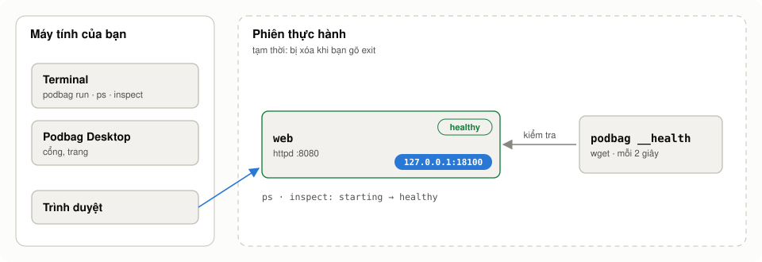

Container đang chạy chưa chắc đã hoạt động đúng. Health check là một lệnh mà Podbag chạy lặp lại bên trong container. Nếu lệnh thành công, container ở trạng thái healthy (khỏe). Trong mô-đun này, bạn thêm health check cho một máy chủ web nhỏ và theo dõi tình trạng của nó.

**Thời gian** 10 phút.



## Bắt đầu mô-đun

Mở **Training** trong Podbag Desktop và chọn **Kiểm tra máy chủ web có hoạt động tốt không**. Mô-đun mới xuất hiện sau khi chọn **Làm mới**. Hoặc chạy lệnh này trong terminal:

```sh
podbag lab start health-checks
```

Bạn cần bản Podbag có danh mục Training (sau v0.3.2). Tiếp tục tại dấu nhắc `training $`.

Để làm các bước trong TUI thay cho Podbag Desktop, hãy thêm `--tui`.

```sh
podbag lab start health-checks --tui
```

Trong TUI, nhấn `:` để mở shell Training cho bước chạy lệnh, gõ `exit` để quay lại TUI và nhấn `q` để kết thúc phiên.

## Chạy máy chủ web có health check

Chạy một máy chủ web tên `web`. Nó phục vụ dòng chữ `Hello from web` ở cổng `8080`. Nếu cổng mặc định `18100` đang được dùng, hãy dùng cổng hiển thị trong Training.

```sh
podbag run -d --name web -p 127.0.0.1:18100:8080 --health-cmd 'wget -q -O /dev/null http://127.0.0.1:8080/' --health-interval 2s --health-timeout 1s --health-retries 3 docker.io/library/busybox:1.37.0 sh -c 'mkdir -p /www && printf "%s\n" "Hello from web" > /www/index.html && exec httpd -f -p 8080 -h /www'
```

Các tùy chọn health check:

- `--health-cmd` là lệnh kiểm tra. Ở đây, `wget` yêu cầu trang từ máy chủ. Lệnh thành công khi máy chủ trả lời.
- `--health-interval 2s` chạy lệnh kiểm tra mỗi 2 giây.
- `--health-timeout 1s` dừng lần kiểm tra chạy lâu hơn 1 giây.
- `--health-retries 3` chuyển container sang unhealthy sau 3 lần kiểm tra thất bại liên tiếp.

Không có tiến trình nào chờ giữa các lần kiểm tra. Khi đến lúc kiểm tra, Podbag chạy `podbag __health`. Tiến trình này chạy lệnh kiểm tra, giữ năm kết quả gần nhất, rồi dừng. Podbag chờ đến khi `web` healthy.

## Xem tình trạng trong ps

```sh
podbag ps
```

Trạng thái của `web` kết thúc bằng `(healthy)`. Ngay sau khi chạy, nó hiển thị `(health: starting)`. Podbag tìm `(healthy)`.

## Đọc kết quả kiểm tra bằng inspect

```sh
podbag inspect web
```

Phần `health` hiển thị `"status": "healthy"`, số lần kiểm tra thất bại liên tiếp (`failing_streak`) và các kết quả gần nhất trong `log`. Mỗi kết quả có thời điểm bắt đầu và kết thúc, mã thoát và đầu ra. Podbag tìm `"status": "healthy"`.

## Mở trang trong Podbag Desktop

Đi tới **Container thực hành → web → Xem cổng**. Chọn **Mở trong trình duyệt**. Trang hiển thị **Hello from web**. Podbag kiểm tra phản hồi HTTP 200 và dòng chữ này.

- **Trong Podbag Desktop:** Chọn **Container thực hành → web → Xem cổng**.
- **Trong TUI:** Chọn `web` trong **Container** rồi nhấn `Enter`.
- **Trong Podbag Desktop:** Chọn **Mở trong trình duyệt**.
- **Trong TUI:** Mở `http://127.0.0.1:18100/` trong trình duyệt. Khi trang hiện ra, nhấn `o`.

## Dọn dẹp và kết thúc

Xóa container. `web` vẫn đang chạy, nên `-f` dừng nó trước. Sau đó kết thúc phiên.

- **Trong Podbag Desktop:** Chọn **Container thực hành → web → Xóa** và xác nhận.
- **Trong TUI:** Chọn `web` trong **Container**, nhấn `d`, rồi nhấn `y`.

```sh
podbag rm -f web
exit
```

Các tài nguyên thực hành tạm thời đã được xóa. Training hiển thị mô-đun đã hoàn thành.
