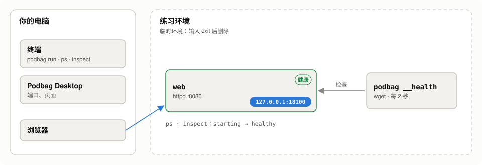

正在运行的容器不一定能正常工作。健康检查是 Podbag 在容器内反复运行的一条命令。如果命令成功，容器就是健康的。在本模块中，你将为一个小型 Web 服务器设置健康检查，并观察它的健康状态。

**预计用时** 10 分钟。



## 开始模块

在 Podbag Desktop 中打开 **Training**，选择**检查 Web 服务器是否健康**。点击**刷新**后会出现新模块。也可以在终端中运行以下命令：

```sh
podbag lab start health-checks
```

需要带有 Training 目录的 Podbag 版本（v0.3.2 之后）。出现 `training $` 提示符后继续。

要在 TUI 而不是 Podbag Desktop 中完成这些步骤，请加上 `--tui`。

```sh
podbag lab start health-checks --tui
```

在 TUI 中，按 `:` 打开 Training 终端来执行命令步骤，输入 `exit` 返回 TUI，按 `q` 结束实验。

## 运行带健康检查的 Web 服务器

运行一个名为 `web` 的 Web 服务器。它在 `8080` 端口上提供文字 `Hello from web`。如果默认端口 `18100` 已被占用，请使用 Training 中显示的端口。

```sh
podbag run -d --name web -p 127.0.0.1:18100:8080 --health-cmd 'wget -q -O /dev/null http://127.0.0.1:8080/' --health-interval 2s --health-timeout 1s --health-retries 3 docker.io/library/busybox:1.37.0 sh -c 'mkdir -p /www && printf "%s\n" "Hello from web" > /www/index.html && exec httpd -f -p 8080 -h /www'
```

健康检查选项：

- `--health-cmd` 是检查命令。这里用 `wget` 向服务器请求页面。服务器响应时，检查成功。
- `--health-interval 2s` 每 2 秒运行一次检查。
- `--health-timeout 1s` 会停止运行超过 1 秒的检查。
- `--health-retries 3` 表示连续 3 次检查失败后，容器变为不健康。

两次检查之间没有进程在等待。到了检查时间，Podbag 会启动 `podbag __health`。它运行检查，保留最近五次结果，然后停止。Podbag 会等到 `web` 变为健康状态。

## 在 ps 中查看健康状态

```sh
podbag ps
```

`web` 的状态以 `(healthy)` 结尾。刚启动时，它显示 `(health: starting)`。Podbag 会检查是否有 `(healthy)`。

## 用 inspect 读取检查结果

```sh
podbag inspect web
```

`health` 部分显示 `"status": "healthy"`、连续失败的检查次数（`failing_streak`），以及 `log` 中的最近结果。每条结果都包含开始和结束时间、退出码和输出。Podbag 会检查是否有 `"status": "healthy"`。

## 在 Podbag Desktop 中打开页面

前往**实验容器 → web → 查看端口**。点击**在浏览器中打开**。页面显示 **Hello from web**。Podbag 会检查 HTTP 200 响应和这段文字。

- **在 Podbag Desktop 中：** 选择**实验容器 → web → 查看端口**。
- **在 TUI 中：** 在**容器**中选择 `web`，然后按 `Enter`。
- **在 Podbag Desktop 中：** 选择**在浏览器中打开**。
- **在 TUI 中：** 在浏览器中打开 `http://127.0.0.1:18100/`。页面显示后按 `o`。

## 清理并结束

删除容器。`web` 仍在运行，所以 `-f` 会先停止它。然后结束实验。

- **在 Podbag Desktop 中：** 选择**实验容器 → web → 删除**并确认。
- **在 TUI 中：** 在**容器**中选择 `web`，按 `d`，再按 `y`。

```sh
podbag rm -f web
exit
```

临时实验资源会被删除。Training 会显示该模块已完成。
