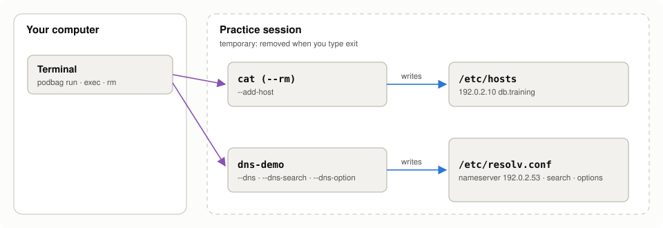

A container finds other computers by name in two files. `/etc/hosts` is a fixed list of names and addresses. `/etc/resolv.conf` says which DNS server to ask for other names. DNS is the system that turns names into addresses. `podbag run` can write both files for you. In this module, you set them and read them.

**Time** 10 minutes.



## Start the module

Open **Training** in Podbag Desktop and select **Set hosts and DNS for a container**. New modules appear after **Refresh**. Or run this command in a terminal:

```sh
podbag lab start hosts-and-dns
```

You need a Podbag build with `--add-host` and `--dns` (after v0.3.2). Continue at the `training $` prompt.

## Pull the busybox image

```sh
podbag pull docker.io/library/busybox:1.37.0
```

Podbag checks that the image is there.

## Add a host name

`--add-host NAME:IP` adds a line to the container's `/etc/hosts`. The container then finds `NAME` at `IP` without DNS. This is useful for a test server that has no DNS name.

```sh
podbag run --rm --add-host db.training:192.0.2.10 docker.io/library/busybox:1.37.0 cat /etc/hosts
```

The container prints its `/etc/hosts`. One line has `192.0.2.10` and `db.training`. The address `192.0.2.10` is for examples only. Podbag checks for `db.training`.

You can give `--add-host` more than once. The address `host-gateway` stands for your computer, but some setups do not have it. One example is a rootless engine, which runs without root rights.

## Run a container with DNS settings

Three options change `/etc/resolv.conf`:

- `--dns` sets the DNS server.
- `--dns-search` sets a search domain. A short name like `db` is then also tried as `db.training.example`.
- `--dns-option` adds an option. `ndots:2` means: a name with fewer than 2 dots tries the search domain first.

```sh
podbag run -d --name dns-demo --dns 192.0.2.53 --dns-search training.example --dns-option ndots:2 docker.io/library/busybox:1.37.0 sleep 3600
```

The container keeps running, so you can look inside it. Podbag checks that `dns-demo` runs.

## Find the DNS server

```sh
podbag exec dns-demo grep nameserver /etc/resolv.conf
```

The output is `nameserver 192.0.2.53`. Podbag checks for this line. The file can also have comment lines from your computer.

## Find the search domain

```sh
podbag exec dns-demo grep search /etc/resolv.conf
```

Podbag checks for the line `search training.example`.

## Find the DNS option

```sh
podbag exec dns-demo grep options /etc/resolv.conf
```

Podbag checks for the line `options ndots:2`.

## Clean up and finish

Remove the container. It is still running, so `-f` stops it first.

```sh
podbag rm -f dns-demo
exit
```

`podbag create` takes the same options. In Compose, `extra_hosts` and `dns` do the same. The temporary practice session is removed. Training shows the module as complete.
