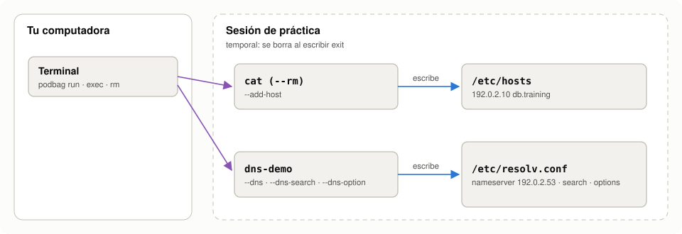

Un contenedor encuentra otras computadoras por su nombre en dos archivos. `/etc/hosts` es una lista fija de nombres y direcciones. `/etc/resolv.conf` indica a qué servidor DNS preguntar por los demás nombres. DNS es el sistema que convierte nombres en direcciones. `podbag run` puede escribir los dos archivos por ti. En este módulo, los configuras y los lees.

**Tiempo** 10 minutos.



## Inicia el módulo

Abre **Training** en Podbag Desktop y selecciona **Configura los hosts y el DNS de un contenedor**. Los módulos nuevos aparecen después de **Actualizar**. O ejecuta este comando en una terminal:

```sh
podbag lab start hosts-and-dns
```

Necesitas una versión de Podbag con `--add-host` y `--dns` (después de v0.3.2). Continúa en el prompt `training $`.

Para hacer los pasos en la TUI en lugar de Podbag Desktop, añade `--tui`.

```sh
podbag lab start hosts-and-dns --tui
```

En la TUI, pulsa `:` para abrir la shell de Training cuando un paso pida un comando, escribe `exit` para volver a la TUI y pulsa `q` para terminar la sesión.

## Descarga la imagen busybox

```sh
podbag pull docker.io/library/busybox:1.37.0
```

- **En Podbag Desktop:** Selecciona **Contenedores de práctica → Descargar docker.io/library/busybox:1.37.0**.
- **En la TUI:** Abre **Imágenes**, pulsa `p`, escribe `docker.io/library/busybox:1.37.0` y pulsa `Enter`.

Podbag comprueba que la imagen está ahí.

## Añade un nombre de host

`--add-host NAME:IP` añade una línea al `/etc/hosts` del contenedor. Entonces el contenedor encuentra `NAME` en `IP` sin DNS. Esto es útil para un servidor de prueba que no tiene nombre DNS.

```sh
podbag run --rm --add-host db.training:192.0.2.10 docker.io/library/busybox:1.37.0 cat /etc/hosts
```

El contenedor muestra su `/etc/hosts`. Una línea tiene `192.0.2.10` y `db.training`. La dirección `192.0.2.10` es solo para ejemplos. Podbag busca `db.training`.

Puedes usar `--add-host` más de una vez. La dirección `host-gateway` representa tu computadora, pero algunas configuraciones no la tienen. Un ejemplo es un motor rootless, que se ejecuta sin permisos de root.

## Ejecuta un contenedor con ajustes de DNS

Tres opciones cambian `/etc/resolv.conf`:

- `--dns` define el servidor DNS.
- `--dns-search` define un dominio de búsqueda. Un nombre corto como `db` se prueba entonces también como `db.training.example`.
- `--dns-option` añade una opción. `ndots:2` significa: un nombre con menos de 2 puntos prueba primero el dominio de búsqueda.

```sh
podbag run -d --name dns-demo --dns 192.0.2.53 --dns-search training.example --dns-option ndots:2 docker.io/library/busybox:1.37.0 sleep 3600
```

El contenedor sigue en ejecución, así que puedes mirar dentro de él. Podbag comprueba que `dns-demo` está en ejecución.

## Busca el servidor DNS

```sh
podbag exec dns-demo grep nameserver /etc/resolv.conf
```

La salida es `nameserver 192.0.2.53`. Podbag busca esta línea. El archivo también puede tener líneas de comentario de tu computadora.

## Busca el dominio de búsqueda

```sh
podbag exec dns-demo grep search /etc/resolv.conf
```

Podbag busca la línea `search training.example`.

## Busca la opción de DNS

```sh
podbag exec dns-demo grep options /etc/resolv.conf
```

Podbag busca la línea `options ndots:2`.

## Elimina el contenedor y termina

Elimina el contenedor. Sigue en ejecución, así que `-f` lo detiene primero.

- **En Podbag Desktop:** Selecciona **Contenedores de práctica → dns-demo → Eliminar** y confirma.
- **En la TUI:** Selecciona `dns-demo` en **Contenedores**, pulsa `d` y luego `y`.

```sh
podbag rm -f dns-demo
exit
```

`podbag create` acepta las mismas opciones. En Compose, `extra_hosts` y `dns` hacen lo mismo. Se elimina la sesión de práctica temporal. Training muestra el módulo como completado.
