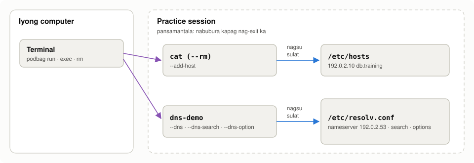

Hinahanap ng container ang ibang computer ayon sa pangalan sa dalawang file. Ang `/etc/hosts` ay nakapirming listahan ng mga pangalan at address. Sinasabi ng `/etc/resolv.conf` kung aling DNS server ang tatanungin para sa ibang pangalan. Ang DNS ay ang sistemang nagpapalit ng pangalan sa address. Kayang isulat ng `podbag run` ang dalawang file para sa iyo. Sa module na ito, itatakda mo ang mga ito at babasahin.

**Oras** 10 minuto.



## Simulan ang module

Buksan ang **Training** sa Podbag Desktop at piliin ang **Itakda ang hosts at DNS ng isang container**. Lalabas ang mga bagong module pagkatapos ng **I-refresh**. O patakbuhin ang command na ito sa terminal:

```sh
podbag lab start hosts-and-dns
```

Kailangan mo ng build ng Podbag na may `--add-host` at `--dns` (pagkatapos ng v0.3.2). Magpatuloy sa prompt na `training $`.

Para gawin ang mga hakbang sa TUI sa halip na sa Podbag Desktop, idagdag ang `--tui`.

```sh
podbag lab start hosts-and-dns --tui
```

Sa TUI, pindutin ang `:` para buksan ang training shell sa isang hakbang na command. I-type ang `exit` para bumalik sa TUI. Pindutin ang `q` para tapusin ang practice session.

## I-pull ang image na busybox

```sh
podbag pull docker.io/library/busybox:1.37.0
```

- **Sa Podbag Desktop:** Piliin ang **Mga practice container → I-pull ang docker.io/library/busybox:1.37.0**.
- **Sa TUI:** Buksan ang **Mga image**, pindutin ang `p`, i-type ang `docker.io/library/busybox:1.37.0` at pindutin ang `Enter`.

Sinusuri ng Podbag na nandoon ang image.

## Magdagdag ng host name

Nagdaragdag ang `--add-host NAME:IP` ng linya sa `/etc/hosts` ng container. Makikita na ng container ang `NAME` sa `IP` nang walang DNS. Kapaki-pakinabang ito para sa test server na walang DNS name.

```sh
podbag run --rm --add-host db.training:192.0.2.10 docker.io/library/busybox:1.37.0 cat /etc/hosts
```

Ipinapakita ng container ang `/etc/hosts` nito. May isang linya na may `192.0.2.10` at `db.training`. Para sa mga halimbawa lang ang address na `192.0.2.10`. Hinahanap ng Podbag ang `db.training`.

Maaari mong ibigay ang `--add-host` nang higit sa isang beses. Ang address na `host-gateway` ay kumakatawan sa computer mo, pero wala nito ang ilang setup. Isang halimbawa ang rootless engine, na tumatakbo nang walang root rights.

## Magpatakbo ng container na may DNS settings

Tatlong option ang nagbabago sa `/etc/resolv.conf`:

- Itinatakda ng `--dns` ang DNS server.
- Itinatakda ng `--dns-search` ang search domain. Ang maikling pangalan tulad ng `db` ay susubukan din bilang `db.training.example`.
- Nagdaragdag ang `--dns-option` ng option. Ang `ndots:2` ay nangangahulugang: ang pangalang may kulang sa 2 tuldok ay susubukan muna sa search domain.

```sh
podbag run -d --name dns-demo --dns 192.0.2.53 --dns-search training.example --dns-option ndots:2 docker.io/library/busybox:1.37.0 sleep 3600
```

Patuloy na tumatakbo ang container, kaya makikita mo ang loob nito. Sinusuri ng Podbag na tumatakbo ang `dns-demo`.

## Hanapin ang DNS server

```sh
podbag exec dns-demo grep nameserver /etc/resolv.conf
```

Ang output ay `nameserver 192.0.2.53`. Hinahanap ng Podbag ang linyang ito. Maaari ding may mga linya ng komento sa file mula sa computer mo.

## Hanapin ang search domain

```sh
podbag exec dns-demo grep search /etc/resolv.conf
```

Hinahanap ng Podbag ang linyang `search training.example`.

## Hanapin ang DNS option

```sh
podbag exec dns-demo grep options /etc/resolv.conf
```

Hinahanap ng Podbag ang linyang `options ndots:2`.

## Maglinis at tapusin

Burahin ang container. Tumatakbo pa ito, kaya inihihinto muna ito ng `-f`.

- **Sa Podbag Desktop:** Piliin ang **Mga practice container → dns-demo → Alisin** at kumpirmahin.
- **Sa TUI:** Piliin ang `dns-demo` sa **Mga container**, pindutin ang `d`, saka ang `y`.

```sh
podbag rm -f dns-demo
exit
```

Tumatanggap ng parehong option ang `podbag create`. Sa Compose, ganoon din ang ginagawa ng `extra_hosts` at `dns`. Naaalis ang pansamantalang practice session. Ipinapakita ng Training na tapos na ang module.
