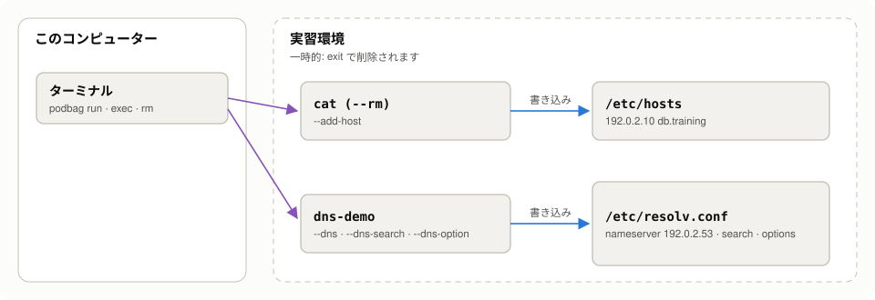

コンテナーは、2 つのファイルを使って、ほかのコンピューターを名前で探します。`/etc/hosts` は、名前とアドレスを固定で並べた一覧です。`/etc/resolv.conf` は、ほかの名前をどの DNS サーバーに問い合わせるかを示します。DNS は、名前をアドレスに変えるしくみです。`podbag run` は、この 2 つのファイルを書き込めます。このモジュールでは、2 つのファイルを設定して読みます。

**所要時間** 10 分。



## モジュールを開始する

Podbag Desktop で **Training** を開き、**コンテナーのホストと DNS を設定する**を選びます。新しいモジュールは**更新**の後に表示されます。ターミナルで次のコマンドを実行しても開始できます。

```sh
podbag lab start hosts-and-dns
```

`--add-host` と `--dns` に対応した Podbag のビルドが必要です(v0.3.2 より後)。`training $` プロンプトが表示されたら続けます。

Podbag Desktop の代わりに TUI で手順を進めるには、`--tui` を付けます。

```sh
podbag lab start hosts-and-dns --tui
```

TUI では、コマンドの手順で `:` を押すと Training シェルが開きます。`exit` と入力すると TUI に戻ります。`q` を押すと実習を終了します。

## busybox イメージを取得する

```sh
podbag pull docker.io/library/busybox:1.37.0
```

- **Podbag Desktop で:** **実習コンテナ → docker.io/library/busybox:1.37.0 を取得**を選びます。
- **TUI で:** **イメージ**を開き、`p` を押して `docker.io/library/busybox:1.37.0` と入力し、`Enter` を押します。

Podbag はイメージがあることを確認します。

## --add-host でホスト名を追加する

`--add-host NAME:IP` は、コンテナーの `/etc/hosts` に 1 行を追加します。コンテナーは、DNS を使わずに `NAME` を `IP` で見つけます。DNS 名のないテスト用サーバーに便利です。

```sh
podbag run --rm --add-host db.training:192.0.2.10 docker.io/library/busybox:1.37.0 cat /etc/hosts
```

コンテナーは自分の `/etc/hosts` を表示します。1 行に `192.0.2.10` と `db.training` があります。アドレス `192.0.2.10` は例のためだけのものです。Podbag は `db.training` があることを確認します。

`--add-host` は何回でも指定できます。アドレス `host-gateway` はお使いのコンピューターを表しますが、使えない環境もあります。例は rootless エンジンです。rootless エンジンは、root 権限なしで動きます。

## DNS の設定付きでコンテナーを実行する

3 つのオプションが `/etc/resolv.conf` を変えます。

- `--dns` は DNS サーバーを設定します。
- `--dns-search` は検索ドメインを設定します。`db` のような短い名前は、`db.training.example` としても試されます。
- `--dns-option` はオプションを追加します。`ndots:2` は、ドットが 2 つより少ない名前では、先に検索ドメインを試すという意味です。

```sh
podbag run -d --name dns-demo --dns 192.0.2.53 --dns-search training.example --dns-option ndots:2 docker.io/library/busybox:1.37.0 sleep 3600
```

コンテナーは動き続けるので、中を調べられます。Podbag は `dns-demo` が実行中であることを確認します。

## DNS サーバーを確認する

```sh
podbag exec dns-demo grep nameserver /etc/resolv.conf
```

出力は `nameserver 192.0.2.53` です。Podbag はこの行があることを確認します。ファイルには、お使いのコンピューターから来たコメント行もあることがあります。

## 検索ドメインを確認する

```sh
podbag exec dns-demo grep search /etc/resolv.conf
```

Podbag は `search training.example` の行があることを確認します。

## DNS オプションを確認する

```sh
podbag exec dns-demo grep options /etc/resolv.conf
```

Podbag は `options ndots:2` の行があることを確認します。

## 片付けて終了する

コンテナーを削除します。まだ実行中なので、`-f` で先に停止します。

- **Podbag Desktop で:** **実習コンテナ → dns-demo → 削除**を選び、確認します。
- **TUI で:** **コンテナ**で `dns-demo` を選び、`d` を押してから `y` を押します。

```sh
podbag rm -f dns-demo
exit
```

`podbag create` にも同じオプションがあります。Compose では、`extra_hosts` と `dns` が同じ働きをします。一時的な実習環境が削除されます。Training にモジュールの完了が表示されます。
