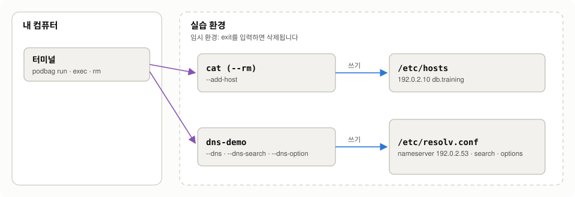

컨테이너는 두 파일을 보고 다른 컴퓨터를 이름으로 찾습니다. `/etc/hosts`는 이름과 주소를 적은 고정 목록입니다. `/etc/resolv.conf`는 다른 이름을 물어볼 DNS 서버를 정합니다. DNS는 이름을 주소로 바꿔 주는 시스템입니다. `podbag run`은 두 파일을 대신 써 줄 수 있습니다. 이번 트레이닝에서는 두 파일을 설정하고 읽어 봅니다.

**예상 시간** 10분.



## 실습 시작

Podbag Desktop에서 **Training**을 열고 **컨테이너의 호스트와 DNS 설정하기**를 선택합니다. 새 모듈은 **새로 고침** 후에 나타납니다. 터미널에서 다음 명령을 실행해도 됩니다.

```sh
podbag lab start hosts-and-dns
```

`--add-host`와 `--dns`를 지원하는 Podbag 빌드가 필요합니다(v0.3.2 이후). `training $` 프롬프트가 나오면 다음 단계로 진행합니다.

Podbag Desktop 대신 TUI에서 실습하려면 `--tui`를 붙입니다.

```sh
podbag lab start hosts-and-dns --tui
```

TUI에서는 `:` 키로 명령 단계용 Training 셸을 열고, `exit`를 입력해 TUI로 돌아오며, `q` 키로 실습을 끝냅니다.

## busybox 이미지 받기

```sh
podbag pull docker.io/library/busybox:1.37.0
```

- **Podbag Desktop에서:** **실습 컨테이너 → docker.io/library/busybox:1.37.0 받기**를 누릅니다.
- **TUI에서:** **이미지** 탭을 열고 `p` 키를 누른 뒤 `docker.io/library/busybox:1.37.0` 입력 후 `Enter` 키를 누릅니다.

Podbag은 이미지가 있는지 확인합니다.

## 호스트 이름 추가하기

`--add-host NAME:IP`는 컨테이너의 `/etc/hosts`에 한 줄을 추가합니다. 그러면 컨테이너는 DNS 없이 `NAME`을 `IP`에서 찾습니다. DNS 이름이 없는 테스트 서버에 쓸모가 있습니다.

```sh
podbag run --rm --add-host db.training:192.0.2.10 docker.io/library/busybox:1.37.0 cat /etc/hosts
```

컨테이너가 자신의 `/etc/hosts`를 출력합니다. 한 줄에 `192.0.2.10`과 `db.training`이 있습니다. `192.0.2.10`은 예시용 주소입니다. Podbag은 `db.training`이 있는지 확인합니다.

`--add-host`는 여러 번 쓸 수 있습니다. `host-gateway` 주소는 내 컴퓨터를 뜻하지만, 이 주소가 없는 환경도 있습니다. root 권한 없이 실행하는 rootless 엔진이 그 예입니다.

## DNS 설정으로 컨테이너 실행하기

세 옵션이 `/etc/resolv.conf`를 바꿉니다.

- `--dns`는 DNS 서버를 정합니다.
- `--dns-search`는 검색 도메인을 정합니다. 그러면 `db` 같은 짧은 이름은 `db.training.example`로도 찾아봅니다.
- `--dns-option`은 옵션을 추가합니다. `ndots:2`는 점이 2개보다 적은 이름을 먼저 검색 도메인으로 찾아본다는 뜻입니다.

```sh
podbag run -d --name dns-demo --dns 192.0.2.53 --dns-search training.example --dns-option ndots:2 docker.io/library/busybox:1.37.0 sleep 3600
```

컨테이너가 계속 실행되므로 안을 살펴볼 수 있습니다. Podbag은 `dns-demo`가 실행 중인지 확인합니다.

## DNS 서버 찾기

```sh
podbag exec dns-demo grep nameserver /etc/resolv.conf
```

출력은 `nameserver 192.0.2.53`입니다. Podbag은 이 줄을 확인합니다. 파일에는 내 컴퓨터에서 온 주석 줄이 있을 수도 있습니다.

## 검색 도메인 찾기

```sh
podbag exec dns-demo grep search /etc/resolv.conf
```

Podbag은 `search training.example` 줄을 확인합니다.

## DNS 옵션 찾기

```sh
podbag exec dns-demo grep options /etc/resolv.conf
```

Podbag은 `options ndots:2` 줄을 확인합니다.

## 정리 및 실습 종료

컨테이너를 삭제합니다. 아직 실행 중이므로 `-f`가 먼저 멈춥니다.

- **Podbag Desktop에서:** **실습 컨테이너 → dns-demo → 삭제**를 누르고 확인합니다.
- **TUI에서:** **컨테이너**에서 `dns-demo` 선택 후 `d` 키, `y` 키를 차례로 누릅니다.

```sh
podbag rm -f dns-demo
exit
```

`podbag create`도 같은 옵션을 받습니다. Compose에서는 `extra_hosts`와 `dns`가 같은 일을 합니다. 임시 실습 환경이 삭제됩니다. Training에 모듈이 완료됨으로 표시됩니다.
