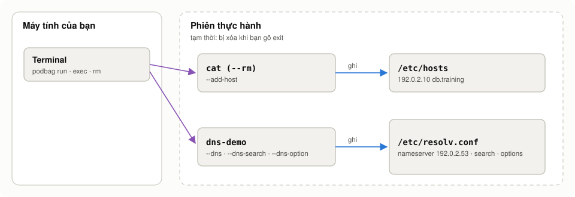

Container tìm các máy tính khác theo tên bằng hai tệp. `/etc/hosts` là danh sách cố định các tên và địa chỉ. `/etc/resolv.conf` cho biết hỏi máy chủ DNS nào để tìm các tên khác. DNS là hệ thống đổi tên thành địa chỉ. `podbag run` có thể ghi cả hai tệp cho bạn. Trong mô-đun này, bạn đặt chúng và đọc chúng.

**Thời gian** 10 phút.



## Bắt đầu mô-đun

Mở **Training** trong Podbag Desktop và chọn **Đặt hosts và DNS cho container**. Mô-đun mới xuất hiện sau khi chọn **Làm mới**. Hoặc chạy lệnh này trong terminal:

```sh
podbag lab start hosts-and-dns
```

Bạn cần bản Podbag có `--add-host` và `--dns` (sau v0.3.2). Tiếp tục tại dấu nhắc `training $`.

Để làm các bước trong TUI thay cho Podbag Desktop, hãy thêm `--tui`.

```sh
podbag lab start hosts-and-dns --tui
```

Trong TUI, nhấn `:` để mở shell Training cho bước chạy lệnh, gõ `exit` để quay lại TUI và nhấn `q` để kết thúc phiên.

## Kéo image busybox

```sh
podbag pull docker.io/library/busybox:1.37.0
```

- **Trong Podbag Desktop:** Chọn **Container thực hành → Tải docker.io/library/busybox:1.37.0**.
- **Trong TUI:** Mở **Image**, nhấn `p`, gõ `docker.io/library/busybox:1.37.0` rồi nhấn `Enter`.

Podbag kiểm tra rằng image đã có.

## Thêm tên máy

`--add-host NAME:IP` thêm một dòng vào `/etc/hosts` của container. Khi đó container tìm `NAME` tại `IP` mà không cần DNS. Cách này hữu ích cho máy chủ thử nghiệm không có tên DNS.

```sh
podbag run --rm --add-host db.training:192.0.2.10 docker.io/library/busybox:1.37.0 cat /etc/hosts
```

Container in `/etc/hosts` của nó. Một dòng có `192.0.2.10` và `db.training`. Địa chỉ `192.0.2.10` chỉ dùng làm ví dụ. Podbag tìm `db.training`.

Bạn có thể dùng `--add-host` nhiều lần. Địa chỉ `host-gateway` đại diện cho máy tính của bạn, nhưng một số cách cài đặt không có nó. Một ví dụ là engine rootless, chạy mà không có quyền root.

## Chạy container với cài đặt DNS

Ba tùy chọn thay đổi `/etc/resolv.conf`:

- `--dns` đặt máy chủ DNS.
- `--dns-search` đặt một miền tìm kiếm. Khi đó một tên ngắn như `db` cũng được thử là `db.training.example`.
- `--dns-option` thêm một tùy chọn. `ndots:2` nghĩa là: tên có ít hơn 2 dấu chấm sẽ thử miền tìm kiếm trước.

```sh
podbag run -d --name dns-demo --dns 192.0.2.53 --dns-search training.example --dns-option ndots:2 docker.io/library/busybox:1.37.0 sleep 3600
```

Container tiếp tục chạy, nên bạn có thể xem bên trong nó. Podbag kiểm tra rằng `dns-demo` đang chạy.

## Tìm máy chủ DNS

```sh
podbag exec dns-demo grep nameserver /etc/resolv.conf
```

Kết quả là `nameserver 192.0.2.53`. Podbag tìm dòng này. Tệp cũng có thể có các dòng chú thích từ máy tính của bạn.

## Tìm miền tìm kiếm

```sh
podbag exec dns-demo grep search /etc/resolv.conf
```

Podbag tìm dòng `search training.example`.

## Tìm tùy chọn DNS

```sh
podbag exec dns-demo grep options /etc/resolv.conf
```

Podbag tìm dòng `options ndots:2`.

## Dọn dẹp và kết thúc

Xóa container. Nó vẫn đang chạy, nên `-f` dừng nó trước.

- **Trong Podbag Desktop:** Chọn **Container thực hành → dns-demo → Xóa** và xác nhận.
- **Trong TUI:** Chọn `dns-demo` trong **Container**, nhấn `d`, rồi nhấn `y`.

```sh
podbag rm -f dns-demo
exit
```

`podbag create` nhận cùng các tùy chọn này. Trong Compose, `extra_hosts` và `dns` làm việc tương tự. Phiên thực hành tạm thời đã được xóa. Training hiển thị mô-đun đã hoàn thành.
