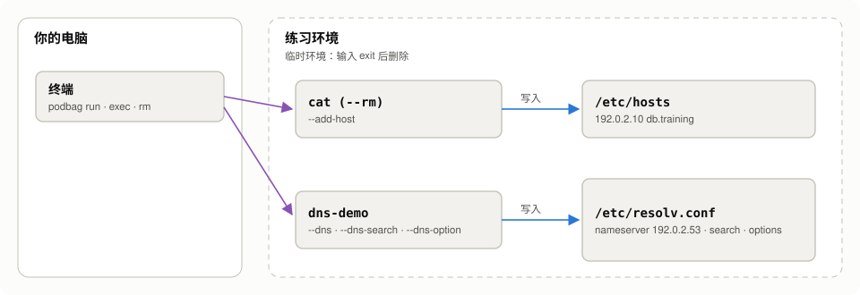

容器通过两个文件按名称查找其他电脑。`/etc/hosts` 是名称和地址的固定列表。`/etc/resolv.conf` 说明该向哪个 DNS 服务器查询其他名称。DNS 是把名称转换成地址的系统。`podbag run` 可以为你写入这两个文件。在本模块中，你将设置它们并读取它们。

**预计用时** 10 分钟。



## 开始模块

在 Podbag Desktop 中打开 **Training**，选择**为容器设置主机和 DNS**。点击**刷新**后会出现新模块。也可以在终端中运行以下命令：

```sh
podbag lab start hosts-and-dns
```

需要支持 `--add-host` 和 `--dns` 的 Podbag 版本（v0.3.2 之后）。出现 `training $` 提示符后继续。

要在 TUI 而不是 Podbag Desktop 中完成这些步骤，请加上 `--tui`。

```sh
podbag lab start hosts-and-dns --tui
```

在 TUI 中，按 `:` 打开 Training 终端来执行命令步骤，输入 `exit` 返回 TUI，按 `q` 结束实验。

## 拉取 busybox 镜像

```sh
podbag pull docker.io/library/busybox:1.37.0
```

- **在 Podbag Desktop 中：** 选择**实验容器 → 拉取 docker.io/library/busybox:1.37.0**。
- **在 TUI 中：** 打开**镜像**，按 `p`，输入 `docker.io/library/busybox:1.37.0` 并按 `Enter`。

Podbag 会检查镜像是否存在。

## 添加主机名

`--add-host NAME:IP` 会在容器的 `/etc/hosts` 中加一行。这样容器不用 DNS，就能在 `IP` 找到 `NAME`。这对没有 DNS 名称的测试服务器很有用。

```sh
podbag run --rm --add-host db.training:192.0.2.10 docker.io/library/busybox:1.37.0 cat /etc/hosts
```

容器会打印它的 `/etc/hosts`。其中一行有 `192.0.2.10` 和 `db.training`。地址 `192.0.2.10` 只用于示例。Podbag 会检查输出中是否有 `db.training`。

`--add-host` 可以多次使用。地址 `host-gateway` 代表你的电脑，但有些环境没有它。例如无根引擎（rootless engine），它不用 root 权限运行。

## 带 DNS 设置运行容器

三个选项可以修改 `/etc/resolv.conf`：

- `--dns` 设置 DNS 服务器。
- `--dns-search` 设置搜索域。这样，像 `db` 这样的短名称也会尝试 `db.training.example`。
- `--dns-option` 添加一个选项。`ndots:2` 的意思是：点少于 2 个的名称会先尝试搜索域。

```sh
podbag run -d --name dns-demo --dns 192.0.2.53 --dns-search training.example --dns-option ndots:2 docker.io/library/busybox:1.37.0 sleep 3600
```

容器会一直运行，所以你可以查看它的内部。Podbag 会检查 `dns-demo` 是否正在运行。

## 查找 DNS 服务器

```sh
podbag exec dns-demo grep nameserver /etc/resolv.conf
```

输出为 `nameserver 192.0.2.53`。Podbag 会检查这一行。文件中也可能有来自你电脑的注释行。

## 查找搜索域

```sh
podbag exec dns-demo grep search /etc/resolv.conf
```

Podbag 会检查是否有 `search training.example` 这一行。

## 查找 DNS 选项

```sh
podbag exec dns-demo grep options /etc/resolv.conf
```

Podbag 会检查是否有 `options ndots:2` 这一行。

## 清理并结束

删除容器。它仍在运行，所以 `-f` 会先停止它。

- **在 Podbag Desktop 中：** 选择**实验容器 → dns-demo → 删除**并确认。
- **在 TUI 中：** 在**容器**中选择 `dns-demo`，按 `d`，再按 `y`。

```sh
podbag rm -f dns-demo
exit
```

`podbag create` 接受相同的选项。在 Compose 中，`extra_hosts` 和 `dns` 的作用相同。临时练习环境会被删除。Training 会显示该模块已完成。
