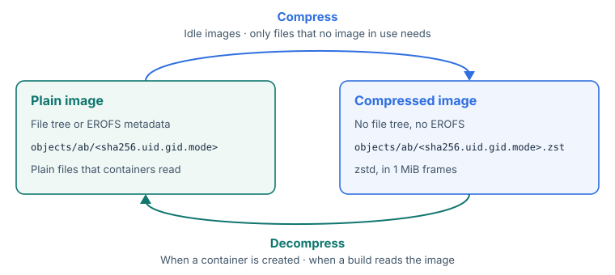
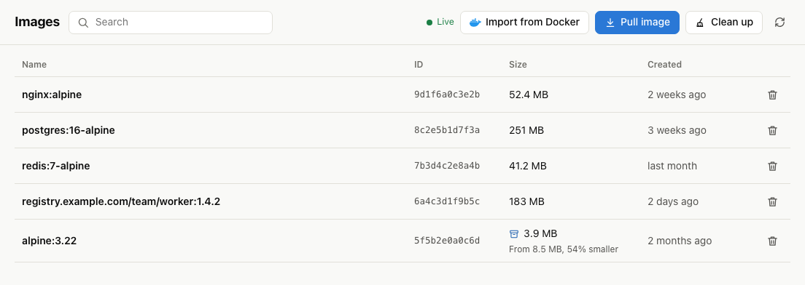

Images you pull stay on the disk. An image you used once last month takes as much space as on the first day. The next podbag release can compress these images. In this post we call the feature **idle image compression**. An idle image is an image that no container uses. The feature is off by default.

## How podbag stores images

podbag stores each file once, at `objects/ab/<sha256.uid.gid.mode>`. The name holds the hash of the contents, the owner and the mode. When two images have the same file, they share this one file.

Containers see these files in one of two ways:

- **Without root**: each image gets a tree of hard links. A hard link is one more name for the same file.
- **As root**: podbag uses composefs. A small EROFS file lists the files of the image, and overlayfs shows them.

Either way, containers read the plain files in `objects` directly. So compression works on these files.

## Compress and decompress



**Compression** only touches idle images. An image is idle when both are true:

- No container uses it. Stopped containers count too.
- It was not used for `compress_idle_after`. The default is 7 days.

podbag first removes the image's tree or EROFS file. Then it writes `<file>.zst` next to each file and removes the plain file. A file that an image in use also has stays plain. Files smaller than 4096 bytes stay plain too: compressing them would not save disk blocks.

**Decompression** happens in two cases: when a container is created from the image, and when a build reads it. podbag turns the `.zst` files back into plain files. Then it builds the tree or the EROFS file again.

### Safety rules

Three rules keep the data safe:

1. An image that has a tree or an EROFS file has all its files plain. So containers only ever see plain files.
2. When a plain file and its `.zst` both exist, the plain file wins.
3. A file decompressed from `.zst` becomes a stored file again only when its hash matches.

### File format

A `.zst` file starts with a zstd skippable frame. zstd skips this part when it reads the data. We put a small header in it: version, size, flags and modification time.

Then come zstd frames of 1 MiB each. Each frame is the smaller of two results: compressed at the "Fastest" level, or stored without compression. So data that is already compressed does not grow.

We compress with [ruzstd](https://github.com/KillingSpark/zstd-rs), a zstd written in pure Rust. It needs no C library, so podbag's static builds stay as they are.

## When podbag compresses

podbag has no daemon, a program that always runs in the background. So no program exists only to compress. Instead, the commands that already tidy the store also compress.

With `image_compression = "idle"`, podbag compresses after `pull`, `load`, `build`, `rmi` and `prune`:

- One command compresses at most 256 MiB or for 2 seconds. The next command goes on.
- It holds the store lock for at most 64 MiB or 1 second at a time, so other commands do not wait long.
- Files larger than 32 MiB are not compressed automatically. `podbag system compress` does them when you run it.
- The image that a command has just pulled is skipped by that command.
- When the store's size limit would remove an image, podbag compresses idle images first.

## Results

podbag-dev VM (a Linux VM on a laptop) · arm64 · 4 CPUs · Linux 7.0.0-44 · store on ext4 · root, composefs · a development build of podbag 0.3.2 with this feature

We pulled five images with compression off. The two python images are 146 MB each and the two Java images are 310 MB each.

- `python:3.12.7-slim-bookworm`, `python:3.12.8-slim-bookworm`
- `eclipse-temurin:21.0.5_11-jre-noble`, `eclipse-temurin:21.0.6_7-jre-noble`
- `alpine:3.22`

Then `podbag system compress` compressed all five.

| Store | Value |
|---|---:|
| Before (Objects row of `system df`) | {{n:725}} MB |
| After | {{n:337}} MB |
| Time to compress the 5 images | {{n:8.4}} s |

The store shrank to less than half. Even before compression, the store is smaller than the five image sizes added up: two versions of the same image share many files. Each file is compressed on its own, so this sharing stays after compression.

| Time of `podbag run` | python 3.12.8 | Java (temurin 21.0.6) |
|---|---:|---:|
| First start of the compressed image | {{n:1391}} ms | {{n:1801}} ms |
| Start of the image when not compressed | {{n:30}} ms | {{n:55}} ms |

Each value is the median of 5 runs. Before each first start we compressed the image again and dropped the page cache. The start we compare with also had the cache dropped. The first start includes the time to decompress the files and build the EROFS file again. Later starts are as fast as for an image that was never compressed.

Images that are not compressed do not get slower when the feature is on. We started `alpine:3.22` 30 times with the feature off and 30 times with it on, in turns. The medians were {{n:12}} ms off and {{n:11}} ms on.

We measured these numbers on a quiet host. The store is a file on the host disk. When the host was busy, compressing took longer and the first start grew to several seconds.

## How to use it

```sh
podbag system compression                  # show the setting
podbag system compression idle             # turn it on
podbag system compression idle --after 3d  # compress images unused for 3 days
podbag system compression off              # turn it off
podbag system compress                     # compress idle images now
podbag system compress myapp:1             # compress this image now
podbag system decompress myapp:1           # decompress this image now
```

- When the feature is off, podbag does not compress images, and the store stays as it is today.
- `podbag system df` gets a `Compressed` row: the number of compressed files and their size before and after.
- `system compress` never compresses an image that a container uses.
- `save`, `push` and `podbag system verify` work on compressed images. They read the files without decompressing them on disk.
- On macOS and Windows the setting is kept where the engine runs: in the VM or in podbag's WSL distribution. Change it with `podbag system compression` or in Podbag Desktop.
- On Linux you can also write `image_compression = "idle"` in `config.toml`.

## Podbag Desktop

- After a new install or an update, Desktop asks once. In the **Save disk space** notice, choose **Turn on** or **Not now**.
- **Settings > Engine** has a **Compress idle images** switch.
- In the **Images** list, a compressed image shows an icon and its size on disk. Below it, a line such as "From 8.5 MB, 54% smaller" gives the size before and how much smaller it got.



The Docker API's `/images/json` adds a `PodbagCompression` field to compressed images. Desktop shows this value.

## What we did not choose

- **File system compression** (such as btrfs): it works only on btrfs. Most Linux users have ext4, and podbag cannot turn it on for them.
- **One archive per image**: this breaks the sharing of single files. Using the image again means unpacking all of it.
- **A FUSE file system that decompresses on read**: with FUSE, a program acts as a file system. That program must keep running, so it needs a daemon.
- **EROFS's own compression**: it works only with composefs, as root. It does not help the hard-link trees used without root.

## When you can use it

Idle image compression comes in the next podbag release. The [Storage section of the usage guide](https://github.com/SteelCrab/podbag/blob/main/docs/usage.md#storage) describes how podbag stores images today.

## Reproduce

[Benchmark script](compress.sh) · [Results and setup](results.txt)

[ruzstd](https://github.com/KillingSpark/zstd-rs) · [zstd format (RFC 8878)](https://www.rfc-editor.org/rfc/rfc8878) · [composefs](https://github.com/composefs/composefs)
