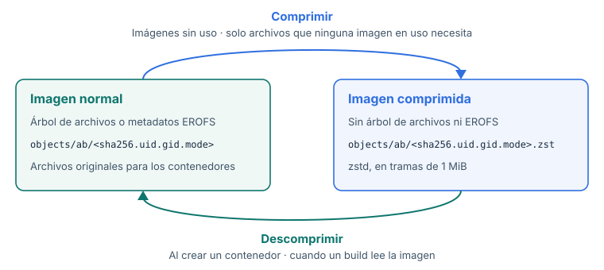
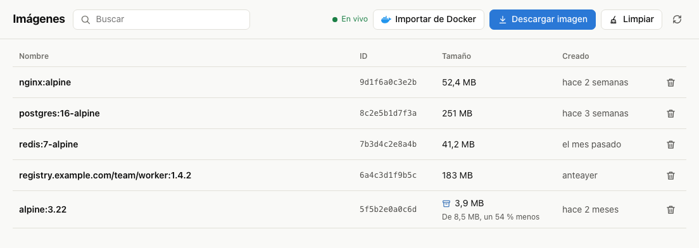

Las imágenes que descargas se quedan en el disco. Una imagen que usaste una vez el mes pasado ocupa lo mismo que el primer día. La próxima versión de podbag puede comprimir estas imágenes. En este artículo llamamos a la función **compresión de imágenes sin uso**. Una imagen sin uso es una imagen que ningún contenedor usa. La función está desactivada por defecto.

## Cómo guarda podbag las imágenes

podbag guarda cada archivo una sola vez, en `objects/ab/<sha256.uid.gid.mode>`. El nombre lleva el hash del contenido, el propietario y los permisos. Si dos imágenes tienen el mismo archivo, comparten ese único archivo.

Los contenedores ven estos archivos de una de dos formas:

- **Sin root**: cada imagen tiene un árbol de enlaces duros. Un enlace duro es otro nombre para el mismo archivo.
- **Con root**: podbag usa composefs. Un pequeño archivo EROFS lista los archivos de la imagen, y overlayfs los muestra.

En los dos casos, los contenedores leen directamente los archivos originales de `objects`. Por eso la compresión trabaja sobre estos archivos.

## Comprimir y descomprimir



La **compresión** solo toca imágenes sin uso. Una imagen está sin uso cuando se cumplen dos cosas:

- Ningún contenedor la usa. Los contenedores detenidos también cuentan.
- No se usó durante `compress_idle_after`. El valor por defecto es 7 días.

Primero, podbag borra el árbol o el archivo EROFS de la imagen. Después escribe `<archivo>.zst` junto a cada archivo y borra el original. Un archivo que también tiene otra imagen en uso se queda como está. Los archivos de menos de 4096 bytes también se quedan como están: comprimirlos no ahorra bloques de disco.

La **descompresión** ocurre en dos casos: al crear un contenedor a partir de la imagen y cuando un build la lee. podbag convierte los `.zst` otra vez en archivos originales. Después vuelve a crear el árbol o el archivo EROFS.

### Reglas de seguridad

Tres reglas protegen los datos:

1. Una imagen que tiene un árbol o un archivo EROFS tiene todos sus archivos sin comprimir. Así, los contenedores solo ven archivos originales.
2. Si existen a la vez el archivo original y su `.zst`, se usa el original.
3. Un archivo descomprimido de un `.zst` vuelve a ser un archivo del almacén solo si su hash coincide.

### Formato del archivo

Un archivo `.zst` empieza con una trama omitible (skippable frame) de zstd. zstd salta esta parte al leer los datos. Ahí ponemos una pequeña cabecera: versión, tamaño, indicadores y hora de modificación.

Después vienen tramas de zstd de 1 MiB cada una. Cada trama es el menor de dos resultados: comprimido con el nivel "Fastest" o guardado sin comprimir. Así, los datos que ya estaban comprimidos no crecen.

Comprimimos con [ruzstd](https://github.com/KillingSpark/zstd-rs), un zstd escrito en Rust puro. No necesita ninguna biblioteca de C, así que las compilaciones estáticas de podbag no cambian.

## Cuándo comprime podbag

podbag no tiene daemon, es decir, un programa que siempre se ejecuta en segundo plano. Por eso no hay un programa dedicado solo a comprimir. En su lugar, los comandos que ya ordenan el almacén también comprimen.

Con `image_compression = "idle"`, podbag comprime después de `pull`, `load`, `build`, `rmi` y `prune`:

- Un comando comprime como mucho 256 MiB o durante 2 segundos. El siguiente comando continúa.
- Mantiene el bloqueo del almacén como mucho 64 MiB o 1 segundo cada vez, así que los demás comandos no esperan mucho.
- Los archivos de más de 32 MiB no se comprimen solos. `podbag system compress` los comprime cuando lo ejecutas.
- Un comando no comprime la imagen que acaba de descargar.
- Si el límite de tamaño del almacén obliga a borrar una imagen, podbag comprime antes las imágenes sin uso.

## Resultados

VM podbag-dev (una VM Linux en un portátil) · arm64 · 4 CPU · Linux 7.0.0-44 · almacén en ext4 · root, composefs · una compilación de desarrollo de podbag 0.3.2 con esta función

Descargamos cinco imágenes con la compresión desactivada. Las dos imágenes de python tienen 146 MB cada una y las dos de Java, 310 MB cada una.

- `python:3.12.7-slim-bookworm`, `python:3.12.8-slim-bookworm`
- `eclipse-temurin:21.0.5_11-jre-noble`, `eclipse-temurin:21.0.6_7-jre-noble`
- `alpine:3.22`

Después, `podbag system compress` comprimió las cinco.

| Almacén | Valor |
|---|---:|
| Antes (fila Objects de `system df`) | {{n:725}} MB |
| Después | {{n:337}} MB |
| Tiempo para comprimir las 5 imágenes | {{n:8.4}} s |

El almacén quedó en menos de la mitad. Incluso antes de comprimir, el almacén es más pequeño que la suma de las cinco imágenes: dos versiones cercanas de una imagen comparten muchos archivos. Cada archivo se comprime por separado, así que esta forma de compartir se mantiene.

| Tiempo de `podbag run` | python 3.12.8 | Java (temurin 21.0.6) |
|---|---:|---:|
| Primer arranque de la imagen comprimida | {{n:1391}} ms | {{n:1801}} ms |
| Arranque de la imagen sin comprimir | {{n:30}} ms | {{n:55}} ms |

Cada valor es la mediana de 5 ejecuciones. Antes de cada primer arranque volvimos a comprimir la imagen y vaciamos la caché de páginas. El arranque con el que comparamos también se midió con la caché vacía. El primer arranque incluye el tiempo de descomprimir los archivos y volver a crear el archivo EROFS. Los arranques siguientes son tan rápidos como los de una imagen que nunca se comprimió.

Las imágenes sin comprimir no se vuelven más lentas con la función activada. Arrancamos `alpine:3.22` 30 veces con la función desactivada y 30 con ella activada, de forma alterna. Las medianas fueron {{n:12}} ms desactivada y {{n:11}} ms activada.

Medimos estos números con el anfitrión en reposo. El almacén es un archivo en el disco del anfitrión. Cuando el anfitrión estaba ocupado, comprimir tardó más y el primer arranque llegó a varios segundos.

## Cómo se usa

```sh
podbag system compression                  # ver el ajuste
podbag system compression idle             # activar
podbag system compression idle --after 3d  # comprimir imágenes sin uso desde hace 3 días
podbag system compression off              # desactivar
podbag system compress                     # comprimir ahora las imágenes sin uso
podbag system compress myapp:1             # comprimir ahora esta imagen
podbag system decompress myapp:1           # descomprimir ahora esta imagen
```

- Con la función desactivada, podbag no comprime imágenes y el almacén queda igual que hoy.
- `podbag system df` tiene una fila `Compressed`: el número de archivos comprimidos y su tamaño antes y después.
- `system compress` nunca comprime una imagen que usa un contenedor.
- `save`, `push` y `podbag system verify` funcionan con imágenes comprimidas. Leen los archivos sin descomprimirlos en el disco.
- En macOS y Windows, el ajuste se guarda donde se ejecuta el motor: en la VM o en la distribución WSL de podbag. Cámbialo con `podbag system compression` o en Podbag Desktop.
- En Linux también puedes escribir `image_compression = "idle"` en `config.toml`.

## Podbag Desktop

- Después de una instalación nueva o de una actualización, Desktop pregunta una vez. En el aviso **Ahorrar espacio en disco**, elige **Activar** o **Ahora no**.
- **Ajustes > Motor** tiene el interruptor **Comprimir imágenes sin uso**.
- En la lista de **Imágenes**, una imagen comprimida muestra un icono y su tamaño en disco. Debajo, una línea como «De 8,5 MB, un 54 % menos» indica el tamaño anterior y cuánto se redujo.



El endpoint `/images/json` de la API de Docker también añade el campo `PodbagCompression` a las imágenes comprimidas. Desktop muestra este valor.

## Lo que no elegimos

- **Compresión del sistema de archivos** (como btrfs): solo funciona en btrfs. La mayoría de los usuarios de Linux tienen ext4, y podbag no puede activarla por ellos.
- **Un archivo comprimido por imagen**: rompe el uso compartido de archivos sueltos. Volver a usar la imagen obliga a descomprimirla entera.
- **Un sistema de archivos FUSE que descomprime al leer**: con FUSE, un programa hace de sistema de archivos. Ese programa debe seguir ejecutándose, así que hace falta un daemon.
- **La compresión propia de EROFS**: solo funciona con composefs, como root. No sirve para los árboles de enlaces duros que se usan sin root.

## Cuándo estará disponible

La compresión de imágenes sin uso llega en la próxima versión de podbag. La [sección Storage de la guía de uso](https://github.com/SteelCrab/podbag/blob/main/docs/usage.md#storage) explica cómo guarda podbag las imágenes hoy.

## Cómo repetir la prueba

[Programa de medición](compress.sh) · [Resultados y entorno](results.txt)

[ruzstd](https://github.com/KillingSpark/zstd-rs) · [Formato zstd (RFC 8878)](https://www.rfc-editor.org/rfc/rfc8878) · [composefs](https://github.com/composefs/composefs)
