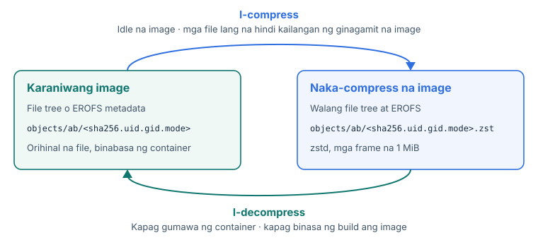
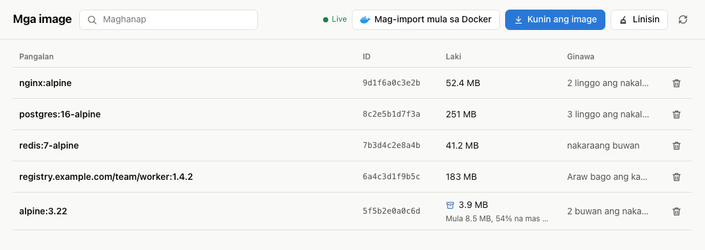

Nananatili sa disk ang mga image na kinuha mo. Ang image na isang beses mo lang ginamit noong isang buwan ay kumakain pa rin ng parehong espasyo gaya ng unang araw. Sa susunod na release ng podbag, puwede nang i-compress ang mga image na ito. Sa post na ito, tinatawag namin itong **pag-compress ng idle na image**. Ang idle na image ay image na hindi ginagamit ng anumang container. Naka-off ito bilang default.

## Paano nag-iimbak ng image ang podbag

Isang beses lang iniimbak ng podbag ang bawat file, sa `objects/ab/<sha256.uid.gid.mode>`. Nasa pangalan ang hash ng laman, ang may-ari at ang mode. Kapag may parehong file ang dalawang image, iisang file na ito ang ginagamit nila.

May dalawang paraan para makita ng container ang mga file na ito:

- **Walang root**: bawat image ay may tree ng mga hard link. Ang hard link ay isa pang pangalan para sa parehong file.
- **May root**: gumagamit ang podbag ng composefs. Nakalista ang mga file ng image sa isang maliit na EROFS file, at ipinapakita ito ng overlayfs.

Sa dalawang paraan, direktang binabasa ng container ang mga orihinal na file sa `objects`. Kaya ang mga file na ito rin ang kino-compress.

## Pag-compress at pag-decompress



Ang **pag-compress** ay para lang sa idle na image. Idle ang image kapag totoo ang dalawang ito:

- Walang container na gumagamit nito. Kasama sa bilang ang mga nakahintong container.
- Hindi ito ginamit sa loob ng `compress_idle_after`. Ang default ay 7 araw.

Una, binubura ng podbag ang tree o ang EROFS file ng image. Pagkatapos, nagsusulat ito ng `<file>.zst` sa tabi ng bawat file at binubura ang orihinal. Hindi ginagalaw ang file na mayroon din sa ibang image na ginagamit. Hindi rin ginagalaw ang mga file na mas maliit sa 4096 byte, dahil hindi nababawasan ang disk block kapag kino-compress ang mga ito.

Nangyayari ang **pag-decompress** sa dalawang kaso: kapag gumawa ng container mula sa image, at kapag binasa ng build ang image. Ibinabalik ng podbag ang mga `.zst` sa orihinal na file. Pagkatapos, gumagawa ulit ito ng tree o EROFS file.

### Mga patakaran para sa kaligtasan

Tatlong patakaran ang nagbabantay sa data:

1. Kapag may tree o EROFS file ang image, orihinal ang lahat ng file nito. Kaya orihinal na file lang ang nakikita ng container.
2. Kapag parehong may orihinal na file at `.zst`, ang orihinal ang ginagamit.
3. Ang file na na-decompress mula sa `.zst` ay nagiging file ulit ng store kapag tugma lang ang hash nito.

### Format ng file

Nagsisimula ang `.zst` file sa isang zstd skippable frame. Nilalaktawan ito ng zstd kapag binabasa ang data. Dito namin inilalagay ang maliit na header: version, laki, mga flag at oras ng pagbabago.

Kasunod nito ang mga zstd frame na tig-1 MiB. Bawat frame ay ang mas maliit sa dalawa: ang resulta ng pag-compress sa level na "Fastest", o ang data na hindi kino-compress. Kaya hindi lumalaki ang data na naka-compress na.

Gumagamit kami ng [ruzstd](https://github.com/KillingSpark/zstd-rs), isang zstd na gawa sa purong Rust. Hindi ito nangangailangan ng C library, kaya nananatili ang static build ng podbag.

## Kailan nagko-compress ang podbag

Walang daemon ang podbag. Ang daemon ay programang laging tumatakbo sa likod. Kaya walang programang nakatalaga lang sa pag-compress. Sa halip, ang mga command na nag-aayos na ng store ang nagko-compress din.

Kapag `image_compression = "idle"`, nagko-compress ang podbag pagkatapos ng `pull`, `load`, `build`, `rmi` at `prune`:

- Hanggang 256 MiB o 2 segundo lang ang kino-compress ng isang command. Itinutuloy ng susunod na command ang natitira.
- Hawak nito ang lock ng store nang hanggang 64 MiB o 1 segundo lang bawat beses, kaya hindi matagal maghihintay ang ibang command.
- Hindi awtomatikong kino-compress ang mga file na mas malaki sa 32 MiB. Kino-compress ang mga ito kapag pinatakbo mo ang `podbag system compress`.
- Hindi kino-compress ng isang command ang image na kakakuha lang nito.
- Kapag kailangang magbura ng image dahil sa limit ng laki ng store, kino-compress muna ang mga idle na image.

## Mga resulta

podbag-dev VM (isang Linux VM sa laptop) · arm64 · 4 na CPU · Linux 7.0.0-44 · store sa ext4 · root, composefs · development build ng podbag 0.3.2 na may feature na ito

Kumuha kami ng limang image habang naka-off ang compression. Tig-146 MB ang dalawang python image at tig-310 MB ang dalawang Java image.

- `python:3.12.7-slim-bookworm`, `python:3.12.8-slim-bookworm`
- `eclipse-temurin:21.0.5_11-jre-noble`, `eclipse-temurin:21.0.6_7-jre-noble`
- `alpine:3.22`

Pagkatapos, kino-compress ng `podbag system compress` ang lima.

| Store | Halaga |
|---|---:|
| Bago (Objects row ng `system df`) | {{n:725}} MB |
| Pagkatapos | {{n:337}} MB |
| Oras ng pag-compress sa 5 image | {{n:8.4}} s |

Bumaba ang store sa mas mababa sa kalahati. Kahit bago mag-compress, mas maliit na ang store kaysa sa kabuuang laki ng limang image, dahil maraming file na pinagsasaluhan ang dalawang magkalapit na bersyon. Hiwalay na kino-compress ang bawat file, kaya nananatili ang pagsasalong ito.

| Oras ng `podbag run` | python 3.12.8 | Java (temurin 21.0.6) |
|---|---:|---:|
| Unang start ng naka-compress na image | {{n:1391}} ms | {{n:1801}} ms |
| Start ng image na hindi naka-compress | {{n:30}} ms | {{n:55}} ms |

Bawat halaga ay median ng 5 run. Bago ang bawat unang start, kino-compress ulit namin ang image at binura ang page cache. Binura rin ang cache para sa start na pinaghahambingan. Kasama sa unang start ang oras ng pag-decompress ng mga file at paggawa ulit ng EROFS file. Ang mga sumunod na start ay kasimbilis ng image na hindi kailanman na-compress.

Hindi bumabagal ang mga image na hindi naka-compress kapag naka-on ang feature. Pinasimulan namin ang `alpine:3.22` nang 30 beses na naka-off at 30 beses na naka-on, nang salitan. Ang median ay {{n:12}} ms kapag off at {{n:11}} ms kapag on.

Sinukat namin ang mga numerong ito habang tahimik ang host. File sa disk ng host ang store. Kapag abala ang host, mas tumagal ang pag-compress at umabot nang ilang segundo ang unang start.

## Paano gamitin

```sh
podbag system compression                  # ipakita ang setting
podbag system compression idle             # i-on
podbag system compression idle --after 3d  # i-compress ang image na 3 araw nang hindi ginagamit
podbag system compression off              # i-off
podbag system compress                     # i-compress ngayon ang mga idle na image
podbag system compress myapp:1             # i-compress ngayon ang image na ito
podbag system decompress myapp:1           # i-decompress ngayon ang image na ito
```

- Kapag naka-off, hindi nagko-compress ng image ang podbag, at pareho ang store gaya ngayon.
- May bagong `Compressed` row ang `podbag system df`: ang bilang ng naka-compress na file at ang laki nila bago at pagkatapos.
- Hindi kailanman kino-compress ng `system compress` ang image na ginagamit ng container.
- Gumagana ang `save`, `push` at `podbag system verify` sa naka-compress na image. Binabasa nila ang mga file nang hindi dine-decompress sa disk.
- Sa macOS at Windows, nakatago ang setting kung saan tumatakbo ang engine: sa VM o sa WSL distribution ng podbag. Baguhin ito gamit ang `podbag system compression` o ang Podbag Desktop.
- Sa Linux, puwede ring isulat ang `image_compression = "idle"` sa `config.toml`.

## Podbag Desktop

- Pagkatapos ng bagong install o update, minsan lang magtatanong ang Desktop. Sa notice na **Makatipid ng disk space**, piliin ang **I-on** o **Hindi muna**.
- May switch na **I-compress ang mga hindi ginagamit na image** sa **Mga setting > Engine**.
- Sa listahan ng **Mga image**, may icon at laki sa disk ang naka-compress na image. Sa ilalim nito, may linyang gaya ng "Mula 8.5 MB, 54% na mas maliit" na nagpapakita ng dating laki at kung gaano ito lumiit.



Nagdadagdag din ang `/images/json` ng Docker API ng field na `PodbagCompression` sa naka-compress na image. Ipinapakita ng Desktop ang halagang ito.

## Ang hindi namin pinili

- **Compression ng file system** (gaya ng btrfs): gumagana lang ito sa btrfs. Ext4 ang gamit ng karamihan ng user ng Linux, at hindi ito mabubuksan ng podbag para sa kanila.
- **Isang archive bawat image**: nasisira ang pagsasalo ng bawat file. Kapag ginamit ulit ang image, kailangang i-unpack ang buong image.
- **FUSE file system na nagde-decompress habang nagbabasa**: sa FUSE, isang programa ang nagsisilbing file system. Kailangang laging tumatakbo ang programang iyon, kaya kailangan ng daemon.
- **Sariling compression ng EROFS**: gumagana lang ito sa composefs, na may root. Hindi ito nakakatulong sa mga hard-link tree na ginagamit nang walang root.

## Kailan ito magagamit

Darating ang pag-compress ng idle na image sa susunod na release ng podbag. Nasa [Storage na bahagi ng usage guide](https://github.com/SteelCrab/podbag/blob/main/docs/usage.md#storage) kung paano nag-iimbak ng image ang podbag ngayon.

## Ulitin ang pagsukat

[Script ng pagsukat](compress.sh) · [Mga resulta at setup](results.txt)

[ruzstd](https://github.com/KillingSpark/zstd-rs) · [Format ng zstd (RFC 8878)](https://www.rfc-editor.org/rfc/rfc8878) · [composefs](https://github.com/composefs/composefs)
