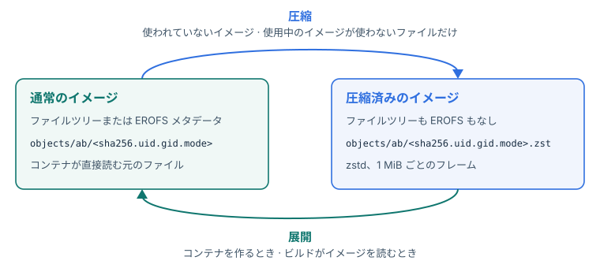
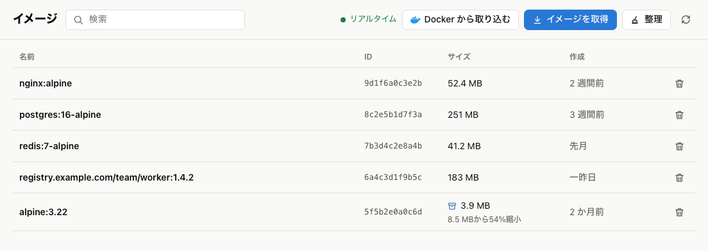

pullしたイメージはディスクに残り続けます。先月一度だけ使ったイメージも、最初の日と同じ容量を使います。次のpodbagリリースでは、このようなイメージを圧縮できます。この記事ではこの機能を**使われていないイメージの圧縮**と呼びます。使われていないイメージとは、どのコンテナも使っていないイメージです。この機能は初期設定ではオフです。

## podbagがイメージを保存する方法

podbagは各ファイルを一度だけ保存します。場所は`objects/ab/<sha256.uid.gid.mode>`です。名前には内容のハッシュ、所有者、パーミッションが入っています。二つのイメージに同じファイルがあれば、二つのイメージはこのファイル一つを共有します。

コンテナはこのファイルを二つの方法で見ます。

- **rootなし**: イメージごとにハードリンクのツリーを作ります。ハードリンクは同じファイルを指す別の名前です。
- **root**: composefsを使います。ファイルの一覧を持つ小さなEROFSファイルとoverlayfsでイメージを見せます。

どちらの方法でも、コンテナは`objects`の元のファイルを直接読みます。そのため圧縮もこのファイルを対象にします。

## 圧縮と展開



**圧縮**は使われていないイメージだけが対象です。次の二つの条件を両方とも満たすイメージです。

- どのコンテナも使っていません。停止したコンテナも数えます。
- `compress_idle_after`の間、使われていません。初期値は7日です。

podbagはまずこのイメージのツリーまたはEROFSファイルを削除します。次に各ファイルの隣に`<ファイル>.zst`を書き、元のファイルを削除します。使用中の別のイメージにもあるファイルは元のままです。4096バイトより小さいファイルも元のままです。圧縮してもディスクのブロック数が減らないからです。

**展開**は二つの場合に起きます。イメージからコンテナを作るときと、ビルドがイメージを読むときです。podbagは`.zst`を元のファイルに戻し、ツリーまたはEROFSファイルを作り直します。

### 安全のためのルール

三つのルールでデータを守ります。

1. ツリーまたはEROFSファイルがあるイメージは、すべてのファイルが元の形です。そのため、コンテナは常に元のファイルだけを見ます。
2. 元のファイルと`.zst`が両方あるときは、元のファイルを使います。
3. `.zst`から展開したファイルは、ハッシュが一致したときだけストアのファイルに戻ります。

### ファイル形式

`.zst`ファイルの先頭には、zstdのskippable frameがあります。zstdがデータとして読まずに飛ばす部分です。ここに小さなヘッダーを置きます。ヘッダーにはバージョン、サイズ、フラグ、更新時刻が入っています。

その後に1 MiBごとのzstdフレームが続きます。各フレームは、"Fastest"レベルで圧縮した結果と圧縮しない結果のうち小さいほうです。そのため、すでに圧縮されたデータも大きくなりません。

圧縮には[ruzstd](https://github.com/KillingSpark/zstd-rs)を使います。ruzstdは純粋なRustで書かれたzstdです。Cライブラリが不要なので、podbagの静的ビルドをそのまま保てます。

## いつ圧縮するか

podbagにはデーモンがありません。デーモンとは裏で常に動くプログラムです。そのため、圧縮だけを担当するプログラムもありません。代わりに、すでにストアを整理しているコマンドが圧縮もします。

`image_compression = "idle"`のとき、`pull`、`load`、`build`、`rmi`、`prune`の後に圧縮します。

- 一つのコマンドが圧縮するのは最大256 MiBまたは2秒です。残りは次のコマンドが続けます。
- ストアのロックは一度に最大64 MiBまたは1秒だけ持ちます。ほかのコマンドは長く待ちません。
- 32 MiBより大きいファイルは自動では圧縮しません。`podbag system compress`を実行すると圧縮します。
- コマンドがpullしたばかりのイメージは、そのコマンドでは圧縮しません。
- ストアのサイズ上限のためにイメージを削除するときは、先に使われていないイメージを圧縮します。

## 測定結果

podbag-dev VM(ノートPC上のLinux VM) · arm64 · CPU 4個 · Linux 7.0.0-44 · ストアはext4 · root、composefs · podbag 0.3.2にこの機能を加えた開発ビルド

圧縮をオフにしたまま、イメージを5個pullしました。pythonイメージ2個はそれぞれ146 MB、Javaイメージ2個はそれぞれ310 MBです。

- `python:3.12.7-slim-bookworm`、`python:3.12.8-slim-bookworm`
- `eclipse-temurin:21.0.5_11-jre-noble`、`eclipse-temurin:21.0.6_7-jre-noble`
- `alpine:3.22`

その後、`podbag system compress`で5個すべてを圧縮しました。

| ストア | 値 |
|---|---:|
| 圧縮前(`system df`のObjects行) | {{n:725}} MB |
| 圧縮後 | {{n:337}} MB |
| 5個のイメージの圧縮にかかった時間 | {{n:8.4}}秒 |

ストアは半分以下になりました。圧縮前でも、ストアは5個のイメージサイズの合計より小さくなっています。近いバージョンの二つのイメージが同じファイルを共有するからです。ファイルごとに圧縮するので、この共有は圧縮後も変わりません。

| `podbag run`の時間 | python 3.12.8 | Java (temurin 21.0.6) |
|---|---:|---:|
| 圧縮したイメージの最初の起動 | {{n:1391}} ms | {{n:1801}} ms |
| 圧縮していないイメージの起動 | {{n:30}} ms | {{n:55}} ms |

各値は5回の中央値です。最初の起動を測る前には、毎回イメージを圧縮し直し、ページキャッシュを消しました。比べた起動もキャッシュを消して測りました。最初の起動には、ファイルを展開してEROFSファイルを作り直す時間が含まれます。その後の起動は、圧縮していないイメージと同じ速さです。

圧縮されていないイメージは、機能をオンにしても遅くなりません。`alpine:3.22`をオフとオンで交互に30回ずつ起動しました。中央値はオフで{{n:12}} ms、オンで{{n:11}} msでした。

これらの数値はホストが静かなときに測りました。ストアはホストのディスク上のファイルです。ホストが忙しいときは圧縮に時間がかかり、最初の起動は数秒まで延びました。

## 使い方

```sh
podbag system compression                  # 設定を表示
podbag system compression idle             # オンにする
podbag system compression idle --after 3d  # 3日使っていないイメージを圧縮
podbag system compression off              # オフにする
podbag system compress                     # 使われていないイメージを今すぐ圧縮
podbag system compress myapp:1             # このイメージを今すぐ圧縮
podbag system decompress myapp:1           # このイメージを今すぐ展開
```

- オフのとき、podbagはイメージを圧縮しません。ストアも今と同じです。
- `podbag system df`に`Compressed`行が加わります。圧縮したファイルの数と、圧縮前後のサイズを表示します。
- `system compress`は、コンテナが使っているイメージを圧縮しません。
- `save`、`push`、`podbag system verify`は圧縮したイメージでも動きます。ディスク上で展開せずにファイルを読みます。
- macOSとWindowsでは、設定はエンジンが動く場所、つまりVMまたはpodbagのWSLディストリビューションに保存されます。`podbag system compression`コマンドかPodbag Desktopで変更します。
- Linuxでは`config.toml`に`image_compression = "idle"`と書くこともできます。

## Podbag Desktop

- 新しくインストールまたはアップデートした後に、一度だけ尋ねます。**ディスク容量を節約**の通知で、**オンにする**か**後で**を選びます。
- **設定 > エンジン**に**使われていないイメージを圧縮**のスイッチがあります。
- **イメージ**の一覧では、圧縮したイメージにアイコンとディスク上のサイズが出ます。その下に「8.5 MBから54%縮小」のように、元のサイズと縮小率が出ます。



Docker APIの`/images/json`も、圧縮したイメージに`PodbagCompression`フィールドを加えます。Desktopはこの値を表示します。

## 選ばなかった方法

- **ファイルシステムの圧縮**(btrfsなど): btrfsでしか動きません。Linuxユーザーの多くはext4を使っています。podbagが代わりにオンにすることもできません。
- **イメージ全体を一つのアーカイブに**: ファイル単位の共有が壊れます。イメージをまた使うときに全体を展開する必要があります。
- **読むときに展開するFUSEファイルシステム**: FUSEでは、プログラムがファイルシステムの役をします。そのプログラムが動き続ける必要があるので、デーモンが要ります。
- **EROFS自体の圧縮**: rootで使うcomposefsでしか動きません。rootなしのハードリンクのツリーには使えません。

## いつ使えるか

使われていないイメージの圧縮は、次のpodbagリリースに入ります。今の保存方法は[使い方ガイドのStorage](https://github.com/SteelCrab/podbag/blob/main/docs/usage.md#storage)にあります。

## 再現用の資料

[測定スクリプト](compress.sh) · [測定結果と環境](results.txt)

[ruzstd](https://github.com/KillingSpark/zstd-rs) · [zstd形式 (RFC 8878)](https://www.rfc-editor.org/rfc/rfc8878) · [composefs](https://github.com/composefs/composefs)
